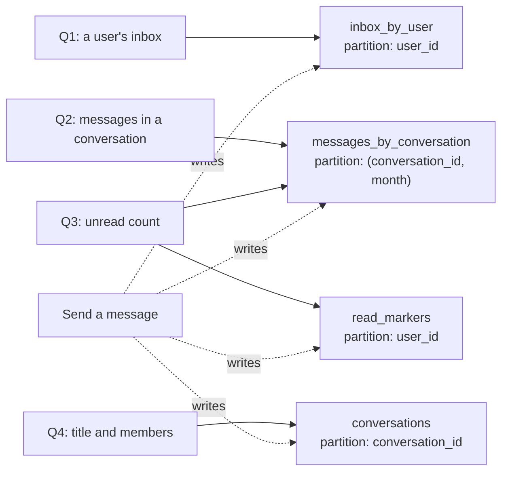
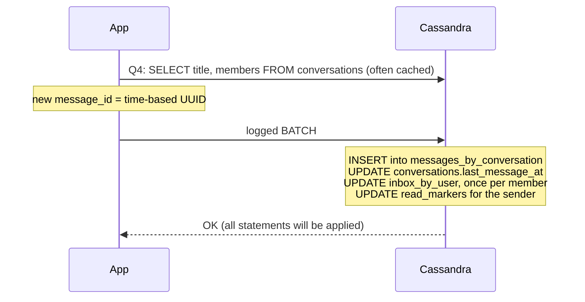

# Tutorial: Model a Chat App, from Questions to Tables

In this tutorial you design the data model for a small chat application, build it, query it, and then use tracing to prove that one tempting design would slowly degrade. It takes about 30 minutes. You'll practice the core Cassandra skill: start from the questions the application asks, not from the entities.

Every query in this tutorial is run against Cassandra 5.0 by [`test_env` scenario 14](../test_env/README.md), and the output is compared with what this page shows.

**You need** the single node from the [quickstart](01_quickstart.md) (sections 1 and 2), and a CQL shell on it:

```bash
docker exec -it cass-quickstart cqlsh
```

---

## 1. Write down the questions first

In a relational database you'd model users, conversations and messages, then write queries. In Cassandra each table serves a known query, so the questions come first. Our chat app needs four:

| # | The app needs to... | Shown on |
| :--- | :--- | :--- |
| Q1 | List a user's conversations, most recent activity first | The inbox screen |
| Q2 | Show the latest messages in a conversation, newest first, and load older ones on scroll | The conversation screen |
| Q3 | Count a user's unread messages in a conversation | The badge next to each conversation |
| Q4 | Get a conversation's title and members | The conversation header, and when sending |

And one write: **send a message**, which must update everything the four questions read.

Each question becomes one table whose partition key is what the app already knows when it asks:



---

## 2. Design each table

**Messages (Q2).** The app knows the conversation, so `conversation_id` is in the partition key. A busy conversation would grow forever in one partition, so the partition key also gets a **month bucket**. Partitions then stay bounded, and old months are never read again. The clustering column is a `timeuuid`, which is unique and sorts by time, so "newest first" is just the clustering order. The [schema design patterns](../02_data_modeling_and_indexing/01_schema_design_patterns.md#3-pattern-2-time-series-bucketing-preventing-huge-partitions) page explains bucketing in more depth.

**Conversations (Q4).** One row per conversation, looked up by ID.

**Inbox (Q1).** The app knows the user. The tempting design clusters the inbox by `last_message_at`, so Cassandra returns it already sorted. But `last_message_at` changes on every message, and a clustering column can't be updated: the app would have to delete the row and insert a new one each time. Section 6 proves why that hurts. Instead, the inbox is clustered by `conversation_id`, `last_message_at` is a regular column updated in place, and the app sorts the user's conversations itself. That's fine as long as one user has at most a few thousand conversations.

**Read markers (Q3).** For each user and conversation, the ID of the last message the user has read. The unread count is the number of messages after it, which is a range query inside one message partition.

Create the keyspace and the tables:

<!-- test: run:chat-schema -->
```sql
CREATE KEYSPACE IF NOT EXISTS chat
  WITH replication = {'class': 'NetworkTopologyStrategy', 'datacenter1': 1};

CREATE TABLE IF NOT EXISTS chat.messages_by_conversation (
    conversation_id text,
    month           text,          -- bucket: '2026-03'
    message_id      timeuuid,
    sender_id       text,
    body            text,
    PRIMARY KEY ((conversation_id, month), message_id)
) WITH CLUSTERING ORDER BY (message_id DESC);

CREATE TABLE IF NOT EXISTS chat.conversations (
    conversation_id text PRIMARY KEY,
    title           text,
    members         set<text>,
    last_message_at timestamp
);

CREATE TABLE IF NOT EXISTS chat.inbox_by_user (
    user_id         text,
    conversation_id text,
    title           text,
    last_message_at timestamp,
    last_preview    text,
    PRIMARY KEY ((user_id), conversation_id)
);

CREATE TABLE IF NOT EXISTS chat.read_markers (
    user_id         text,
    conversation_id text,
    last_read       timeuuid,
    PRIMARY KEY ((user_id), conversation_id)
);
```

---

## 3. Load some conversations

Three users (ana, ben and chloe) in three conversations. In the real app, the driver generates each message ID when the message is sent (`Uuids.timeBased()` in Java, `uuid.uuid1()` in Python, or `now()` in CQL). Here they are fixed, so your results match this page.

<!-- test: run:chat-data -->
```sql
INSERT INTO chat.conversations (conversation_id, title, members, last_message_at)
  VALUES ('conv-1', 'Trip planning', {'ana', 'ben'}, '2026-03-02 09:05:00+0000');
INSERT INTO chat.conversations (conversation_id, title, members, last_message_at)
  VALUES ('conv-2', 'Book club', {'ana', 'chloe'}, '2026-03-03 18:20:00+0000');
INSERT INTO chat.conversations (conversation_id, title, members, last_message_at)
  VALUES ('conv-3', 'Team lunch', {'ben', 'chloe'}, '2026-03-04 08:02:00+0000');

INSERT INTO chat.messages_by_conversation (conversation_id, month, message_id, sender_id, body)
  VALUES ('conv-1', '2026-03', 31746800-1616-11f1-9001-0242ac110002, 'ana', 'Who is booking the cabin?');
INSERT INTO chat.messages_by_conversation (conversation_id, month, message_id, sender_id, body)
  VALUES ('conv-1', '2026-03', 67195100-1616-11f1-9001-0242ac110002, 'ben', 'I can do it tonight');
INSERT INTO chat.messages_by_conversation (conversation_id, month, message_id, sender_id, body)
  VALUES ('conv-1', '2026-03', e444c600-1616-11f1-9001-0242ac110002, 'ana', 'Great, thanks!');
INSERT INTO chat.messages_by_conversation (conversation_id, month, message_id, sender_id, body)
  VALUES ('conv-2', '2026-03', 97074800-172d-11f1-9001-0242ac110002, 'chloe', 'Next book: Dune?');
INSERT INTO chat.messages_by_conversation (conversation_id, month, message_id, sender_id, body)
  VALUES ('conv-3', '2026-03', 24838000-17a0-11f1-9001-0242ac110002, 'ben', 'Pizza or tacos?');
INSERT INTO chat.messages_by_conversation (conversation_id, month, message_id, sender_id, body)
  VALUES ('conv-3', '2026-03', 6c0a0c00-17a0-11f1-9001-0242ac110002, 'chloe', 'Tacos');

INSERT INTO chat.inbox_by_user (user_id, conversation_id, title, last_message_at, last_preview)
  VALUES ('ana', 'conv-1', 'Trip planning', '2026-03-02 09:05:00+0000', 'Great, thanks!');
INSERT INTO chat.inbox_by_user (user_id, conversation_id, title, last_message_at, last_preview)
  VALUES ('ben', 'conv-1', 'Trip planning', '2026-03-02 09:05:00+0000', 'Great, thanks!');
INSERT INTO chat.inbox_by_user (user_id, conversation_id, title, last_message_at, last_preview)
  VALUES ('ana', 'conv-2', 'Book club', '2026-03-03 18:20:00+0000', 'Next book: Dune?');
INSERT INTO chat.inbox_by_user (user_id, conversation_id, title, last_message_at, last_preview)
  VALUES ('chloe', 'conv-2', 'Book club', '2026-03-03 18:20:00+0000', 'Next book: Dune?');
INSERT INTO chat.inbox_by_user (user_id, conversation_id, title, last_message_at, last_preview)
  VALUES ('ben', 'conv-3', 'Team lunch', '2026-03-04 08:02:00+0000', 'Tacos');
INSERT INTO chat.inbox_by_user (user_id, conversation_id, title, last_message_at, last_preview)
  VALUES ('chloe', 'conv-3', 'Team lunch', '2026-03-04 08:02:00+0000', 'Tacos');

INSERT INTO chat.read_markers (user_id, conversation_id, last_read) VALUES ('ana', 'conv-1', e444c600-1616-11f1-9001-0242ac110002);
INSERT INTO chat.read_markers (user_id, conversation_id, last_read) VALUES ('ben', 'conv-1', 67195100-1616-11f1-9001-0242ac110002);
INSERT INTO chat.read_markers (user_id, conversation_id, last_read) VALUES ('chloe', 'conv-2', 97074800-172d-11f1-9001-0242ac110002);
INSERT INTO chat.read_markers (user_id, conversation_id, last_read) VALUES ('chloe', 'conv-3', 6c0a0c00-17a0-11f1-9001-0242ac110002);
```

---

## 4. Answer the four questions

**Q1: ana's inbox.** One partition read. The rows come back in `conversation_id` order; the app sorts them by `last_message_at`:

<!-- test: q:chat-q1 -->
```sql
SELECT conversation_id, title, last_message_at, last_preview FROM chat.inbox_by_user WHERE user_id = 'ana';
```
```text
 conversation_id | title         | last_message_at                 | last_preview
-----------------+---------------+---------------------------------+------------------
          conv-1 | Trip planning | 2026-03-02 09:05:00.000000+0000 |   Great, thanks!
          conv-2 |     Book club | 2026-03-03 18:20:00.000000+0000 | Next book: Dune?

(2 rows)
```

**Q2: the latest messages in conv-1.** One partition, already newest first. `to_timestamp()` turns the `timeuuid` into a readable time:

<!-- test: q:chat-q2 -->
```sql
SELECT to_timestamp(message_id) AS sent_at, sender_id, body
  FROM chat.messages_by_conversation
 WHERE conversation_id = 'conv-1' AND month = '2026-03'
 LIMIT 2;
```
```text
 sent_at                         | sender_id | body
---------------------------------+-----------+---------------------
 2026-03-02 09:05:00.000000+0000 |       ana |      Great, thanks!
 2026-03-02 09:01:30.000000+0000 |       ben | I can do it tonight

(2 rows)
```

When the user scrolls up, ask for messages older than the oldest one on screen. In the app, `message_id` comes from the previous page:

<!-- test: q:chat-q2-older -->
```sql
SELECT to_timestamp(message_id) AS sent_at, sender_id, body
  FROM chat.messages_by_conversation
 WHERE conversation_id = 'conv-1' AND month = '2026-03' AND message_id < 67195100-1616-11f1-9001-0242ac110002
 LIMIT 2;
```
```text
 sent_at                         | sender_id | body
---------------------------------+-----------+---------------------------
 2026-03-02 09:00:00.000000+0000 |       ana | Who is booking the cabin?

(1 rows)
```

When a page comes back short, continue in the previous month's bucket. The app knows when each conversation started, so it knows when to stop.

**Q3: ben's unread count in conv-1.** Read his marker, then count the messages after it. Both are single-partition reads:

<!-- test: q:chat-q3 -->
```sql
SELECT last_read FROM chat.read_markers WHERE user_id = 'ben' AND conversation_id = 'conv-1';
SELECT count(*) AS unread FROM chat.messages_by_conversation
 WHERE conversation_id = 'conv-1' AND month = '2026-03' AND message_id > 67195100-1616-11f1-9001-0242ac110002;
```
```text
 last_read
--------------------------------------
 67195100-1616-11f1-9001-0242ac110002

(1 rows)

 unread
--------
      1

(1 rows)
```

**Q4: the conversation header.**

<!-- test: q:chat-q4 -->
```sql
SELECT title, members FROM chat.conversations WHERE conversation_id = 'conv-1';
```
```text
 title         | members
---------------+----------------
 Trip planning | {'ana', 'ben'}

(1 rows)
```

---

## 5. Send a message

Sending is where the design pays for its fast reads: one message is written to several tables. ben sends "Cabin is booked" to conv-1 at 2026-03-05 12:00. The app already has the members from Q4, so it doesn't need to read anything before writing:



<!-- test: q:chat-send -->
```sql
BEGIN BATCH
  INSERT INTO chat.messages_by_conversation (conversation_id, month, message_id, sender_id, body)
    VALUES ('conv-1', '2026-03', d5fee000-188a-11f1-9001-0242ac110002, 'ben', 'Cabin is booked');
  UPDATE chat.conversations SET last_message_at = '2026-03-05 12:00:00+0000' WHERE conversation_id = 'conv-1';
  UPDATE chat.inbox_by_user SET last_message_at = '2026-03-05 12:00:00+0000', last_preview = 'Cabin is booked'
   WHERE user_id = 'ana' AND conversation_id = 'conv-1';
  UPDATE chat.inbox_by_user SET last_message_at = '2026-03-05 12:00:00+0000', last_preview = 'Cabin is booked'
   WHERE user_id = 'ben' AND conversation_id = 'conv-1';
  UPDATE chat.read_markers SET last_read = d5fee000-188a-11f1-9001-0242ac110002
   WHERE user_id = 'ben' AND conversation_id = 'conv-1';
APPLY BATCH;
SELECT conversation_id, last_message_at, last_preview FROM chat.inbox_by_user WHERE user_id = 'ana';
```
```text
 conversation_id | last_message_at                 | last_preview
-----------------+---------------------------------+------------------
          conv-1 | 2026-03-05 12:00:00.000000+0000 |  Cabin is booked
          conv-2 | 2026-03-03 18:20:00.000000+0000 | Next book: Dune?

(2 rows)
```

Why a **logged** batch: the statements go to different partitions, and the batch log guarantees that if any of them is applied, all of them eventually are. Without it, a crash between statements could leave a message that never shows up in an inbox. A logged batch costs an extra write to the batch log, so keep it to the few partitions one action touches. Never use a batch to load unrelated rows faster ([performant writes](../03_application_development/01_performant_writes.md)).

A logged batch is not isolated: another client can read the inbox before the message itself is visible. For a chat app that's acceptable. If it isn't for yours, read [consistency & transactions](../03_application_development/04_consistency_and_transactions.md).

---

## 6. Prove a design choice with tracing

Section 2 rejected an inbox clustered by `last_message_at`. Here's the evidence. Create that version and move conv-1 to the top three times, as three new messages would:

<!-- test: run:chat-tempting -->
```sql
CREATE TABLE IF NOT EXISTS chat.inbox_by_activity (
    user_id text, last_message_at timestamp, conversation_id text, title text,
    PRIMARY KEY ((user_id), last_message_at, conversation_id)
) WITH CLUSTERING ORDER BY (last_message_at DESC, conversation_id ASC);

INSERT INTO chat.inbox_by_activity (user_id, last_message_at, conversation_id, title)
  VALUES ('ana', '2026-03-03 18:20:00+0000', 'conv-2', 'Book club');
INSERT INTO chat.inbox_by_activity (user_id, last_message_at, conversation_id, title)
  VALUES ('ana', '2026-03-02 09:05:00+0000', 'conv-1', 'Trip planning');

-- Each new message in conv-1 has to move its row: delete the old position, insert the new one.
BEGIN BATCH
  DELETE FROM chat.inbox_by_activity WHERE user_id = 'ana' AND last_message_at = '2026-03-02 09:05:00+0000' AND conversation_id = 'conv-1';
  INSERT INTO chat.inbox_by_activity (user_id, last_message_at, conversation_id, title) VALUES ('ana', '2026-03-05 12:00:00+0000', 'conv-1', 'Trip planning');
APPLY BATCH;
BEGIN BATCH
  DELETE FROM chat.inbox_by_activity WHERE user_id = 'ana' AND last_message_at = '2026-03-05 12:00:00+0000' AND conversation_id = 'conv-1';
  INSERT INTO chat.inbox_by_activity (user_id, last_message_at, conversation_id, title) VALUES ('ana', '2026-03-05 12:01:00+0000', 'conv-1', 'Trip planning');
APPLY BATCH;
BEGIN BATCH
  DELETE FROM chat.inbox_by_activity WHERE user_id = 'ana' AND last_message_at = '2026-03-05 12:01:00+0000' AND conversation_id = 'conv-1';
  INSERT INTO chat.inbox_by_activity (user_id, last_message_at, conversation_id, title) VALUES ('ana', '2026-03-05 12:02:00+0000', 'conv-1', 'Trip planning');
APPLY BATCH;
```

Now read ana's inbox from both tables with tracing on, and keep only the trace line that counts what the read touched. Run this from your terminal, not from `cqlsh`:

<!-- test: sh:chat-trace -->
```bash
for t in inbox_by_activity inbox_by_user; do
  printf '%-18s ' "$t:"
  docker exec cass-quickstart cqlsh --no-color -e "TRACING ON; SELECT * FROM chat.$t WHERE user_id = 'ana';" \
    | grep -o 'Read [0-9]* live rows and [0-9]* tombstone cells'
done
```
```text
inbox_by_activity: Read 2 live rows and 3 tombstone cells
inbox_by_user:     Read 2 live rows and 0 tombstone cells
```

Both return ana's two conversations. But the activity-sorted table also read **one tombstone per message** that moved a conversation, and those tombstones stay until `gc_grace_seconds` (10 days by default) has passed and compaction removes them. An active group chat sends hundreds of messages a day. Every inbox read would then wade through thousands of tombstones, getting slower until it hits the tombstone warning and failure thresholds ([troubleshooting](../06_operations_and_housekeeping/05_troubleshooting_playbook.md#4-tombstone-warnings--tombstoneoverwhelmingexception)). The inbox keyed by conversation updates in place and reads zero.

**Use this technique on your own designs:** load realistic data, run the real query with `TRACING ON`, and read the `live rows` and `tombstone cells` counts. It answers "will this table hold up?" before production does. The [cqlsh reference](../09_reference/06_cqlsh.md#5-reading-a-trace) explains the rest of the trace.

---

## 7. Check partition sizes before you ship

The rule of thumb is to keep partitions under about 100 MB and 100,000 rows ([anti-patterns](../01_architecture_and_mental_model/02_anti_patterns.md)). Estimate each table's largest partition with your own numbers. These are illustrative:

| Table | Largest partition | Estimate |
| :--- | :--- | :--- |
| `messages_by_conversation` | The busiest conversation in its busiest month | 5,000 messages a day × 31 days ≈ 155,000 rows × ~200 bytes ≈ 31 MB. The size is fine, but the row count is over 100,000, so bucket by **week** or **day** for conversations that busy |
| `inbox_by_user` | The user with the most conversations | 2,000 conversations × ~150 bytes ≈ 300 KB |
| `read_markers` | Same | 2,000 rows × ~50 bytes ≈ 100 KB |
| `conversations` | One row | Tiny. Large group chats keep a big `members` set, so cap group size or move members to their own table |

Once you have real data, `nodetool tablestats chat` and `nodetool tablehistograms chat messages_by_conversation` show actual partition sizes ([nodetool guide](../06_operations_and_housekeeping/01_nodetool_operations_guide.md)).

---

## 8. What you practiced, and clean up

* Write the questions down first; each becomes a table keyed by what the app knows.
* Bound partitions with a time bucket.
* Never put a value that changes in a clustering column. Moving rows creates tombstones.
* Keep denormalized copies in step with a small logged batch.
* Prove a design with real data and `TRACING ON`.

Next: the clause-by-clause [Querying with CQL](../03_application_development/05_querying_with_cql.md) page, [schema design patterns](../02_data_modeling_and_indexing/01_schema_design_patterns.md) for more patterns, and the [client drivers](../03_application_development/03_client_drivers.md) page to build the app.

To remove the tutorial's data:

```sql
DROP KEYSPACE chat;
```
