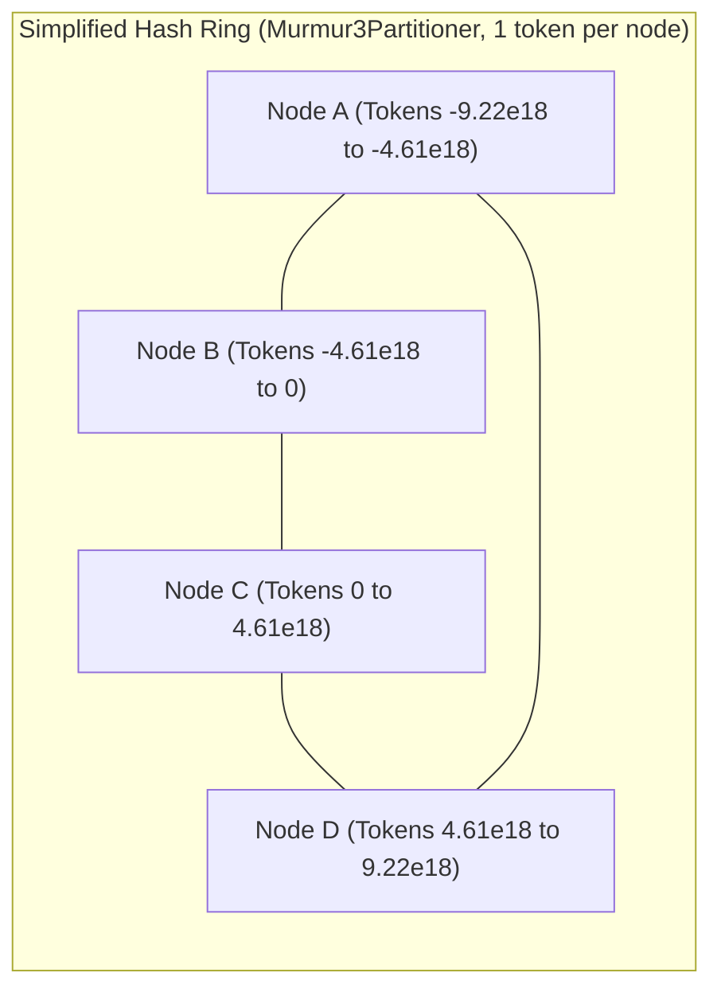

# The Developer Mental Model: RDBMS vs. Cassandra

> [!CAUTION]
> Commands on this page can change or delete data and affect running clusters. Try them on a test or staging cluster first, and read the [disclaimer](../README.md#disclaimer). The guide is provided "as is", without warranty.

To write fast code for Cassandra, you must first unlearn relational database assumptions.

In PostgreSQL, MySQL, or Oracle, data is stored in **B-Trees**. In Cassandra, data is stored across a distributed cluster using a **Log-Structured Merge-tree (LSM-tree)** architecture and a **Consistent Hash Ring**.

> [!NOTE]
> **`cassandra.yaml` vs. `cassandra_latest.yaml`**: Cassandra 5.0 ships two configuration files. The default `conf/cassandra.yaml` keeps 4.x-compatible defaults (`SkipListMemtable`, `BIG` SSTables, `SizeTieredCompactionStrategy`, legacy secondary indexes, `storage_compatibility_mode: CASSANDRA_4`). `conf/cassandra_latest.yaml` enables the newer features: `TrieMemtable` with `memtable_allocation_type: offheap_objects`, `BTI` SSTables (`sstable.selected_format: bti`), `UnifiedCompactionStrategy`, `default_secondary_index: sai`, `paxos_variant: v2`, `key_cache_size: 0MiB`, `uuid_sstable_identifiers_enabled: true`, `stream_entire_sstables: true`, `trickle_fsync: true`, `commitlog_disk_access_mode: auto`, `batchlog_endpoint_strategy: dynamic_remote` and `storage_compatibility_mode: NONE`.
>
> `storage_compatibility_mode: NONE` writes SSTable and messaging formats that Cassandra 4.x cannot read. On a cluster upgraded from 4.x, move through `CASSANDRA_4` → `UPGRADING` → `NONE` with a rolling restart at each step, and only after every node runs 5.0. Do not drop `cassandra_latest.yaml` onto an upgraded node. This page notes where the behaviour differs between the two files.

---

## 1. Physical Architecture: Why Writes are Cheaper than Reads

In traditional databases, writes often involve in-place updates, locking, and updating multiple secondary indexes on disk.

In Cassandra, **writes are cheap, and random reads are comparatively expensive**.

```mermaid
graph TD
    subgraph WritePath ["The Write Path: Append-Only"]
        W1["Client CQL Write"] --> W2["Coordinator Node"]
        W2 -->|Forwards mutation| W3["Each Replica Node"]
        W3 --> W4["CommitLog: Sequential Append"]
        W3 --> W5["Memtable in RAM: Sorted In-Memory Structure"]
        W5 -.->|When Full| W6["Flush to Immutable SSTable on Disk"]
    end

    subgraph ReadPath ["The Read Path: Multi-Stage Lookup on Each Replica"]
        R1["Client CQL Read"] --> R2["Check Memtables in RAM"]
        R1 --> R3["Per SSTable: Key Range Check + Bloom Filter"]
        R3 --> R4["BIG: Key Cache, Summary, Index. BTI: Trie Partition Index"]
        R4 --> R5["Read Data Chunks from Chunk Cache or Disk"]
        R2 & R5 --> R6["Merge Memtable + SSTable versions by Timestamp"]
        R6 --> R7["Return Latest Cells to Client"]
    end
```



### The Physical Write Path
The coordinator forwards the mutation to every replica that owns the partition. On each replica:
1. **CommitLog Append**: The write is appended to the commit log (sequential I/O, no seeks). With the default `commitlog_sync: periodic` (`commitlog_sync_period: 10000ms`), the commit log is fsynced in the background, so an acknowledged write may sit in the OS buffer for up to that period.
2. **Memtable Insert**: The mutation is placed into an in-memory sorted structure. With the shipped `cassandra.yaml` this is `SkipListMemtable`. `cassandra_latest.yaml` (or setting `memtable.configurations.default: inherits: trie`) switches to the 5.0 `TrieMemtable`.
3. **Acknowledgment**: Once enough replicas for the requested consistency level (for example `LOCAL_QUORUM`) have written to their commit log and memtable, the coordinator acknowledges the write to your application.
4. **No In-Place Overwrites**: Cassandra *never* seeks to an old row to update it. It simply writes the new value with a newer timestamp.

### The Physical Read Path
To read a partition, each replica must locate and merge data from potentially multiple files on disk:
1. If the row cache is enabled for the table (it is off by default: `row_cache_size: 0MiB`), check it first.
2. Check the in-memory **Memtables** for recent writes that have not yet been flushed to SSTables.
3. For each candidate SSTable, skip it if the key is outside the SSTable's key range, then check its **Bloom Filter** (a probabilistic in-memory filter that answers: *"Is this partition definitely NOT in this SSTable?"*).
4. Locate the partition inside the SSTable:
   * **`BIG` format** (the default in `cassandra.yaml`): check the **Key Cache**, then the partition summary, then the partition index.
   * **`BTI` format** (selected in `cassandra_latest.yaml`): look up the trie-based partition index. The key cache is not used, so `cassandra_latest.yaml` sets `key_cache_size: 0MiB`.
5. Fetch data chunks from the **Chunk Cache** (sized by `file_cache_size`) or from disk.
6. **Reconciliation**: If memtables and several SSTables hold updates or tombstones for that partition, Cassandra merges them, resolving conflicts using Last-Write-Wins (LWW) timestamps.

> [!IMPORTANT]
> **Takeaway**: Writing to Cassandra is an append-only operation. Reading may require multi-file inspection and reconciliation. Therefore, **always optimize your schema for the read path**.

---

## 2. The Distributed Hash Ring & Token Placement

Cassandra clusters are masterless. Every node plays the same role. Data is distributed using consistent hashing:



> [!NOTE]
> The diagram is simplified. By default (`num_tokens: 16`), each node owns many small, non-contiguous token ranges (virtual nodes) rather than one contiguous quarter of the ring.

1. Every row has a **Partition Key**.
2. Cassandra runs the partition key through the `Murmur3Partitioner` hash function (the default `partitioner`) to produce a 64-bit token between $-2^{63}$ and $2^{63}-1$.
3. The nodes that own the token range containing that token hold the replicas for that row (as many as the keyspace's replication factor).

### What This Means for Your Code:
* **Single-Partition Query**:
  ```sql
  SELECT * FROM users WHERE user_id = 123e4567-e89b-12d3-a456-426614174000;
  ```
  A token-aware driver computes the token locally and sends the request straight to a replica that owns the data. Only that partition's replica set is involved, so this is the fastest and most predictable kind of query.

* **Scatter-Gather Multi-Partition Query**:
  ```sql
  SELECT * FROM users WHERE signup_date = '2026-11-21' ALLOW FILTERING;
  ```
  The coordinator must query **every token range in the cluster**, page through the data each replica scans, and filter out non-matching rows. Latency grows with data size and cluster size, and large tables commonly hit timeouts. Operators can block such queries entirely with the `allow_filtering_enabled: false` guardrail.

---

## 3. RDBMS Concepts vs. Cassandra Reality

| Relational Database (RDBMS) | Apache Cassandra 5.0 | Developer Impact |
| :--- | :--- | :--- |
| **Normalized Schema** (3NF, 1 table per entity) | **Denormalized Schema** (1 table per query) | Duplicate data across tables to serve different queries directly. Disk is cheap; latency is not. |
| **Table Joins (`JOIN`)** | **No Joins Allowed** | Joins across distributed networks destroy performance. Pre-join your data at write time. |
| **Arbitrary `WHERE` Clauses** | **Primary Key Restrictions First** | Efficient queries restrict the partition key (and optionally clustering keys). Other columns need a secondary index (prefer Storage-Attached Indexing, SAI) or `ALLOW FILTERING`, which the `allow_filtering_enabled` guardrail can disable. |
| **ACID Multi-Table Transactions** | **Row/Partition Atomicity** | Writes are atomic and isolated per partition. Lightweight transactions (LWT, Paxos) give compare-and-set within a single partition. Logged batches give atomicity (not isolation) across partitions. Cassandra 5.0 has no multi-partition ACID transactions. |
| **In-place `UPDATE`** | **Append-Only Upsert** | `INSERT` and `UPDATE` are both upserts under the hood: they write a timestamped mutation. |
| **Auto-Incrementing IDs** | **UUIDs & TimeUUIDs** | Distributed systems cannot coordinate a central sequence generator without a severe bottleneck. |
