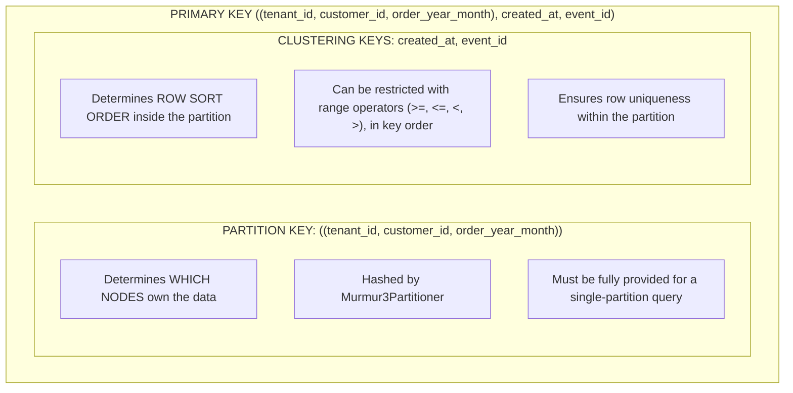

# Schema Design Patterns: Query-First Data Modeling

In relational databases, you model your entities first (normalize to 3NF) and figure out queries later using SQL `JOIN`.

In Apache Cassandra, you **design your tables around your queries**:
$$\text{Application Query} \longrightarrow \text{Primary Key} \longrightarrow \text{Table Schema}$$

If you have 3 distinct query patterns for the same core entity, expect to create up to **3 distinct Cassandra tables** (or fewer, if an SAI index can serve a low-volume query; see Pattern 1).

---

## 1. Anatomy of the Cassandra Primary Key

Understanding the components of `PRIMARY KEY` is the most important skill for a Cassandra developer:

```sql
CREATE TABLE order_events (
    tenant_id text,
    customer_id uuid,
    order_year_month text,
    created_at timestamp,
    event_id uuid,
    event_payload text,
    PRIMARY KEY ((tenant_id, customer_id, order_year_month), created_at, event_id)
) WITH CLUSTERING ORDER BY (created_at DESC, event_id ASC);
```



Clustering columns must be restricted in the order they are declared: you can restrict `created_at` alone, or `created_at = ? AND event_id > ?`, but not `event_id` alone without `ALLOW FILTERING` or an index.

---

## 2. Pattern 1: Lookup Tables (Denormalized Lookup by Secondary Field)

Suppose your application needs to:
* **Q1**: Look up a user profile by `user_id`.
* **Q2**: Look up a user profile by `email` during login.

In Postgres, you would create an index on `email`. In Cassandra, you typically create two tables:

```sql
-- Table 1: Serves Q1 (Get user by ID)
CREATE TABLE users_by_id (
    user_id uuid PRIMARY KEY,
    email text,
    first_name text,
    last_name text,
    password_hash text,
    created_at timestamp
);

-- Table 2: Serves Q2 (Get user by Email)
CREATE TABLE users_by_email (
    email text PRIMARY KEY,
    user_id uuid,
    password_hash text
);
```

### Keeping Both Tables in Sync

* **Option A: Logged batch (recommended for a few denormalized tables).** Keeping denormalized tables in sync is the case multi-partition **logged** batches are designed for. If the batch is acknowledged, or even if it times out after reaching the batchlog, every statement in it will eventually be applied. It is atomic, **not isolated**: a reader may briefly see one table updated and the other not.
  ```sql
  BEGIN BATCH
      INSERT INTO users_by_id (user_id, email, first_name, last_name, password_hash, created_at)
          VALUES (?, ?, ?, ?, ?, ?);
      INSERT INTO users_by_email (email, user_id, password_hash) VALUES (?, ?, ?);
  APPLY BATCH;
  ```
  Keep such batches small (a handful of statements, under `batch_size_warn_threshold`, default 5KiB). Do not use them for bulk ingest (see [02_anti_patterns.md](../01_architecture_and_mental_model/02_anti_patterns.md)).
* **Option B: Separate idempotent writes with retries.** Write to both tables independently, mark the statements idempotent (`setIdempotent(true)`) so the driver may retry them, and have the application retry the failed write. This is cheaper than a logged batch but can leave the tables temporarily or (if the application gives up) permanently out of sync. Plain `INSERT`/`UPDATE` of regular columns are idempotent; counter updates and list appends are not.
* **Option C: An SAI index instead of a second table.** You can add `CREATE INDEX ON users_by_id (email) USING 'sai'` and drop the second table. But `email` is a **high-cardinality** column and the query does not restrict the partition key, so each lookup fans out to replicas across the token ring to find one row. That is acceptable for low-throughput lookups (admin tools, back office), not for a high-volume login path. See [02_indexing_and_vector_search.md](02_indexing_and_vector_search.md).

When the lookup must also be **unique** (no two users with the same email), use a lightweight transaction (`INSERT ... IF NOT EXISTS`) on `users_by_email`. See [04_consistency_and_transactions.md](../03_application_development/04_consistency_and_transactions.md).

---

## 3. Pattern 2: Time-Series Bucketing (Preventing Huge Partitions)

Time-series data (metrics, logs, sensor data, chat messages) grows indefinitely. If you partition only by `device_id`, the partition grows without bound.

These docs use one rule of thumb for partition size: **keep partitions under ~100 MB and ~100,000 rows**. It is a guideline, not a server limit; smaller partitions are better.

### The Solution: Time-Window Bucketing
Add a bucketing column (e.g. `year_month` or `date`) into the composite partition key. Choose the bucket width so that the busiest entity stays within the rule of thumb:

```sql
CREATE TABLE sensor_telemetry (
    device_id uuid,
    bucket_date date, -- e.g., '2026-11-21'
    reading_timestamp timestamp,
    metric_name text,
    metric_value double,
    PRIMARY KEY ((device_id, bucket_date), reading_timestamp, metric_name)
) WITH CLUSTERING ORDER BY (reading_timestamp DESC, metric_name ASC);
```

### Querying Across Time Windows:
* **Query for today**:
  ```sql
  SELECT * FROM sensor_telemetry
  WHERE device_id = ? AND bucket_date = '2026-11-21';
  ```
  Rows come back newest first because of the table's clustering order.
* **Query for the last 3 days**:
  Issue 3 concurrent async queries for `2026-11-21`, `2026-11-20`, and `2026-11-19`, and merge the sorted results in your application.

For time-series data that expires, pair this pattern with a TTL and `TimeWindowCompactionStrategy` (see section 6).

---

## 4. Pattern 3: Wide Rows for Historical Feeds & Activity Logs

To model an activity feed where the latest events are read first:

```sql
CREATE TABLE account_activity (
    account_id uuid,
    event_time timestamp,
    event_id uuid,
    action text,
    actor_id uuid,
    ip_address inet,
    PRIMARY KEY ((account_id), event_time, event_id)
) WITH CLUSTERING ORDER BY (event_time DESC, event_id ASC);
```

### Why This Design Works:
* All events for an account are stored together, sorted by clustering key, in each SSTable.
* `CLUSTERING ORDER BY (event_time DESC)` means "latest N events" reads start at the beginning of the partition.
* `event_id` as the second clustering key keeps two events with the same timestamp from overwriting each other.
* If one account can produce more events than the partition-size rule of thumb allows, add a time bucket to the partition key as in Pattern 2.

---

## 5. Other Modeling Features and When to Use Them

### Static Columns
A `STATIC` column has one value per **partition**, shared by all rows in it. Use it for partition-level attributes you would otherwise repeat in every row:
```sql
CREATE TABLE account_activity_v2 (
    account_id uuid,
    account_name text STATIC,   -- stored once per partition
    event_time timestamp,
    event_id uuid,
    action text,
    PRIMARY KEY ((account_id), event_time, event_id)
);
```
Static columns are only allowed on tables with clustering columns.

### Counters
`counter` columns support atomic increments (`UPDATE page_views SET views = views + 1 WHERE page_id = ?`). Restrictions:
* A counter table may contain only counter columns besides the primary key.
* Counter updates cannot use a TTL (`Cannot provide custom TTL for counter updates`), and a counter table cannot have `default_time_to_live`.
* Counter increments are **not idempotent**. A retried increment after a timeout may be applied twice, so counters are approximate under failure.
* Deleting a counter and then reusing it is unreliable; treat deleted counters as gone.

### Materialized Views (experimental)
Materialized views are **disabled by default** (`materialized_views_enabled: false` in `cassandra.yaml`, under "EXPERIMENTAL FEATURES") and the shipped config says they are "not recommended for production use". The view can silently drift from the base table. Prefer application-maintained tables (Pattern 1) or SAI.

### Change Data Capture (CDC)
CDC lets an external process consume per-table mutations from commit log segments. Enable it on the node (`cdc_enabled: true`, with `cdc_raw_directory` and `cdc_total_space`) and on the table (`ALTER TABLE ... WITH cdc = true`). When `cdc_raw_directory` fills up, writes to CDC tables are rejected by default (`cdc_block_writes: true`), so a consumer must keep deleting processed segments.

### Legacy SASI Indexes
SASI indexes are experimental and disabled by default (`sasi_indexes_enabled: false`). Use SAI instead.

---

## 6. Choosing `gc_grace_seconds` and TTLs

* **`gc_grace_seconds`** (table option, default `864000` = 10 days) is how long a tombstone must be kept before compaction may purge it. **Every replica must be repaired at least once within this window**, or deleted data can come back (see [02_housekeeping_and_automations.md](../06_operations_and_housekeeping/02_housekeeping_and_automations.md)).
  * Lowering it reduces tombstone build-up but shortens the deadline for repair and for bringing back down nodes (a node down longer than `gc_grace_seconds` must not simply be restarted; it should be rebuilt or replaced).
  * Tables that are only ever written with TTL and never explicitly deleted or overwritten can use a lower value, since expired cells do not need to be propagated by repair.
* **TTLs**: set `default_time_to_live` on the table for data that always expires; it applies to every write that does not specify `USING TTL`. The maximum TTL is 20 years, but with the default `storage_compatibility_mode: CASSANDRA_4` any expiry after 2038-01-19 is rejected (see [Performant Writes](../03_application_development/01_performant_writes.md#5-rule-5-write-ttls-wisely)).
* For TTL'd time-series data, use `TimeWindowCompactionStrategy` (or UCS tuned for time series) so whole SSTables can be dropped once expired. Avoid mixing TTL and non-TTL data, or different TTLs, in one TWCS table.

---

## 7. Summary Rules for Data Modeling

1. **One query pattern = one table**, unless an SAI index can serve a low-volume query.
2. **Always constrain partition sizes**: rule of thumb **< ~100 MB and < ~100,000 rows** per partition. If a partition can grow indefinitely, add a bucketing key (`year_month` or `day`).
3. **Clustering keys define sort order**: order them to match your most frequent slice scans.
4. **Duplicate data deliberately**, and keep the copies in sync with small logged batches or idempotent retries.
5. **Plan deletes**: every delete is a tombstone that lives at least `gc_grace_seconds`, and repair must run within that window.
