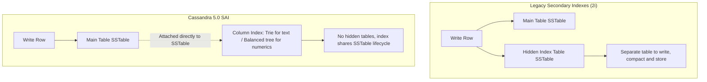

# Indexing & Vector Search in Cassandra 5.0

> [!CAUTION]
> Commands on this page can change or delete data and affect running clusters. Try them on a test or staging cluster first, and read the [disclaimer](../README.md#disclaimer). The guide is provided "as is", without warranty.

Cassandra 5.0 significantly expands querying with two new features:
1. **Storage-Attached Indexing (SAI)**: A new secondary index implementation that offers an alternative to legacy secondary indexes (2i).
2. **Native Vector Search**: Direct support for AI/ML embeddings and Approximate Nearest Neighbor (ANN) search.

---

## 1. Storage-Attached Indexing (SAI) vs. Legacy 2i

In older Cassandra versions (3.x, 4.x), legacy secondary indexes stored their entries in hidden, node-local index tables. These tables have their own write path, compaction, and disk footprint.

**Cassandra 5.0 SAI attaches index components directly to each SSTable (and memtable) instead:**



Both SAI and 2i are **node-local** indexes. A query that does not restrict the partition key must still be sent to replicas across the whole token ring, so SAI does not remove scatter-gather. It makes each node's part of the work cheaper.

### When to Use SAI:
* To query non-primary-key columns (e.g., `email`, `status`, `country`, `timestamp`) without building a separate query table.
* To avoid creating dozens of duplicate denormalized tables for low-to-medium volume queries.
* Mind the column's cardinality. For a very high-cardinality column (e.g., `email`), the few matching rows may sit on a handful of nodes, and an unrestricted query may scan much of the cluster before finding them. For a low-cardinality column (e.g., `status`), a `LIMIT` larger than the number of matching rows forces Cassandra to search all replicas before it can return. Restricting the partition key avoids both problems.

### Creating an SAI Index:
```sql
CREATE TABLE product_catalog (
    category_id text,
    product_id uuid,
    brand text,
    price decimal,
    in_stock boolean,
    tags set<text>,
    PRIMARY KEY ((category_id), product_id)
);

-- Index a numeric column (block-balanced tree; supports =, <, <=, >, >=)
CREATE INDEX idx_product_price ON product_catalog (price) USING 'sai';

-- Index a text column (trie-based terms dictionary; equality only)
CREATE INDEX idx_product_brand ON product_catalog (brand) USING 'sai'
WITH OPTIONS = {'case_sensitive': false, 'normalize': true};

-- Index elements within a collection (queried with CONTAINS)
CREATE INDEX idx_product_tags ON product_catalog (values(tags)) USING 'sai';
```

`USING 'sai'` is shorthand for `CREATE CUSTOM INDEX ... USING 'StorageAttachedIndex'`. Both forms work.

`CREATE INDEX` returns before the index is ready: each node builds it in the background from the SSTables it already has. Until enough replicas finish, queries that need the index fail with `ReadFailure ... INDEX_NOT_AVAILABLE`, even on an empty or tiny table. Check progress before you send traffic that depends on a new index:

```sql
SELECT index_name, is_queryable, is_building
  FROM system_views.sai_column_indexes WHERE keyspace_name = '<keyspace>';
```

`system_views` tables are local to the node you're connected to, so run it on each node, or watch for the build to finish in each node's `system.log`. On a large table the build can take a long time and adds compaction-like I/O; create indexes before you load data when you can.

> [!NOTE]
> A plain `CREATE INDEX` **without** `USING 'sai'` builds a **legacy 2i** with the shipped `cassandra.yaml` (`default_secondary_index: legacy_local_table`). Only `conf/cassandra_latest.yaml` sets `default_secondary_index: sai`. Always specify `USING 'sai'` explicitly.

### SAI Operator Support and Text Analyzer Options:
* **Text, ascii, boolean, uuid** columns: equality (`=`) only. Range queries and `LIKE` are not supported.
* **Numeric, date/time and inet** columns: equality and range (`<`, `<=`, `>`, `>=`).
* **Collections**: `values(col)` supports `CONTAINS`, `keys(map)` supports `CONTAINS KEY`, and `entries(map)` supports `map[key] = value`. `full(frozen_col)` supports equality on the whole frozen value.
* **Analyzer options**, for text/ascii indexes only:

| Option | Default | Effect |
| :--- | :--- | :--- |
| `case_sensitive` | `true` | `false` makes `brand = 'sony'` match `'Sony'` |
| `normalize` | `false` | `true` applies Unicode NFC normalization before matching |
| `ascii` | `false` | `true` folds non-ASCII characters to their ASCII equivalents (e.g., `é` → `e`) |

### Efficient Querying with SAI:
```sql
-- Recommended: Scope SAI search to a known partition (only that partition's replicas are queried)
SELECT * FROM product_catalog 
WHERE category_id = 'electronics' 
  AND brand = 'Sony' 
  AND price <= 499.99;

-- Use sparingly (low-throughput only): Global search across all partitions (fans out across the token ring)
SELECT * FROM product_catalog 
WHERE brand = 'Sony' 
  AND price <= 499.99;

-- Collection element match
SELECT * FROM product_catalog 
WHERE category_id = 'electronics' 
  AND tags CONTAINS 'wireless';
```

---

## 2. Native Vector Search & Embeddings in 5.0

Cassandra 5.0 can store high-dimensional vector embeddings and run **Approximate Nearest Neighbor (ANN)** similarity search through SAI. The vector index uses the [JVector](https://github.com/jbellis/jvector) library, a graph-based ANN index that is a close cousin of HNSW and draws on DiskANN.

### Schema Definition:
```sql
CREATE TABLE knowledge_base (
    tenant_id text,
    document_id uuid,
    title text,
    chunk_text text,
    embedding vector<float, 384>, -- 384-dimensional vector (e.g., MiniLM)
    PRIMARY KEY ((tenant_id), document_id)
);

-- Create the vector index
CREATE INDEX idx_knowledge_embedding ON knowledge_base (embedding)
USING 'sai'
WITH OPTIONS = {'similarity_function': 'COSINE'};
```

### Vector Index Options:

| Option | Allowed values | Default |
| :--- | :--- | :--- |
| `similarity_function` | `COSINE`, `DOT_PRODUCT`, `EUCLIDEAN` | `COSINE` |
| `optimize_for` | `LATENCY`, `RECALL` | `LATENCY` |
| `maximum_node_connections` | 1–512 | 16 |
| `construction_beam_width` | 1–3200 | 100 |

> [!NOTE]
> Cassandra rejects `maximum_node_connections` and `construction_beam_width` unless every node starts with the JVM system property `-Dcassandra.sai.vector.allow_custom_parameters=true`. Most users should keep the defaults.

### Vector Guardrails (cassandra.yaml):
* `vector_dimensions_warn_threshold` / `vector_dimensions_fail_threshold`: limit the declared vector dimensions (both disabled by default, `-1`).
* `sai_vector_term_size_warn_threshold` / `sai_vector_term_size_fail_threshold`: default `16KiB` / `32KiB` per indexed vector. At 4 bytes per float, the 32KiB fail threshold caps indexed vectors at about 8,192 dimensions unless you raise it.

---

## 3. Choosing the Right Similarity Function

| Function | Use Case | Mathematical Basis | Notes |
| :--- | :--- | :--- | :--- |
| **`COSINE`** | Text & NLP semantic search | $\cos(\theta) = \frac{\mathbf{A} \cdot \mathbf{B}}{\|\mathbf{A}\| \|\mathbf{B}\|}$ | Compares the angle between vectors regardless of their magnitude. **All-zero vectors are rejected**, both when indexing and when querying. |
| **`DOT_PRODUCT`** | Pre-normalized unit vectors | $\mathbf{A} \cdot \mathbf{B} = \sum A_i B_i$ | Cheaper to compute than cosine and gives the same ranking for unit-length ($L_2 = 1.0$) vectors. **If the vectors are not normalized, the results are meaningless, and Cassandra does not warn you.** |
| **`EUCLIDEAN`** | Computer vision, spatial embeddings, clustering | $d(\mathbf{A}, \mathbf{B}) = \sqrt{\sum (A_i - B_i)^2}$ | Standard geometric ($L_2$) distance. |

**Similarity scores:** the CQL functions `similarity_cosine()`, `similarity_dot_product()` and `similarity_euclidean()` return a score where **higher means more similar**. Cosine and dot product are scaled to `(1 + x) / 2`. The cosine score is always between 0 and 1, and the dot-product score is too when the vectors are unit length. Euclidean is returned as `1 / (1 + d²)`, not as a raw distance. `ANN OF` always returns the most similar rows first.

---

## 4. Querying Vectors with `ANN OF`

To find the top $K$ most similar items:

```sql
-- Recommended: Scoped to a partition (only that partition's replicas are searched)
SELECT document_id, title, similarity_cosine(embedding, ?) AS score
FROM knowledge_base
WHERE tenant_id = 'acme_corp'
ORDER BY embedding ANN OF ?
LIMIT 5;
```

### ANN Query Rules (enforced by Cassandra 5.0):
* A `LIMIT` is **required** and must be **≤ 1000**. The cap comes from the JVM property `cassandra.sai.vector_search.max_top_k`.
* ANN queries **do not page**. If the driver's page size is smaller than `LIMIT`, Cassandra raises the page size to match and returns a client warning.
* No aggregation (`COUNT`, `SUM`, ...) and no `PER PARTITION LIMIT` with `ANN OF`.
* **Consistency level:** ANN queries run at `ONE` / `LOCAL_ONE`. Higher levels such as `QUORUM` and `LOCAL_QUORUM` are silently downgraded, and only a client warning is returned. `SERIAL` / `LOCAL_SERIAL` are rejected.
* `ANN OF` must be the **only** ordering. You cannot combine it with another `ORDER BY` column or use `DESC`.
* Every column filtered in the `WHERE` clause (other than a full partition-key restriction) must have an SAI index. Clustering-column restrictions that can be served without filtering are also allowed.
* A vector index supports only `ANN OF`. You cannot run `WHERE embedding = ...`.
* `CREATE INDEX` on a vector column returns a client warning in 5.0: "SAI ANN indexes on vector columns are experimental and are not recommended for production use", followed by the limits above. The index is still created. Evaluate it under your own load before relying on it ([example](../03_application_development/05_querying_with_cql.md#1-set-up-the-sample-data)). A vector index can take more disk than the vectors themselves and makes compaction much slower; [capacity planning](../05_cluster_deployment_and_config/05_capacity_planning.md#sai-and-vector-indexes) has measured figures.

### The Golden Rule of Vector Search:
> [!IMPORTANT]
> **Partition your vector tables whenever possible.**
> A global unpartitioned ANN query (`SELECT ... ORDER BY embedding ANN OF ? LIMIT 5`) is a range scan across the whole token ring. The coordinator queries the vector index on replicas covering every token range and merges their top-K candidates.
> Scoping ANN searches by tenant, category, or user limits the search to a single partition's replicas and keeps latency low and predictable.
