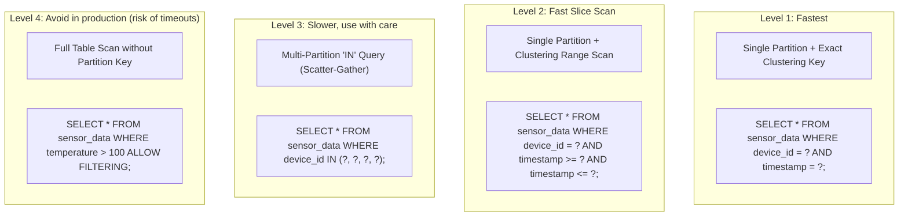

# Performant Reads: Latency Minimization & Query Optimization

Cassandra writes are append-only and cheap; reads are more expensive because they may need to merge data from the memtable and several SSTables, on one or more replicas. To achieve consistently low read latencies, you must design your reads around **partition boundaries**.

---

## 1. The Anatomy of an Optimal Read Query

In Cassandra, read performance is determined by how many partitions, files and nodes must be touched. From cheapest to most expensive:



Absolute latencies depend on hardware, data size, replication factor (RF) and consistency level (CL); what matters is the relative cost of each level.

---

## 2. Rule #1: Always Target a Single Partition

Every high-throughput read query must include the entire **Partition Key** in the `WHERE` clause:

```sql
-- ✅ FAST: Query routes directly to the replicas holding the data
SELECT first_name, email
FROM users
WHERE user_id = 123e4567-e89b-12d3-a456-426614174000;
```

If your table has a composite partition key (e.g. `PRIMARY KEY ((tenant_id, user_id), created_at)`), you **must provide both parts** of the partition key:
```sql
-- ✅ FAST: Full partition key provided
SELECT * FROM audit_logs WHERE tenant_id = 'acme' AND user_id = 'alice';

-- ❌ REJECTED: Missing tenant_id is refused unless you add ALLOW FILTERING (a full scan) or an index covers the column
SELECT * FROM audit_logs WHERE user_id = 'alice';
```

---

## 3. Rule #2: Slice Scans Within a Partition

Once the partition is located, scanning rows ordered by **Clustering Keys** is efficient because rows are stored sorted by clustering key within each partition:

```sql
CREATE TABLE user_timeline (
    user_id uuid,
    post_time timestamp,
    post_id uuid,
    content text,
    PRIMARY KEY ((user_id), post_time, post_id)
) WITH CLUSTERING ORDER BY (post_time DESC);

-- ✅ FAST: Contiguous, sorted read of the latest 20 posts within one partition
SELECT * FROM user_timeline
WHERE user_id = ?
ORDER BY post_time DESC
LIMIT 20;

-- ✅ FAST: Time range slice scan within the partition
SELECT * FROM user_timeline
WHERE user_id = ?
  AND post_time >= '2026-11-01 00:00:00'
  AND post_time < '2026-11-20 00:00:00';
```

---

## 4. Rule #3: Avoid Multi-Partition `IN (...)` Clauses

It is tempting to write queries like:
```sql
-- ❌ ANTI-PATTERN: Multi-partition IN query
SELECT * FROM users WHERE user_id IN (?, ?, ?, ?);  -- imagine 50 bind markers
```

### Why Multi-Partition `IN` Hurts:
1. The coordinator node acts as a scatter-gather proxy. For each of the 50 keys it queries the replicas required by the consistency level (potentially many different nodes), waits for all of them, merges the results in coordinator memory, and returns them.
2. The entire query's latency is pegged to the **slowest single replica** involved.
3. If one replica pauses (e.g. for GC), your whole request stalls.

Operators can cap this with the `partition_keys_in_select_warn_threshold` / `partition_keys_in_select_fail_threshold` and `in_select_cartesian_product_warn_threshold` / `in_select_cartesian_product_fail_threshold` guardrails in `cassandra.yaml` (disabled by default).

### The Performant Alternative: Client-Side Parallel Asynchronous Reads
Instead of an `IN` clause, send separate async queries from your client and merge the futures:

```java
// ✅ PERFORMANT: Concurrent individual async reads (lower latency, higher resiliency)
List<UUID> userIds = List.of(id1, id2, id3, id4);
List<CompletableFuture<Row>> futures = userIds.stream()
    .map(id -> session.executeAsync(selectStmt.bind(id))
                      .thenApply(AsyncResultSet::one)
                      .toCompletableFuture())
    .collect(Collectors.toList());

// Wait for all reads, then collect the rows (null for ids that were not found)
List<Row> rows = CompletableFuture.allOf(futures.toArray(new CompletableFuture[0]))
    .thenApply(v -> futures.stream().map(CompletableFuture::join).collect(Collectors.toList()))
    .join();
```

---

## 5. Rule #4: Paginate Without Offsets

Cassandra does not support SQL `OFFSET`, because skipping 10,000 rows would still require reading and discarding those 10,000 rows.

### Token-Range Scanning (for full-table batch jobs):
To scan an entire table (e.g. for background batch processing), walk the token ring:

```sql
-- Fetch first page
SELECT token(user_id), user_id, email FROM users LIMIT 100;

-- Fetch next page using the token of the last user_id seen
SELECT token(user_id), user_id, email FROM users
WHERE token(user_id) > token(?)
LIMIT 100;
```

> [!WARNING]
> This pattern is only safe when every partition holds a single row (as in `users` above). If a partition spans the page boundary, its remaining rows are skipped. For multi-row partitions, use the driver's paging state (below), or split the ring into token ranges and read each range with driver paging.

### Driver-Level Automatic Paging:
The drivers support transparent paging, and this is the recommended approach for user-facing pagination (the paging state can be saved and resumed):
```java
// Set page size (driver default is 5,000 rows: basic.request.page-size)
SimpleStatement statement = SimpleStatement.newInstance("SELECT * FROM large_table")
    .setPageSize(1000);

ResultSet rs = session.execute(statement);
for (Row row : rs) {
    // When the current page is exhausted, the driver fetches the next page.
    // With the synchronous ResultSet this blocks the iterating thread;
    // use executeAsync() and AsyncResultSet.fetchNextPage() for non-blocking paging.
    processRow(row);
}
```

---

## 6. Rule #5: Use SAI Instead of `ALLOW FILTERING`

If you need to query by a non-key column, `ALLOW FILTERING` without a partition key scans the whole table. Cassandra 5.0 includes Storage-Attached Indexing (SAI), which indexes the column on each node:

```sql
-- USING 'sai' is required unless default_secondary_index is set to sai (as in cassandra_latest.yaml)
CREATE INDEX sensor_temperature_idx ON sensor_data (temperature) USING 'sai';

SELECT * FROM sensor_data WHERE temperature > 100;
```

SAI queries without a partition key still contact many nodes, so restrict them to the partition key wherever possible and use `LIMIT`.

---

## 7. Summary Checklist for High-Speed Reads

- [ ] Every high-throughput query supplies the entire partition key.
- [ ] Use clustering key slice scans (`>=`, `<=`) for ordered ranges.
- [ ] Replace multi-partition `IN (...)` queries with parallel asynchronous client reads.
- [ ] Never use `ALLOW FILTERING` in user-facing production APIs; consider an SAI index instead.
- [ ] Use driver paging for user-facing pages; use token-range scans (`WHERE token(id) > ?`) only for full-table batch jobs.
- [ ] Set driver page size according to row width (typically 500 – 2,000 rows).
