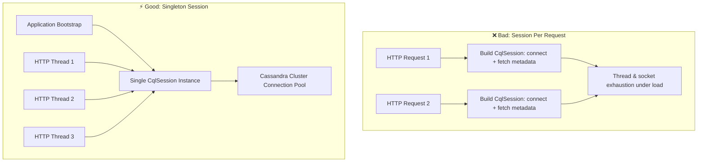

# Client Driver Best Practices & Architecture

Your application talks to Cassandra through a native-protocol driver: the Apache Cassandra Java driver (formerly the DataStax Java driver), or drivers for Python, Go, Node.js, C#, Rust and others. Cassandra 5.0 speaks native protocol v3, v4 and v5 (v5 is the current version; v6 is beta only), and drivers negotiate the highest version both sides support.

Configuring the driver properly is just as important as writing correct CQL. The examples use the Java driver 4.x (`application.conf` / HOCON); other drivers have equivalent settings.

---

## 1. Rule #1: The `CqlSession` Must Be a Singleton

The `CqlSession` (or `Cluster` in older drivers) is a heavy, thread-safe object:
* It maintains connection pools to the nodes it uses.
* It keeps a control connection that receives topology, status and schema change events from the cluster.
* It hosts internal Netty event-loop thread pools.
* It caches prepared statements and schema/token metadata.



### Implementation (Java Spring / Guice / Plain Java):
```java
// Maintain a single instance across the entire application lifecycle
public class CassandraClient {
    private static final CqlSession SESSION = CqlSession.builder()
        .addContactPoint(new InetSocketAddress("10.0.1.10", 9042))
        // Must match the DC name the snitch reports (see `nodetool status`), e.g. "us-east-1"
        // with Ec2Snitch's default naming, or "dc1" with the shipped cassandra-rackdc.properties.
        .withLocalDatacenter("us-east-1")
        .build();

    public static CqlSession getSession() {
        return SESSION;
    }
}
```
Close the session once, at application shutdown.

---

## 2. Rule #2: Connection Pool Sizing (Multiplexing)

In traditional SQL databases (PostgreSQL/MySQL), one TCP connection handles one query at a time, so applications keep pools of tens of connections per server.

**Cassandra's native protocol multiplexes requests:**
* Protocol v3 and later allow up to **32,768 stream IDs** per connection, so many requests can be in flight on one socket.
* The Java driver 4.x caps in-flight requests per connection at **1,024** by default (`advanced.connection.max-requests-per-connection`).
* One connection per node is usually enough. Large pools waste memory and file descriptors on both sides.

### Recommended Pool Sizing:
```hocon
# application.conf (Java driver 4.x)
datastax-java-driver {
  advanced.connection {
    max-requests-per-connection = 1024   # default
    pool {
      local.size = 1    # connections per node in the local DC (default 1)
      remote.size = 1   # connections per node in remote DCs (default 1)
    }
  }
}
```
Raise `local.size` only if you measure that a single connection per node is saturated (many requests queued in the driver while nodes are idle).

---

## 3. Rule #3: Token-Aware, DC-Local Routing

The Java driver 4.x `DefaultLoadBalancingPolicy` is **token-aware and DC-aware by default**: it only uses nodes in the configured local datacenter, and it tries replicas of the statement's partition first.

```
Without token awareness:
Client ────────► Any Coordinator ────────► Replica Nodes (extra hop)

With token awareness:
Client (computes token locally) ───────────► A Replica Node as Coordinator
```

### Requirements for Token-Aware Routing to Work:
1. The driver must know the statement's **routing key**. Bound `PreparedStatement`s provide it automatically, because the driver knows which bind markers are partition key columns. For a `SimpleStatement`, set it yourself with `setRoutingKey(...)` (and `setRoutingKeyspace(...)`).
2. The query must restrict the complete partition key.
3. The local datacenter must be set (`basic.load-balancing-policy.local-datacenter` or `withLocalDatacenter(...)`). The 4.x driver refuses to start without it unless only the default contact point is used.

---

## 4. Rule #4: Reduce Tail Latency with Speculative Execution

Individual nodes periodically experience GC pauses, compaction I/O spikes or network hiccups, which shows up as tail latency (p99, p99.9).

**Speculative execution** sends the same request to another node if the first one has not answered within a delay:

```hocon
# application.conf
datastax-java-driver {
  advanced.speculative-execution-policy {
    class = ConstantSpeculativeExecutionPolicy
    delay = 15ms         # if no answer within 15ms, also try the next node
    max-executions = 2   # including the initial execution
  }
}
```

* The driver **only** speculatively executes statements marked idempotent (Rule #5). Non-idempotent statements are never sent twice.
* Speculative executions add load. Set `delay` around your observed p99 latency, not the median, and watch server load after enabling it.

---

## 5. Rule #5: Mark Statements as Idempotent

For the driver to retry a failed or timed-out request, or to run it speculatively, it **must know the statement is idempotent** (running it twice leaves the same state as running it once). The Java driver 4.x treats statements as **non-idempotent by default** (`basic.request.default-idempotence = false`).

```java
// Tell the driver it is safe to retry this statement
SimpleStatement statement = SimpleStatement.newInstance("UPDATE users SET status = 'ACTIVE' WHERE user_id = ?")
    .setIdempotent(true);

// Or configure it globally (only if every statement your application runs is idempotent):
// datastax-java-driver.basic.request.default-idempotence = true
```

> [!WARNING]
> Plain `INSERT` and `UPDATE` statements that set regular columns are idempotent (last write wins).
> These are **not** idempotent and must not be retried blindly:
> * appending or prepending to a list (`items = items + ['item']`)
> * counter increments (`hits = hits + 1`)
> * lightweight transactions (`IF NOT EXISTS`, `IF col = ?`): a retry of a write that actually succeeded returns `[applied] = false`
> * statements using server-side `now()` / `uuid()` / `currentTimestamp()` values, since each execution generates a new value

---

## 6. Other Driver Settings Worth Knowing

* **Timeouts**: the driver's request timeout (`basic.request.timeout`, default 2 seconds) should be at least the server's timeouts (`read_request_timeout` 5000ms, `write_request_timeout` 2000ms in the shipped `cassandra.yaml`), or the client gives up before the server reports the real error.
* **Consistency**: set the default consistency level (`basic.request.consistency`, default `LOCAL_ONE`) explicitly, usually to `LOCAL_QUORUM`. See [04_consistency_and_transactions.md](04_consistency_and_transactions.md).
* **Paging**: the default page size is 5,000 rows (`basic.request.page-size`). See [02_performant_reads.md](02_performant_reads.md).
* **Client timestamps**: the Java driver 4.x generates write timestamps on the client by default. Keep application hosts NTP-synchronized; clock skew between clients decides which concurrent write wins.
* **Authentication and TLS**: configure `advanced.auth-provider` and `advanced.ssl-engine-factory` when the cluster enables `PasswordAuthenticator` and client encryption.
