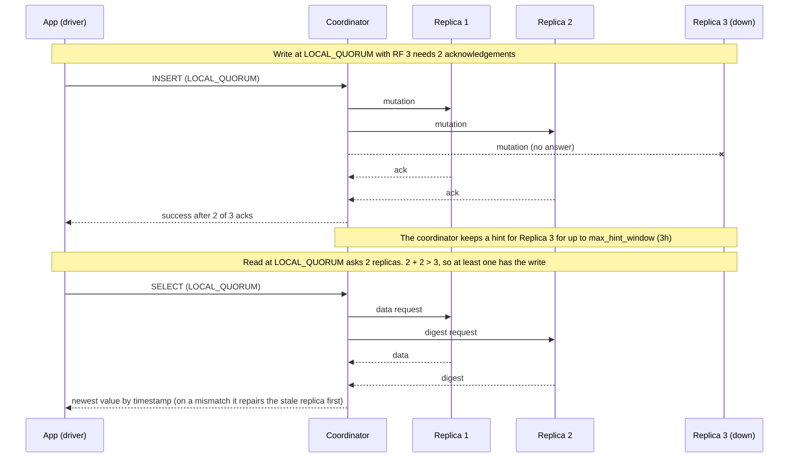
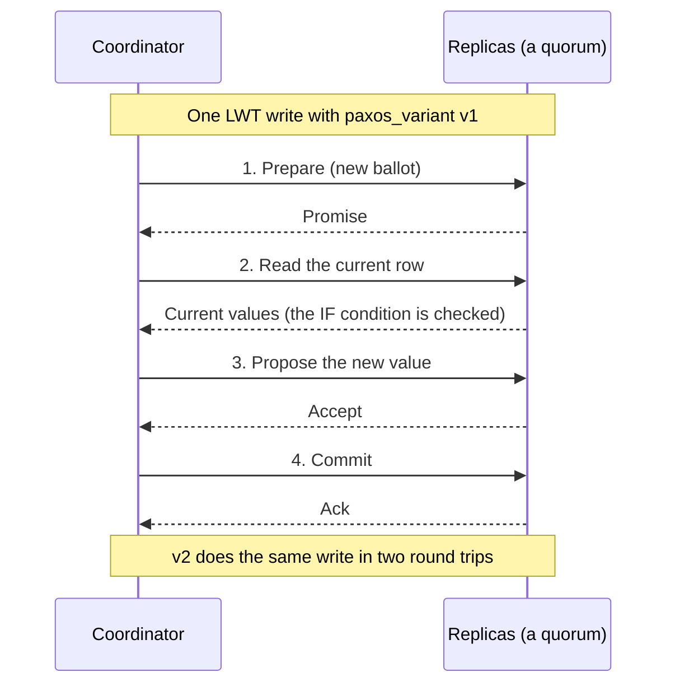

# Consistency Levels, Lightweight Transactions & Data Masking

Cassandra lets developers choose the consistency level **per query**, trading off latency, availability and consistency. Single-partition compare-and-set is available through lightweight transactions (LWT). Cassandra 5.0 has **no multi-partition ACID transactions**.

---

## 1. Tunable Consistency Matrix

In a keyspace with replication factor $N$ per datacenter (typically $N = 3$):

$$\text{Read-your-writes when: } R + W > N$$

If the number of replicas that must acknowledge a read ($R$) plus the number that must acknowledge a write ($W$) is greater than the replication factor ($N$), every read overlaps at least one replica that has the latest acknowledged write. With `LOCAL_QUORUM` that holds per datacenter, using that DC's replication factor.

| Consistency Level | Replicas that must respond | Relative latency | Tolerates (RF=3 per DC) | Typical use |
| :--- | :--- | :--- | :--- | :--- |
| **`ONE` / `LOCAL_ONE`** | 1 (`LOCAL_ONE`: in the local DC) | Lowest | 2 replicas down | Logs, metrics, telemetry; data where staleness is acceptable |
| **`LOCAL_QUORUM`** | $\lfloor RF_{local}/2 \rfloor + 1$ in the local DC | Low | 1 replica down per DC | **The usual production default** for reads and writes |
| **`EACH_QUORUM`** (writes only) | A quorum in **every** DC | Cross-DC | 1 replica down per DC, but any DC unreachable fails the write | Writes that must be durable in all DCs before acknowledging |
| **`QUORUM`** | Majority of all replicas across all DCs | Cross-DC | Depends on DC layout | Rarely needed in multi-DC; it ties latency to remote DCs |
| **`ALL`** | Every replica in every DC | Slowest | None | Avoid in production |
| **`ANY`** (writes only) | 1 node, which may only store a hint | Lowest | All replicas down | Almost never appropriate: the write may not be readable until hints are delivered |
| **`SERIAL` / `LOCAL_SERIAL`** | Paxos quorum (all DCs / local DC) | LWT cost | As `QUORUM` / `LOCAL_QUORUM` | The serial consistency of LWTs, and reads that must see in-progress LWTs |

Latency is relative: absolute numbers depend on hardware, network, RF and data size.

### The Standard Production Pattern:
* **Writes**: `LOCAL_QUORUM`
* **Reads**: `LOCAL_QUORUM`
* **Result**: Read-your-writes within a datacenter, tolerating one replica down per DC, without waiting on remote DCs. Other DCs catch up asynchronously, via hints and read repair, and through scheduled repair.

What happens with RF 3 when one replica is down:



```java
SimpleStatement statement = SimpleStatement.newInstance("SELECT * FROM accounts WHERE id = ?")
    .setConsistencyLevel(DefaultConsistencyLevel.LOCAL_QUORUM);
```
The Java driver 4.x defaults to `LOCAL_ONE`, so set `basic.request.consistency = LOCAL_QUORUM` (or per statement) explicitly.

### Timestamps, Clock Skew and Last-Write-Wins
Each write carries a timestamp in microseconds, set by the client (the Java driver 4.x default) or else by the coordinator. When two writes touch the same cell, the **higher timestamp wins**, regardless of arrival order. Consequences:
* Keep **all clients and Cassandra nodes NTP-synchronized**. A client whose clock runs ahead can make its writes unbeatable until real time catches up; one that runs behind can have its writes silently discarded.
* A delete followed immediately by an insert with an older (skewed) timestamp loses to the tombstone.
* Operators can reject far-future timestamps with the `maximum_timestamp_warn_threshold` / `maximum_timestamp_fail_threshold` guardrails (disabled by default).

---

## 2. Lightweight Transactions (LWT)

Standard writes are blind last-write-wins: they do not check whether a row already exists or what its current value is.

When you need **compare-and-set (CAS)** semantics within **one partition**, use a lightweight transaction with an `IF` clause:

```sql
-- Create user only if username does not already exist
INSERT INTO user_credentials (username, user_id, hash)
VALUES ('alice', 123e4567-e89b-12d3-a456-426614174000, 'hashed_pw')
IF NOT EXISTS;

-- Update account balance only if the current value matches (optimistic locking)
UPDATE bank_accounts
SET balance = 150.00
WHERE account_id = ?
IF balance = 200.00;
```

The result has an `[applied]` boolean column. If `false`, the row also contains the current values that made the condition fail.

### Two Consistency Levels per LWT
* **Serial consistency** (`SERIAL` or `LOCAL_SERIAL`) controls the Paxos phase. `LOCAL_SERIAL` keeps Paxos within the local DC, and is only safe if all LWTs on that data run from one DC at a time.
* **Commit consistency** (the regular consistency level, e.g. `LOCAL_QUORUM`) controls how the result is written to the table.
* Pick one serial level per piece of data. **Mixing `SERIAL` and `LOCAL_SERIAL` on the same data** is the most likely source of linearizability violations.
* To read a value consistently with in-progress LWTs, read at `SERIAL` / `LOCAL_SERIAL`.

### Hazards
* **Do not mix LWT and non-LWT writes on the same cells.** Plain writes bypass Paxos and use ordinary timestamps, so they can overwrite or be overwritten by an LWT in ways the CAS condition never saw. If a column is managed with `IF`, write it with `IF` everywhere (including deletes: `DELETE ... IF EXISTS`).
* **LWTs are not idempotent.** If an LWT times out, it may or may not have been applied. Re-check the state (for example with a `SERIAL` read) before retrying; a blind retry of a write that did succeed returns `[applied] = false`.
* **Contention**: many clients hitting the same partition with LWTs retry against each other and time out (`cas_contention_timeout`, default 1000ms). Design so that each partition has few concurrent writers.
* A `BATCH` containing conditions must target a single partition.

---

## 3. Paxos v1 vs. Paxos v2

The improved **Paxos v2** implementation was introduced in **Cassandra 4.1** (not 5.0). In 5.0:

* **`conf/cassandra.yaml`**: v2 is **off** (`#paxos_variant: v1`; the default is v1).
* **`conf/cassandra_latest.yaml`**: `paxos_variant: v2`.

Round-trips per the shipped `cassandra.yaml`:

| `paxos_variant` | Write LWT | Read at `SERIAL` |
| :--- | :--- | :--- |
| `v1` (default) | 4 round-trips | 3 round-trips |
| `v1_without_linearizable_reads_or_rejected_writes` | 4 | 2 (weaker semantics) |
| **`v2`** (recommended) | **2 round-trips** | 1 or 2 round-trips |
| `v2_without_linearizable_reads` | 2 | 1 (weaker read semantics) |
| `v2_without_linearizable_reads_or_rejected_writes` | 2 | 1 (weaker semantics) |

v2 also keeps LWTs linearizable across safe range movements (bootstrap, decommission), which v1 does not guarantee.

Where v1's four round trips go for one conditional write:



### Enabling v2 on an existing cluster
From the shipped `cassandra.yaml` and NEWS.txt:
1. Make sure every node runs the same Cassandra version (4.1 or later).
2. Run `nodetool repair --full -pr` on each node.
3. Set `paxos_variant: v2` in `cassandra.yaml` on each node and do a rolling restart. (It can also be changed at runtime over JMX, but must be persisted in the yaml.)

Rolling back to v1 is safe: revert the setting and do a rolling restart. No data migration is needed.

### Optional: `paxos_state_purging: repaired`
`paxos_state_purging` controls how Paxos state in `system.paxos` is cleaned up. The default is `legacy` (TTL-based).
* With v2, Paxos repair runs automatically as part of incremental repair. Once regular repairs that include Paxos repair are running, you can set `paxos_state_purging: repaired` on every node.
* With `repaired` in place across the cluster, applications may use a commit consistency of `ANY` (or `LOCAL_QUORUM`) for LWT writes, which saves one more round-trip.
* **Once set to `repaired`, never go back to `legacy`.** If Paxos repairs must stop for an extended period, switch to `gc_grace` and restore your applications' default commit consistency.
* `nodetool repair --paxos-only` runs only the Paxos repair step.

---

## 4. When to Use LWT vs When to Avoid It

| Use Case | Use LWT (`IF`)? | Rationale |
| :--- | :---: | :--- |
| **User registration (unique email/username)** | **YES** | Guarantees only one user claims a key. |
| **Balance deductions on one account** | **YES** | Prevents double-spend via a CAS check on that row. Transfers between two accounts span two partitions and are **not** atomic with LWT. |
| **State machine transitions (`PENDING` → `RUNNING`)** | **YES** | Ensures only one worker claims the task. |
| **High-volume telemetry / metrics ingestion** | **NO** | LWT costs several round-trips per write; use plain writes. |
| **Frequent counter / like updates** | **NO** | Contention on a hot row causes CAS retries and timeouts; use counter columns (approximate under retries) or aggregate in the application. |

---

## 5. Dynamic Data Masking (DDM, new in 5.0)

Cassandra 5.0 adds **Dynamic Data Masking**: columns can be declared with a masking function, and users without the right permission see the masked value instead of the real one.

### Prerequisites
* **DDM is disabled by default.** Set `dynamic_data_masking_enabled: true` in `cassandra.yaml` on every node. Otherwise `MASKED WITH` fails with "Cannot mask columns because dynamic data masking is not enabled", and existing masks are not applied.
* **Masking only works with authorization enabled.** With the shipped `AllowAllAuthorizer`, every user effectively has every permission, including `UNMASK`. Use `CassandraAuthorizer` (and `PasswordAuthenticator`). Superusers always see clear values.

```sql
-- Attach masking functions directly to columns
CREATE TABLE finance.user_pii (
    user_id uuid PRIMARY KEY,
    full_name text,
    email text MASKED WITH DEFAULT,
    ssn text MASKED WITH mask_inner(1, 1, 'X'),
    credit_card text MASKED WITH mask_inner(0, 4)
);

-- Masks can be added to or removed from existing columns
ALTER TABLE finance.user_pii ALTER full_name MASKED WITH mask_outer(1, 0);
ALTER TABLE finance.user_pii ALTER full_name DROP MASKED;
```

For a user without `UNMASK`, given `email = 'alice@example.com'`, `ssn = '123-45-6789'`, `credit_card = '4111111111111234'`:
* `email` → `'****'` (`DEFAULT` uses `mask_default`, which returns `****` for text types and a fixed value for other types)
* `ssn` → `'1XXXXXXXXX9'` (`mask_inner(begin, end, pad)` keeps the first `begin` and last `end` characters and replaces **each** character in between, so the length is preserved)
* `credit_card` → `'************1234'` (the default padding character is `*`)

Other functions: `mask_null()`, `mask_outer(begin, end[, pad])`, `mask_replace(value)`, and `mask_hash(...)`.

### Permissions
* `UNMASK`: see clear values.
* `SELECT_MASKED`: run `SELECT` with `WHERE` restrictions on masked columns while still seeing masked values. Without `UNMASK` or `SELECT_MASKED`, filtering on a masked column is rejected, which prevents guessing values by filtering.

Both can be granted on a keyspace, on all tables in a keyspace, or on a table:
```sql
GRANT UNMASK ON KEYSPACE finance TO compliance_role;
GRANT SELECT_MASKED ON TABLE finance.user_pii TO support_role;
```

Masking applies to query results only. Data is stored in clear text, so it does not replace encryption, and it does not mask values in SSTables, backups, logs or tools such as `sstabledump`.
