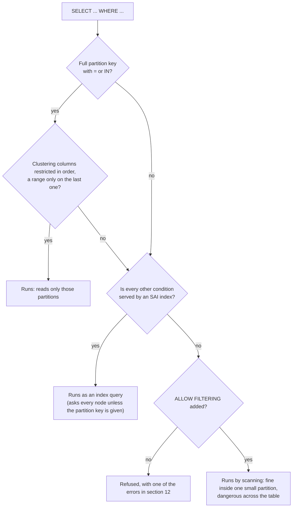

# Querying with CQL: Clause by Clause, with Results

> [!CAUTION]
> Commands on this page can change or delete data and affect running clusters. Try them on a test or staging cluster first, and read the [disclaimer](../README.md#disclaimer). The guide is provided "as is", without warranty.

This page teaches CQL `SELECT` one clause at a time. Every example runs against one small sample dataset and shows the output `cqlsh` prints. When Cassandra refuses a query, the page shows the exact error and what to do instead. You learn the rules faster by seeing what is refused than by reading the grammar.

Every example on this page is run against Cassandra 5.0 by [`test_env` scenario 14](../test_env/README.md), and its output is compared with what is shown here. If an output on this page is wrong for 5.0, that scenario fails.

For the full syntax, see the [CQL quick reference](../09_reference/04_cql_quick_reference.md). For every function with its arguments and an example, see the [CQL functions reference](../09_reference/05_cql_functions.md). For why the rules exist, read the [mental model](../01_architecture_and_mental_model/01_mental_model.md) and [schema design patterns](../02_data_modeling_and_indexing/01_schema_design_patterns.md). For the performance side of the same queries, read [performant reads](02_performant_reads.md).

---

## 1. Set up the sample data

You need the single node from the [quickstart](../00_getting_started/01_quickstart.md) (sections 1 and 2). Open a CQL shell on it:

```bash
docker exec -it cass-quickstart cqlsh
```

Paste this into `cqlsh`. It creates a keyspace called `examples` with two tables: orders stored by customer, and a product catalog with Storage-Attached Indexes (SAI).

<!-- test: run:examples-setup -->
```sql
CREATE KEYSPACE IF NOT EXISTS examples
  WITH replication = {'class': 'NetworkTopologyStrategy', 'datacenter1': 1};

CREATE TABLE IF NOT EXISTS examples.orders_by_customer (
    customer_id text,
    order_time  timestamp,
    order_id    int,
    status      text,
    total       decimal,
    items       map<text, int>,
    tags        set<text>,
    PRIMARY KEY ((customer_id), order_time, order_id)
) WITH CLUSTERING ORDER BY (order_time DESC, order_id ASC);

CREATE TABLE IF NOT EXISTS examples.products (
    product_id text PRIMARY KEY,
    name       text,
    category   text,
    price      decimal,
    tags       set<text>,
    embedding  vector<float, 3>
);

BEGIN UNLOGGED BATCH USING TIMESTAMP 1767225600000000
  INSERT INTO examples.orders_by_customer (customer_id, order_time, order_id, status, total, items, tags)
    VALUES ('c-001', '2026-01-05 09:15:00+0000', 1001, 'shipped', 42.50, {'p-10': 1, 'p-20': 2}, {'gift'});
  INSERT INTO examples.orders_by_customer (customer_id, order_time, order_id, status, total, items, tags)
    VALUES ('c-001', '2026-01-05 17:40:00+0000', 1002, 'shipped', 15.00, {'p-30': 1}, {});
  INSERT INTO examples.orders_by_customer (customer_id, order_time, order_id, status, total, items, tags)
    VALUES ('c-001', '2026-01-12 11:00:00+0000', 1003, 'pending', 99.90, {'p-40': 1}, {'express'});
  INSERT INTO examples.orders_by_customer (customer_id, order_time, order_id, status, total, items, tags)
    VALUES ('c-002', '2026-01-07 08:05:00+0000', 2001, 'shipped', 7.25, {'p-20': 1}, {});
  INSERT INTO examples.orders_by_customer (customer_id, order_time, order_id, status, total, items, tags)
    VALUES ('c-002', '2026-01-09 20:30:00+0000', 2002, 'cancelled', 120.00, {'p-50': 3}, {'gift', 'express'});
APPLY BATCH;

BEGIN UNLOGGED BATCH USING TIMESTAMP 1767225600000000
  INSERT INTO examples.products (product_id, name, category, price, tags, embedding)
    VALUES ('p-10', 'Trail mug', 'kitchen', 12.50, {'outdoor'}, [0.9, 0.1, 0.0]);
  INSERT INTO examples.products (product_id, name, category, price, tags, embedding)
    VALUES ('p-20', 'Camp stove', 'outdoor', 15.00, {'outdoor', 'gas'}, [0.8, 0.3, 0.1]);
  INSERT INTO examples.products (product_id, name, category, price, tags, embedding)
    VALUES ('p-30', 'Chef knife', 'kitchen', 15.00, {}, [0.1, 0.9, 0.2]);
  INSERT INTO examples.products (product_id, name, category, price, tags, embedding)
    VALUES ('p-40', 'Headlamp', 'outdoor', 99.90, {'outdoor', 'battery'}, [0.7, 0.0, 0.6]);
  INSERT INTO examples.products (product_id, name, category, price, tags, embedding)
    VALUES ('p-50', 'Tea towel', 'kitchen', 40.00, {}, [0.2, 0.8, 0.1]);
APPLY BATCH;

CREATE INDEX IF NOT EXISTS products_category  ON examples.products (category)     USING 'sai';
CREATE INDEX IF NOT EXISTS products_price     ON examples.products (price)        USING 'sai';
CREATE INDEX IF NOT EXISTS products_tags      ON examples.products (values(tags)) USING 'sai';
CREATE INDEX IF NOT EXISTS products_embedding ON examples.products (embedding)    USING 'sai'
  WITH OPTIONS = {'similarity_function': 'COSINE'};
```

Three things to notice:

* The batches set `USING TIMESTAMP` so that the `WRITETIME` example in section 10 prints the same value for you as it does here. Real applications let the driver or the server set the timestamp. The batches are `UNLOGGED` because the rows they write are small and the example doesn't need the batch log; see [performant writes](01_performant_writes.md) for when a logged batch is worth it.
* The last `CREATE INDEX` prints a warning that SAI vector indexes are experimental, followed by the list of query features they don't support. That's expected in 5.0; section 9 shows those limits.
* SAI indexes build in the background. Before you query them, check that they are ready:

<!-- test: q:examples-indexes -->
```sql
SELECT index_name, is_queryable, is_building
  FROM system_views.sai_column_indexes WHERE keyspace_name = 'examples';
```
```text
 index_name         | is_queryable | is_building
--------------------+--------------+-------------
  products_category |         True |       False
 products_embedding |         True |       False
     products_price |         True |       False
      products_tags |         True |       False

(4 rows)
```

When `is_queryable` is `True` for all four, you are ready. If you query an index before then, the query fails with `INDEX_NOT_AVAILABLE` (see [Indexing & Vector Search](../02_data_modeling_and_indexing/02_indexing_and_vector_search.md)).

---

## 2. The rule behind every refusal

Cassandra only runs a query when it knows which partitions to read and can read rows from them in stored order. For `orders_by_customer`, whose primary key is `((customer_id), order_time, order_id)`, that means:

| You restrict | Allowed? |
| :--- | :--- |
| `customer_id` with `=` or `IN` | Yes. This is how you pick partitions. |
| `customer_id` and then `order_time`, with `=` or a range | Yes. Clustering columns are restricted in order. |
| `customer_id`, `order_time` with `=`, and then `order_id` | Yes. |
| `order_id` without `order_time` | No. You can't skip a clustering column. |
| `order_id` after a range on `order_time` | No. Only the last restricted clustering column may use a range. |
| A range on `customer_id`, or any condition on `status` | No, unless an index serves it or you add `ALLOW FILTERING`. |

The same rules as a decision chart:



Indexes (section 8) and `ALLOW FILTERING` are the two ways out. The [anti-patterns page](../01_architecture_and_mental_model/02_anti_patterns.md) explains why `ALLOW FILTERING` is usually the wrong one.

---

## 3. `SELECT` at a glance

```sql
SELECT [JSON] [DISTINCT] <columns, functions or *>
  FROM <keyspace>.<table>
 [WHERE <relations>]                                  -- section 4, section 8
 [GROUP BY <primary key prefix>]                      -- section 7
 [ORDER BY <clustering column> [ASC | DESC]           -- section 5
   | ORDER BY <vector column> ANN OF <vector>]        -- section 9
 [PER PARTITION LIMIT <n>]                            -- section 6
 [LIMIT <n>]                                          -- section 6
 [ALLOW FILTERING];                                   -- section 8
```

There are no joins, subqueries, `OR`, `BETWEEN`, `HAVING` or `OFFSET`. Each read touches one table. When you need data from two tables, the usual answer is a second table shaped for that query; see [schema design patterns](../02_data_modeling_and_indexing/01_schema_design_patterns.md).

---

## 4. `WHERE` on the primary key

**One partition.** This is the query the table was designed for. Rows come back in the table's clustering order, newest first:

<!-- test: q:pk-partition -->
```sql
SELECT * FROM examples.orders_by_customer WHERE customer_id = 'c-001';
```
```text
 customer_id | order_time                      | order_id | items                  | status  | tags        | total
-------------+---------------------------------+----------+------------------------+---------+-------------+-------
       c-001 | 2026-01-12 11:00:00.000000+0000 |     1003 |            {'p-40': 1} | pending | {'express'} | 99.90
       c-001 | 2026-01-05 17:40:00.000000+0000 |     1002 |            {'p-30': 1} | shipped |        null | 15.00
       c-001 | 2026-01-05 09:15:00.000000+0000 |     1001 | {'p-10': 1, 'p-20': 2} | shipped |    {'gift'} | 42.50

(3 rows)
```

The empty `tags` set on order 1002 prints as `null`. Cassandra doesn't store empty collections, so an empty set and a missing one look the same.

**A range of clustering columns.** All orders on 5 January. A date string without a time means midnight. Without a zone, it's read in the time zone of the node that coordinates the query (UTC in the Docker image), so put `+0000` in application code:

<!-- test: q:pk-range -->
```sql
SELECT order_time, order_id, total FROM examples.orders_by_customer
 WHERE customer_id = 'c-001' AND order_time >= '2026-01-05' AND order_time < '2026-01-06';
```
```text
 order_time                      | order_id | total
---------------------------------+----------+-------
 2026-01-05 17:40:00.000000+0000 |     1002 | 15.00
 2026-01-05 09:15:00.000000+0000 |     1001 | 42.50

(2 rows)
```

**Several partitions with `IN`.** Fine for a handful of keys. For many keys, send one query per key from the application in parallel instead ([performant reads](02_performant_reads.md)):

<!-- test: q:pk-in -->
```sql
SELECT customer_id, order_id, total FROM examples.orders_by_customer WHERE customer_id IN ('c-001', 'c-002');
```
```text
 customer_id | order_id | total
-------------+----------+--------
       c-001 |     1003 |  99.90
       c-001 |     1002 |  15.00
       c-001 |     1001 |  42.50
       c-002 |     2002 | 120.00
       c-002 |     2001 |   7.25

(5 rows)
```

**Continuing after a known row.** A tuple comparison on the clustering columns starts after a given row, which is how a "load more" button fetches the next page. If the first page showed only the newest order (1003), the next page is everything older than it:

<!-- test: q:pk-tuple -->
```sql
SELECT order_id FROM examples.orders_by_customer
 WHERE customer_id = 'c-001' AND (order_time, order_id) < ('2026-01-12 11:00:00+0000', 1003);
```
```text
 order_id
----------
     1002
     1001

(2 rows)
```

The comparison is by value, not by stored order. With `order_time DESC`, older rows come next, so "after" is `<`.

### What is refused, and why

Skipping a clustering column:

<!-- test: q:pk-skip -->
```sql
SELECT * FROM examples.orders_by_customer WHERE customer_id = 'c-001' AND order_id = 1001;
```
```text
InvalidRequest: Error from server: code=2200 [Invalid query] message="PRIMARY KEY column "order_id" cannot be restricted as preceding column "order_time" is not restricted"
```

Restricting a clustering column after a range on the one before it:

<!-- test: q:pk-after-range -->
```sql
SELECT order_id FROM examples.orders_by_customer
 WHERE customer_id = 'c-001' AND order_time > '2026-01-01' AND order_id = 1001;
```
```text
InvalidRequest: Error from server: code=2200 [Invalid query] message="Clustering column "order_id" cannot be restricted (preceding column "order_time" is restricted by a non-EQ relation)"
```

No partition key, or a range on it. Cassandra would have to read every partition, so it asks for `ALLOW FILTERING`. Don't add it; restrict the partition key instead:

<!-- test: q:pk-no-partition -->
```sql
SELECT * FROM examples.orders_by_customer WHERE order_time > '2026-01-01';
SELECT * FROM examples.orders_by_customer WHERE customer_id > 'c-001';
```
```text
InvalidRequest: Error from server: code=2200 [Invalid query] message="Cannot execute this query as it might involve data filtering and thus may have unpredictable performance. If you want to execute this query despite the performance unpredictability, use ALLOW FILTERING"
InvalidRequest: Error from server: code=2200 [Invalid query] message="Cannot execute this query as it might involve data filtering and thus may have unpredictable performance. If you want to execute this query despite the performance unpredictability, use ALLOW FILTERING"
```

`!=` and `BETWEEN` don't exist in `WHERE`. Use two range conditions instead of `BETWEEN`:

<!-- test: q:pk-not-supported -->
```sql
SELECT * FROM examples.orders_by_customer WHERE customer_id = 'c-001' AND status != 'shipped';
SELECT * FROM examples.orders_by_customer WHERE customer_id = 'c-001' AND order_time BETWEEN '2026-01-01' AND '2026-02-01';
```
```text
InvalidRequest: Error from server: code=2200 [Invalid query] message="Unsupported "!=" relation: status != 'shipped'"
SyntaxException: line 1:85 no viable alternative at input 'BETWEEN' (...WHERE customer_id = 'c-001' AND [order_time] BETWEEN...)
```

---

## 5. `ORDER BY`

Within a partition you can only use the clustering order or its exact reverse:

<!-- test: q:order-asc -->
```sql
SELECT order_time, order_id FROM examples.orders_by_customer WHERE customer_id = 'c-001' ORDER BY order_time ASC;
```
```text
 order_time                      | order_id
---------------------------------+----------
 2026-01-05 09:15:00.000000+0000 |     1001
 2026-01-05 17:40:00.000000+0000 |     1002
 2026-01-12 11:00:00.000000+0000 |     1003

(3 rows)
```

Any other column is refused. If you need orders by total, sort in the application or build a table clustered by total:

<!-- test: q:order-nonkey -->
```sql
SELECT * FROM examples.orders_by_customer WHERE customer_id = 'c-001' ORDER BY total;
```
```text
InvalidRequest: Error from server: code=2200 [Invalid query] message="Order by is currently only supported on the clustered columns of the PRIMARY KEY, got total"
```

`ORDER BY` with `IN` on the partition key has to sort across partitions in memory, so Cassandra refuses it while paging is on. `cqlsh` pages by default:

<!-- test: q:order-in -->
```sql
SELECT order_id FROM examples.orders_by_customer WHERE customer_id IN ('c-001', 'c-002') ORDER BY order_time;
```
```text
InvalidRequest: Error from server: code=2200 [Invalid query] message="Cannot page queries with both ORDER BY and a IN restriction on the partition key; you must either remove the ORDER BY or the IN and sort client side, or disable paging for this query"
```

With paging off it runs, and the rows from both customers are merged in `order_time` order. Drivers have the same rule: set the page size to 0 (no paging) for that statement only, and only when the result is small.

<!-- test: q:order-in-no-paging -->
```sql
PAGING OFF;
SELECT order_id FROM examples.orders_by_customer WHERE customer_id IN ('c-001', 'c-002') ORDER BY order_time;
```
```text
PAGING set to OFF

 order_id
----------
     1001
     1002
     2001
     2002
     1003

(5 rows)
```

Without `ORDER BY`, rows from several partitions come back in token order (the order of the hashed partition key), which looks random. Don't rely on it.

---

## 6. `LIMIT` and `PER PARTITION LIMIT`

`LIMIT` caps the whole result. With the newest-first clustering order, this returns a customer's two latest orders:

<!-- test: q:limit -->
```sql
SELECT order_id, total FROM examples.orders_by_customer WHERE customer_id = 'c-001' LIMIT 2;
```
```text
 order_id | total
----------+-------
     1003 | 99.90
     1002 | 15.00

(2 rows)
```

`PER PARTITION LIMIT` caps the rows taken from each partition. With newest-first clustering, `PER PARTITION LIMIT 1` gives the latest order of every customer:

<!-- test: q:per-partition-limit -->
```sql
SELECT customer_id, order_id, order_time FROM examples.orders_by_customer PER PARTITION LIMIT 1;
```
```text
 customer_id | order_id | order_time
-------------+----------+---------------------------------
       c-001 |     1003 | 2026-01-12 11:00:00.000000+0000
       c-002 |     2002 | 2026-01-09 20:30:00.000000+0000

(2 rows)
```

This query has no `WHERE`, so it reads every partition. That's fine on a sample dataset; on a large table, use it with `WHERE customer_id IN (...)` or a token range (section 10). There is no `OFFSET`. To page, let the driver page (it does so automatically) or use the tuple comparison from section 4.

`DISTINCT` returns only partition keys (and static columns), one row per partition:

<!-- test: q:distinct -->
```sql
SELECT DISTINCT customer_id FROM examples.orders_by_customer;
```
```text
 customer_id
-------------
       c-001
       c-002

(2 rows)
```

---

## 7. Aggregates and `GROUP BY`

`count`, `sum`, `avg`, `min` and `max` work on the rows a query selects. `GROUP BY` takes a prefix of the primary key: the partition key, then clustering columns in order:

<!-- test: q:group-by-customer -->
```sql
SELECT customer_id, count(*) AS orders, sum(total) AS spent, max(total) AS largest
  FROM examples.orders_by_customer GROUP BY customer_id;
```
```text
 customer_id | orders | spent  | largest
-------------+--------+--------+---------
       c-001 |      3 | 157.40 |   99.90
       c-002 |      2 | 127.25 |  120.00

(2 rows)

Warnings :
Aggregation query used without partition key
```

The warning means the query scanned every partition. It is harmless here and a real cost on a large table, where a full-table aggregate can time out. Keep aggregates inside one partition, or keep counts in a separate table as you write.

The last `GROUP BY` column can be wrapped in `floor()` to group by time. Orders per day for one customer:

<!-- test: q:group-by-day -->
```sql
SELECT customer_id, floor(order_time, 1d) AS day, count(*) AS orders
  FROM examples.orders_by_customer
 WHERE customer_id = 'c-001'
 GROUP BY customer_id, floor(order_time, 1d);
```
```text
 customer_id | day                             | orders
-------------+---------------------------------+--------
       c-001 | 2026-01-12 00:00:00.000000+0000 |      1
       c-001 | 2026-01-05 00:00:00.000000+0000 |      2

(2 rows)
```

Grouping by a column outside the primary key is refused. There is no `HAVING`:

<!-- test: q:group-by-nonkey -->
```sql
SELECT status, count(*) FROM examples.orders_by_customer GROUP BY status;
```
```text
InvalidRequest: Error from server: code=2200 [Invalid query] message="Group by is currently only supported on the columns of the PRIMARY KEY, got status"
```

---

## 8. Filtering on other columns: SAI and `ALLOW FILTERING`

`products` has SAI indexes on `category`, `price` and `tags`, so you can filter on them without the partition key and without `ALLOW FILTERING`:

<!-- test: q:sai-equality -->
```sql
SELECT product_id, name, price FROM examples.products WHERE category = 'kitchen';
```
```text
 product_id | name       | price
------------+------------+-------
       p-10 |  Trail mug | 12.50
       p-50 |  Tea towel | 40.00
       p-30 | Chef knife | 15.00

(3 rows)
```

Several indexed conditions are combined with `AND`, and SAI supports ranges on numeric columns:

<!-- test: q:sai-and-range -->
```sql
SELECT product_id, name, price FROM examples.products WHERE category = 'outdoor' AND price < 50;
```
```text
 product_id | name       | price
------------+------------+-------
       p-20 | Camp stove | 15.00

(1 rows)
```

An index on `values(tags)` answers `CONTAINS`:

<!-- test: q:sai-contains -->
```sql
SELECT product_id, name FROM examples.products WHERE tags CONTAINS 'outdoor';
```
```text
 product_id | name
------------+------------
       p-20 | Camp stove
       p-10 |  Trail mug
       p-40 |   Headlamp

(3 rows)
```

An indexed query that has no partition key asks every node, so keep it selective, or add the partition key when you have it. See [Indexing & Vector Search](../02_data_modeling_and_indexing/02_indexing_and_vector_search.md).

### What SAI does not do in 5.0

A column without an index is refused, just like on a table without indexes:

<!-- test: q:sai-unindexed -->
```sql
SELECT product_id FROM examples.products WHERE name = 'Headlamp';
```
```text
InvalidRequest: Error from server: code=2200 [Invalid query] message="Cannot execute this query as it might involve data filtering and thus may have unpredictable performance. If you want to execute this query despite the performance unpredictability, use ALLOW FILTERING"
```

`OR` is not part of CQL in 5.0, and `LIKE` needs a SASI index (SAI doesn't support it):

<!-- test: q:sai-or-like -->
```sql
SELECT product_id, name FROM examples.products WHERE category = 'kitchen' OR price > 90;
SELECT product_id, name FROM examples.products WHERE name LIKE 'Head%';
```
```text
SyntaxException: line 1:74 no viable alternative at input 'OR' (...products WHERE category = 'kitchen' [OR]...)
InvalidRequest: Error from server: code=2200 [Invalid query] message="LIKE restriction is only supported on properly indexed columns. name LIKE 'Head%' is not valid."
```

Run two queries and merge the results in the application instead of `OR`. For prefix or text search, use an analyzed SAI index for matching words, or a search engine for anything more.

### `ALLOW FILTERING` inside one partition

`ALLOW FILTERING` is acceptable when the partition key is given and the partition is small. Cassandra reads that one partition and drops the rows that don't match:

<!-- test: q:filter-in-partition -->
```sql
SELECT order_id, status FROM examples.orders_by_customer
 WHERE customer_id = 'c-001' AND status = 'pending' ALLOW FILTERING;
```
```text
 order_id | status
----------+---------
     1003 | pending

(1 rows)
```

Without `customer_id`, the same query would read the whole table. The `allow_filtering_enabled` guardrail can forbid `ALLOW FILTERING` cluster-wide ([configuration](../05_cluster_deployment_and_config/01_configuration_and_tuning.md)).

---

## 9. Vector search with `ANN OF`

`ORDER BY <vector column> ANN OF <vector>` returns the rows whose vectors are most similar to the one you give. `similarity_cosine` shows the score:

<!-- test: q:ann -->
```sql
SELECT product_id, name, similarity_cosine(embedding, [0.85, 0.2, 0.05]) AS score
  FROM examples.products
 ORDER BY embedding ANN OF [0.85, 0.2, 0.05] LIMIT 3;
```
```text
 product_id | name       | score
------------+------------+----------
       p-10 |  Trail mug | 0.995567
       p-20 | Camp stove | 0.995085
       p-40 |   Headlamp | 0.887534

(3 rows)
```

A `LIMIT` is required, and it can't exceed 1000:

<!-- test: q:ann-limits -->
```sql
SELECT product_id FROM examples.products ORDER BY embedding ANN OF [0.85, 0.2, 0.05];
SELECT product_id FROM examples.products ORDER BY embedding ANN OF [0.85, 0.2, 0.05] LIMIT 1001;
```
```text
InvalidRequest: Error from server: code=2200 [Invalid query] message="Top-K queries must have a limit specified and the limit must be less than the query page size"
InvalidRequest: Error from server: code=2200 [Invalid query] message="Use of ANN OF in an ORDER BY clause requires a LIMIT that is not greater than 1000. LIMIT was 1001"
```

The first message mentions the page size: ANN results are never paged. If the page size is smaller than `LIMIT`, Cassandra raises it to match and returns a warning. In `cqlsh` (page size 100) you see that warning for any `LIMIT` above 100. The other ANN rules (consistency level, combining with filters) are on the [vector search page](../02_data_modeling_and_indexing/02_indexing_and_vector_search.md#4-querying-vectors-with-ann-of).

---

## 10. What you can select

**JSON.** `SELECT JSON` returns each row as one JSON string, handy for APIs and debugging:

<!-- test: q:select-json -->
```sql
SELECT JSON product_id, name, price, tags FROM examples.products WHERE product_id = 'p-20';
```
```text
 [json]
------------------------------------------------------------------------------------------
 {"product_id": "p-20", "name": "Camp stove", "price": 15.00, "tags": ["gas", "outdoor"]}

(1 rows)
```

**Write time.** `WRITETIME(column)` is the timestamp, in microseconds since the epoch, of the write that set the value. Here it is the `USING TIMESTAMP` from the setup batch (2026-01-01 00:00 UTC). It's useful when you debug "my update was lost", because the write with the higher timestamp wins:

<!-- test: q:select-writetime -->
```sql
SELECT order_id, status, WRITETIME(status) AS written_at FROM examples.orders_by_customer WHERE customer_id = 'c-002';
```
```text
 order_id | status    | written_at
----------+-----------+------------------
     2002 | cancelled | 1767225600000000
     2001 |   shipped | 1767225600000000

(2 rows)
```

**Collection elements and functions.** Select one map entry by key, or use the 5.0 collection functions:

<!-- test: q:select-collections -->
```sql
SELECT order_id, items['p-20'] AS p20_qty, map_keys(items) AS products, collection_count(items) AS lines
  FROM examples.orders_by_customer WHERE customer_id = 'c-001';
```
```text
 order_id | p20_qty | products         | lines
----------+---------+------------------+-------
     1003 |    null |         {'p-40'} |     1
     1002 |    null |         {'p-30'} |     1
     1001 |       2 | {'p-10', 'p-20'} |     2

(3 rows)
```

**Tokens.** `token()` shows the hashed partition key that decides which nodes own a row. A full-table scan is done in token ranges, a slice at a time:

<!-- test: q:select-token -->
```sql
SELECT product_id, token(product_id) FROM examples.products;
SELECT product_id FROM examples.products WHERE token(product_id) > -9223372036854775808 AND token(product_id) <= 0;
```
```text
 product_id | system.token(product_id)
------------+--------------------------
       p-20 |     -7817445536988497955
       p-10 |     -7310949253147931851
       p-50 |     -6844295030212618749
       p-30 |     -2927222883759192311
       p-40 |      7020566949614561254

(5 rows)

 product_id
------------
       p-20
       p-10
       p-50
       p-30

(4 rows)
```

Without a `WHERE`, rows come back in token order, which is why `p-20` is first. Spark and `COPY TO` read whole tables this way, one token range at a time.

Every function, with its arguments, return type and an example, is in the [CQL functions reference](../09_reference/05_cql_functions.md).

---

## 11. Conditional writes return a row

An `INSERT ... IF NOT EXISTS` or an `UPDATE ... IF` is a lightweight transaction (LWT). Unlike a normal write, it returns a row: `[applied]` says whether it took effect, and when it didn't, the current values are shown:

<!-- test: q:lwt-not-applied -->
```sql
INSERT INTO examples.products (product_id, name) VALUES ('p-10', 'Duplicate mug') IF NOT EXISTS;
```
```text
 [applied] | product_id | category | embedding     | name      | price | tags
-----------+------------+----------+---------------+-----------+-------+-------------
     False |       p-10 |  kitchen | [0.9, 0.1, 0] | Trail mug | 12.50 | {'outdoor'}
```

Your application must check `[applied]`; the driver returns it as a normal column (in Java, `ResultSet.wasApplied()`). An LWT costs several round trips between replicas instead of one. See [consistency & transactions](04_consistency_and_transactions.md).

---

## 12. Error messages and what they mean

The messages above, plus the ones you'll meet on day one. Each says `InvalidRequest: Error from server: code=2200 [Invalid query]` before the quoted text, and a syntax error says `SyntaxException`.

<!-- test: q:errors-names -->
```sql
SELECT nope FROM examples.orders_by_customer WHERE customer_id = 'c-001';
SELECT * FROM examples.orders WHERE customer_id = 'c-001';
SELECT * FROM shop.orders WHERE customer_id = 'c-001';
SELECT * FROM examples.orders_by_customer WHERE customer_id = 1;
SELECT * FROM examples.orders_by_customer WHERE customer_id = 'c-001' AND order_time > 'yesterday';
```
```text
InvalidRequest: Error from server: code=2200 [Invalid query] message="Undefined column name nope in table examples.orders_by_customer"
InvalidRequest: Error from server: code=2200 [Invalid query] message="table orders does not exist"
InvalidRequest: Error from server: code=2200 [Invalid query] message="keyspace shop does not exist"
InvalidRequest: Error from server: code=2200 [Invalid query] message="Invalid INTEGER constant (1) for "customer_id" of type text"
InvalidRequest: Error from server: code=2200 [Invalid query] message="Unable to parse a date/time from 'yesterday'"
```

| Message (start of) | Cause | Fix |
| :--- | :--- | :--- |
| `Cannot execute this query as it might involve data filtering` | No partition key, a range on it, or a condition on a column without an index | Restrict the partition key, add an SAI index, or model a table for the query ([section 4](#4-where-on-the-primary-key), [section 8](#8-filtering-on-other-columns-sai-and-allow-filtering)) |
| `PRIMARY KEY column "x" cannot be restricted as preceding column "y" is not restricted` | A clustering column was skipped | Restrict the columns before it, or reorder the clustering key for this query |
| `Clustering column "x" cannot be restricted (preceding column "y" is restricted by a non-EQ relation)` | A condition after a range | Make the range the last condition; filter the rest in the application |
| `Order by is currently only supported on the clustered columns of the PRIMARY KEY` | `ORDER BY` a regular column | Sort in the application, or create a table clustered by that column |
| `Cannot page queries with both ORDER BY and a IN restriction on the partition key` | `ORDER BY` with `IN` while paging | Query each partition separately, or turn paging off for this small query |
| `Group by is currently only supported on the columns of the PRIMARY KEY` | `GROUP BY` a regular column | Group in the application, or keep counters per group |
| `Unsupported "!=" relation` / `no viable alternative at input 'BETWEEN'` / `... 'OR'` | Operators CQL doesn't have in `WHERE` | Two range conditions instead of `BETWEEN`; two queries instead of `OR` |
| `LIKE restriction is only supported on properly indexed columns` | `LIKE` on a column without a SASI index | See [section 8](#what-sai-does-not-do-in-50) |
| `Top-K queries must have a limit specified` / `requires a LIMIT that is not greater than 1000` | `ANN OF` without `LIMIT`, or above 1000 | Add `LIMIT` ≤ 1000 |
| `Undefined column name` / `table x does not exist` / `keyspace x does not exist` | A typo, or the wrong keyspace | `DESCRIBE TABLES;` or `DESCRIBE TABLE ks.t;` in `cqlsh` |
| `Invalid INTEGER constant (1) for "x" of type text` | The literal's type doesn't match the column | Quote text, don't quote numbers; see the [literal formats](../09_reference/04_cql_quick_reference.md#3-data-types) |
| `Unable to parse a date/time from '...'` | A timestamp string Cassandra can't parse | Use `'2026-01-05'` or `'2026-01-05 09:15:00+0000'` |
| `INDEX_NOT_AVAILABLE` (in a `ReadFailure`) | The SAI index is still building | Wait until `is_queryable` is `True` ([section 1](#1-set-up-the-sample-data)) |

Errors that come from load rather than from the query (timeouts, `Unavailable`, tombstone warnings) are in the [troubleshooting playbook](../06_operations_and_housekeeping/05_troubleshooting_playbook.md).

---

## 13. Clean up

To remove the sample data and keep the node:

```sql
DROP KEYSPACE examples;
```

`DROP KEYSPACE` takes a snapshot first (`auto_snapshot: true` in the shipped `cassandra.yaml`), so the disk space comes back only after `nodetool clearsnapshot --all`. To remove everything, delete the container as the [quickstart](../00_getting_started/01_quickstart.md#7-clean-up) shows.
