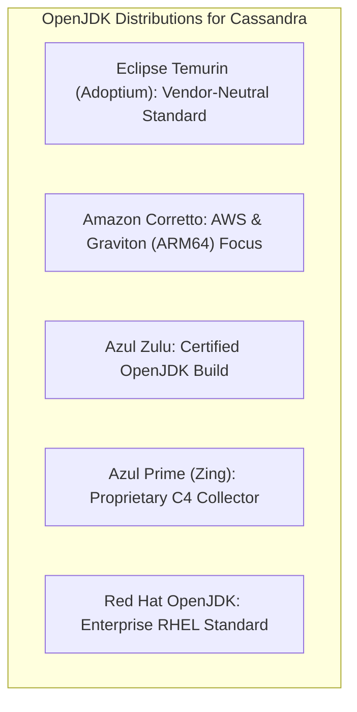

# Java & OpenJDK Flavors: Performance, Trade-offs & Garbage Collection

Apache Cassandra 5.0 supports **Java 11** and **Java 17**. Java 17 has been fully supported since **5.0.5**; earlier 5.0.x releases treated it as experimental. **Java 21 is not supported** in Cassandra 5.0.

Choosing the right JDK distribution and garbage collector directly impacts cluster throughput, p99 tail latency, and CPU efficiency.

---

## 1. Supported Java Versions for Cassandra 5.0

| Java Version | Support Status | Notes |
| :--- | :--- | :--- |
| **Java 11 (LTS)** | Supported | The default build JDK for 5.0 (`java.default=11` in `build.xml`). JVM options come from `conf/jvm11-server.options`. |
| **Java 17 (LTS)** | Supported (fully since 5.0.5; experimental in 5.0.0–5.0.4) | JVM options come from `conf/jvm17-server.options`. A good choice for new 5.0 deployments on 5.0.5 or later. |
| **Java 21 (LTS)** | Not supported | Not in `java.supported=11,17`. The startup script does not block it (it treats any version above 11 as 17 and loads `jvm17-server.options`), but it is untested. Do not use it in production. |

`bin/cassandra` uses whichever `java` it finds via `JAVA_HOME` or `PATH`. It exits with "Cassandra 5.0 requires Java 11 or Java 17." if the version is older than 17 and not 11.

---

## 2. OpenJDK Flavors & Distributions Comparison

Any TCK-certified OpenJDK 11 or 17 build can run Cassandra. The distributions below differ mainly in support model, platform focus, and bundled extras.



### 1. Eclipse Temurin (Adoptium)
* **Profile**: The community standard, vendor-neutral OpenJDK reference build.
* **Best For**: On-premises, generic Linux VMs, Docker/Kubernetes container images.
* **Pros**: Widely used, predictable HotSpot behavior.
* **Cons**: No cloud-specific extras.

---

### 2. Amazon Corretto
* **Profile**: Amazon's multiplatform, production-grade OpenJDK build.
* **Best For**: Deployments on **AWS EC2** (x86_64 and **AWS Graviton / ARM64**), especially if you want Amazon's support channel.
* **Crypto note**: You do not need Corretto to get the **Amazon Corretto Crypto Provider (ACCP)**. Cassandra 5.0 bundles ACCP and installs it by default at node startup on x86_64 and aarch64, whatever the JDK. This is configured in the `crypto_provider` section of `cassandra.yaml` (`DefaultCryptoProvider`, `fail_on_missing_provider: "false"`).

---

### 3. Azul Zulu vs. Azul Prime (Zing)
* **Azul Zulu**:
  * Open-source, certified TCK-compliant OpenJDK build with commercial support options.
  * Available for x86 and ARM64.
* **Azul Prime (Zing) [Commercial]**:
  * Replaces HotSpot's JIT with the **Falcon JIT Compiler** (LLVM-based) and uses the **C4 (Continuously Concurrent Compacting Collector)**, which is designed for very low pause times on large heaps.
  * **Trade-off**: Requires a commercial license and is not part of the Apache Cassandra test matrix. The shipped `jvm*-server.options` files are tuned for HotSpot G1, so validate any Prime-specific flags yourself.

---

### 4. Red Hat OpenJDK
* **Profile**: OpenJDK build distributed with RHEL, CentOS Stream, and Rocky Linux.
* **Best For**: Enterprise bare-metal RHEL environments and OpenShift deployments.
* **Key Feature**: Integrates with RHEL's FIPS-validated crypto configuration, and includes the Shenandoah GC. Cassandra does not ship Shenandoah settings (see below).

---

## 3. Garbage Collector Deep Dive: G1GC vs. ZGC vs. Shenandoah

GC pauses are a common source of Cassandra tail latency, alongside compaction and disk I/O contention and network effects.

### Garbage Collector Comparison

| Collector | Shipped in 5.0 options files? | Pause behavior | Notes |
| :--- | :--- | :--- | :--- |
| **G1GC** | **Yes — the default in both `jvm11-server.options` and `jvm17-server.options`** | Pause target set by `MaxGCPauseMillis` (shipped: 300 ms) | The tested, recommended collector. Works best with heaps of about 31 GB or less. |
| **CMS** | Commented out in `jvm11-server.options` only | Short pauses but prone to fragmentation | Removed from the JDK in Java 14, so it is only usable on Java 11. Legacy. |
| **ZGC** (single-generation on Java 17) | No | Very short pauses | Uses more CPU and memory than G1. Not part of the shipped configuration. Validate it yourself. |
| **Shenandoah** | No | Short pauses | Availability depends on the JDK build. Not part of the shipped configuration. |

---

### Sizing Strategy 1: G1GC (Best for Heaps $\le 31\text{ GB}$)
Cassandra 5.0's [`conf/jvm17-server.options`](https://github.com/apache/cassandra/blob/cassandra-5.0/conf/jvm17-server.options) and [`conf/jvm11-server.options`](https://github.com/apache/cassandra/blob/cassandra-5.0/conf/jvm11-server.options) are pre-tuned for G1GC.
* **Why it shines**: With heaps up to about 31 GB, the JVM keeps **Compressed OOPs** (32-bit object pointers), which saves heap space.
* **Heap auto-sizing**: If you don't set a heap size, `conf/cassandra-env.sh` sets it to **min(½ of RAM, 31 GiB)** (`heap_limit="31744"` MiB) with G1, and `-XX:MaxDirectMemorySize` to **half the heap** (¼ of RAM, capped at about 15.5 GiB) unless you set it yourself. To override, set `-Xms`/`-Xmx` (always as a pair, same value) in `conf/jvm-server.options`, or `MAX_HEAP_SIZE` in `conf/cassandra-env.sh`.
* **Shipped G1 flags** (from `jvm17-server.options`):
  ```bash
  -XX:+UseG1GC
  -XX:+ParallelRefProcEnabled
  -XX:MaxTenuringThreshold=2
  -XX:G1HeapRegionSize=16m
  -XX:+UnlockExperimentalVMOptions
  -XX:G1NewSizePercent=50
  -XX:G1RSetUpdatingPauseTimePercent=5
  -XX:MaxGCPauseMillis=300
  -XX:InitiatingHeapOccupancyPercent=70
  ```

---

### Sizing Strategy 2: Trying a Non-Default Collector (ZGC on Java 17)
The shipped options files enable G1. If you want to evaluate ZGC on Java 17:
* **Replace G1, don't add to it**: Comment out the entire G1 block (`-XX:+UseG1GC` through `-XX:InitiatingHeapOccupancyPercent=70`) in `jvm17-server.options`. If both `-XX:+UseG1GC` and `-XX:+UseZGC` are present, the JVM refuses to start ("Conflicting collector combinations").
* **Do not add `-XX:+ZGenerational`**: That flag exists only on JDK 21+. On Java 17 the JVM aborts with "Unrecognized VM option".
* ```bash
  # jvm17-server.options, after commenting out the G1 settings
  -XX:+UseZGC
  ```
* This is not a shipped or tested configuration. Benchmark it against G1 under your own workload before you use it in production.

---

## 4. Hardware Architecture: x86_64 vs. ARM64 (Graviton / Ampere)

Cassandra 5.0 runs on 64-bit ARM (aarch64) hosts, such as AWS Graviton, GCP Tau T2A/Axion, and Azure Ampere Altra-based VMs, as well as on x86_64.

### Considerations:
* **Price-to-Performance**: ARM64 instances are often cheaper per vCPU. Benchmark your own workload (for example with `cassandra-stress` or NoSQLBench) before you commit.
* **Crypto**: The bundled Amazon Corretto Crypto Provider supports both x86_64 and aarch64.
* **JDK**: Use a supported Java 11 or 17 build for aarch64 from any of the distributions above.
