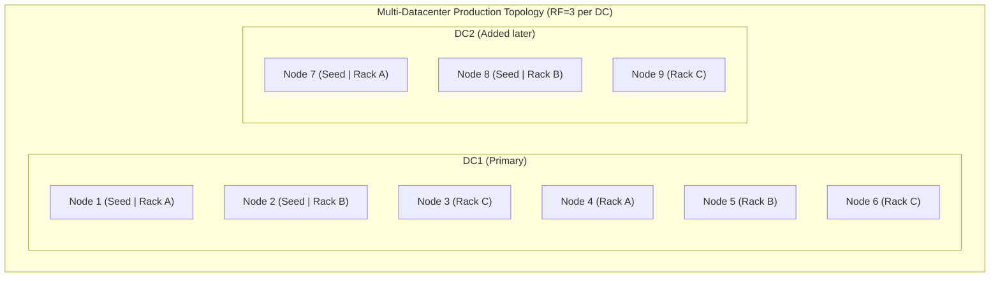
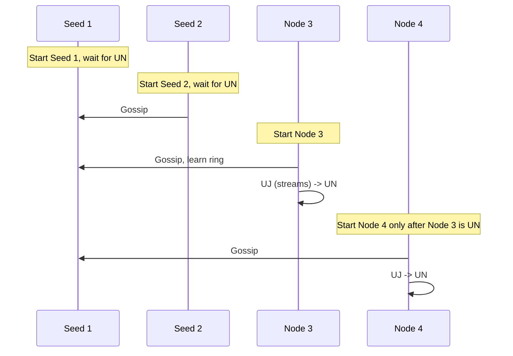

# Production Cluster Deployment Runbook

> [!CAUTION]
> Commands on this page can change or delete data and affect running clusters. Try them on a test or staging cluster first, and read the [disclaimer](../README.md#disclaimer). The guide is provided "as is", without warranty.

This runbook covers provisioning, configuring, bootstrapping and validating a multi-node, multi-datacenter Apache Cassandra 5.0 cluster from scratch, and then adding a datacenter to a live cluster.

---

## 1. Pre-Flight Planning

Decide these before touching a server. Several **cannot be changed later** without rebuilding nodes.

Work out the node count and machine type first: see [capacity planning](05_capacity_planning.md).

| Decision | Notes |
| :--- | :--- |
| `cluster_name` | Must match on every node. |
| Datacenter and rack names | Come from the snitch. A node refuses to start if its DC or rack changes after it has joined, so pick the snitch (and for EC2 the `ec2_naming_scheme`) once. |
| Replication factor per DC | Usually 3. Set `allocate_tokens_for_local_replication_factor` to match **before** first start. |
| `num_tokens` | 16 (the default). Must be the same on all nodes of a DC to use the token allocator well. |
| Racks | Use as many racks as the RF (e.g. 3 AZs for RF=3), with the same number of nodes in each. Uneven racks give uneven load. |
| Config template | `cassandra.yaml` (upgrade-compatible) or `cassandra_latest.yaml` (5.0 features). See [01_configuration_and_tuning.md](01_configuration_and_tuning.md). |



### Seed nodes
1. **2–3 seeds per datacenter**, spread across racks. Seeds are only used for gossip discovery; they are not special otherwise.
2. **Same `seeds:` list on every node** in every DC.
3. **Seeds do not bootstrap.** A node that finds its own address in the seed list skips streaming when it joins. That's fine for the very first nodes of a new cluster, but never add a *new* node to an existing cluster as a seed. Add it as a non-seed, let it bootstrap, and only then add it to the seed list (a rolling config change).
4. **Never make every node a seed.**

### Choosing a snitch

| Environment | Snitch | Notes |
| :--- | :--- | :--- |
| Any (on-prem, VMs, Kubernetes, single- or multi-cloud) | **`GossipingPropertyFileSnitch`** | DC/rack read from `conf/cassandra-rackdc.properties` (`dc=`, `rack=`). The most portable choice. |
| AWS, single region (private IPs) | `Ec2Snitch` | DC = region, rack = AZ. Private IPs only. |
| AWS, multiple regions over **public IPs** | `Ec2MultiRegionSnitch` | Sets `broadcast_address` to the instance's public IP; seeds must be public IPs. Not for VPC-peered/Transit Gateway setups (use `GossipingPropertyFileSnitch` or `Ec2Snitch` there). See [AWS guide](../04_infrastructure_and_cloud/02_aws_deployment_guide.md). |
| GCP | `GoogleCloudSnitch` | See [GCP guide](../04_infrastructure_and_cloud/03_gcp_deployment_guide.md). |
| Azure | `AzureSnitch` | See [Azure guide](../04_infrastructure_and_cloud/04_azure_deployment_guide.md). |

`SimpleSnitch` (the shipped default) ignores DCs and racks. Don't use it in production.

---

## 2. Choosing an Install Method

| Method | Config dir | Data / commit log default | Logs | Service |
| :--- | :--- | :--- | :--- | :--- |
| **Tarball** (`apache-cassandra-5.0.x-bin.tar.gz`) | `$CASSANDRA_HOME/conf` | `$CASSANDRA_HOME/data/...` | `$CASSANDRA_HOME/logs` | None. Run `bin/cassandra`, or write your own systemd unit. |
| **Debian package** | `/etc/cassandra` | `/var/lib/cassandra/...` | `/var/log/cassandra` | SysV init script (`/etc/init.d/cassandra`, from `debian/init`); systemd runs it via its SysV compatibility layer. Installs sysctl and limits files. |
| **RPM package** | `/etc/cassandra/conf` (an `alternatives` link to `/etc/cassandra/default.conf`) | `/var/lib/cassandra/...` | `/var/log/cassandra` | SysV init script (`/etc/rc.d/init.d/cassandra`). Installs a limits file. |
| **Built from source** ([apache/cassandra](https://github.com/apache/cassandra), branch `cassandra-5.0`) | `conf/` | `data/` | `logs/` | None. Build with `ant jar` (requires JDK 11 or 17; plain `ant` runs the default `check` target). `ant artifacts` builds the release tarballs under `build/`. See [TESTING.md](https://github.com/apache/cassandra/blob/cassandra-5.0/TESTING.md) and [CONTRIBUTING.md](https://github.com/apache/cassandra/blob/cassandra-5.0/CONTRIBUTING.md). Not for production unless you produce release artifacts. |

The commands below assume a package install managed with `systemctl` and data under `/mnt/cassandra`. Adjust paths for your method. **Don't let a package start Cassandra with the default config** before you configure it: the deb package starts the service on install. If it does, stop it and delete `/var/lib/cassandra/*` before the first real start, or the node will have the wrong cluster name and tokens.

---

## 3. Host Preparation

On every node:

```bash
# 1. Install a supported JDK: Java 11 or Java 17 (not 21)
sudo apt-get update && sudo apt-get install -y openjdk-17-jre-headless

# 2. Directories (the package creates the 'cassandra' user; for tarball installs create it yourself)
id cassandra || sudo useradd -r -m -d /var/lib/cassandra -s /usr/sbin/nologin cassandra
sudo mkdir -p /mnt/cassandra/{data,commitlog,saved_caches,hints}
sudo chown -R cassandra:cassandra /mnt/cassandra

# 3. Kernel, limits, THP, swap: see 01_configuration_and_tuning.md, section 4
```

Keep clocks in sync (chrony/NTP) on every node and client. Cassandra resolves conflicts by write timestamp, so clock skew silently loses writes.

---

## 4. Node Configuration

Per node, edit `cassandra.yaml` (location depends on install method):

```yaml
cluster_name: 'ProductionCluster'
num_tokens: 16
allocate_tokens_for_local_replication_factor: 3

listen_address: 10.0.1.10          # this node's private IP
rpc_address: 0.0.0.0
broadcast_rpc_address: 10.0.1.10   # required when rpc_address is 0.0.0.0

seed_provider:
  - class_name: org.apache.cassandra.locator.SimpleSeedProvider
    parameters:
      - seeds: "10.0.1.10,10.0.1.11,10.0.2.10,10.0.2.11"

data_file_directories:
  - /mnt/cassandra/data
commitlog_directory: /mnt/cassandra/commitlog
saved_caches_directory: /mnt/cassandra/saved_caches
hints_directory: /mnt/cassandra/hints

endpoint_snitch: GossipingPropertyFileSnitch
```

And `cassandra-rackdc.properties`:

```ini
dc=dc1
rack=rack-a
# prefer_local=true   # use listen_address for intra-DC traffic when broadcast_address differs
```

### How `allocate_tokens_for_local_replication_factor` works
With 16 vnodes, randomly chosen tokens give poor balance. With this set (default `3`), each **joining** node chooses its tokens to even out the load for that replication factor in its DC, based on the tokens already in the ring. Consequences:

* The value should equal the keyspaces' RF in that DC.
* It only helps if nodes join **one at a time**, so each sees the previous nodes' tokens. That's the main reason for sequential bootstrap below.
* It only works with `Murmur3Partitioner` (the default).

---

## 5. Bootstrap Sequence

> [!CAUTION]
> **Start nodes one at a time.** Concurrent joins break token allocation (above) and can produce overlapping range movements. By default a node refuses to bootstrap while another node is joining (`cassandra.consistent.rangemovement=true`).



1. **Start the first seed** of DC1: `sudo systemctl start cassandra`. Wait until `nodetool status` shows it as `UN`.
2. **Start the other seeds** one at a time, waiting for `UN` each time.
3. **Start each non-seed** one at a time. Watch `system.log` (`/var/log/cassandra/system.log` for packages, `$CASSANDRA_HOME/logs/system.log` for tarballs). A bootstrapping node logs:
   * `Bootstrap completed for tokens [...]` when streaming finishes,
   * `Starting listening for CQL clients on ...` when the native transport is up,
   * `Startup complete` at the end.

   Wait for `UN` in `nodetool status` before starting the next node. There's no need for an extra fixed wait.

On a brand-new empty cluster there is no data to stream, so each join is quick.

---

## 6. Adding a Datacenter to a Live Cluster

1. **Make sure clients won't use the new DC yet.** Drivers must use a DC-aware policy with `local-datacenter` set to the existing DC, and the application must use `LOCAL_*` consistency levels. Otherwise clients may read from empty nodes.
2. **Configure the new nodes** with:
   * the same `cluster_name`, and the same snitch, seed list and `num_tokens`,
   * the new DC name in `cassandra-rackdc.properties`,
   * **`auto_bootstrap: false`** in `cassandra.yaml` (not present in the shipped file; add it). Without it, each new node tries to bootstrap data that has no replicas in its DC yet.
3. **Start the new nodes one at a time** (seeds first). They join with tokens but **no data**.
4. **Extend replication**, for user keyspaces **and** the system keyspaces that use `NetworkTopologyStrategy`:
   ```sql
   ALTER KEYSPACE production_keyspace WITH replication =
     {'class': 'NetworkTopologyStrategy', 'dc1': 3, 'dc2': 3};
   ALTER KEYSPACE system_auth WITH replication =
     {'class': 'NetworkTopologyStrategy', 'dc1': 3, 'dc2': 3};
   ALTER KEYSPACE system_distributed WITH replication =
     {'class': 'NetworkTopologyStrategy', 'dc1': 3, 'dc2': 3};
   ALTER KEYSPACE system_traces WITH replication =
     {'class': 'NetworkTopologyStrategy', 'dc1': 2, 'dc2': 2};
   ```
   (`system_auth`, `system_distributed` and `system_traces` are created with `SimpleStrategy`, and `system_auth` with RF 1 by default. Switch them to `NetworkTopologyStrategy` in DC1 before go-live, and run `nodetool repair --full system_auth` after any RF change; see the security guide.)
5. **Stream existing data** on each new-DC node, one node at a time:
   ```bash
   nodetool rebuild -- dc1
   ```
   `rebuild` streams from the named source DC. It adds load on the source DC, so throttle it with `nodetool setstreamthroughput -m <MiB/s>` if needed (without `-m` the value is in megabits/s). If a rebuild fails, re-run it on that node.
6. **Remove `auto_bootstrap: false`** from the new nodes' config so future replacements bootstrap normally.
7. Point the new DC's clients at it, then run a full repair to confirm consistency.

To **remove** a DC, reverse the order: move clients away, `ALTER KEYSPACE` to drop the DC from every keyspace, then `nodetool decommission` each node in it.

---

## 7. Post-Deployment Verification

```bash
# All nodes UN, ownership roughly even (use a keyspace name to see effective ownership)
nodetool status production_keyspace

# One schema version across the cluster
nodetool describecluster

# CQL connectivity. The shipped AllowAllAuthenticator needs no credentials:
cqlsh 10.0.1.10 -e "DESCRIBE KEYSPACES;"
# After enabling PasswordAuthenticator (see the security guide), log in with a real role:
# cqlsh -u <admin_role> 10.0.1.10

# No pending or dropped messages
nodetool tpstats
```

### Before go-live
* [ ] Authentication, authorization and TLS enabled, and the default `cassandra` superuser replaced: [03_security_hardening.md](03_security_hardening.md).
* [ ] `system_auth`, `system_distributed`, `system_traces` use `NetworkTopologyStrategy` with an appropriate RF in every DC.
* [ ] Repair scheduled to complete within `gc_grace_seconds` (see [housekeeping](../06_operations_and_housekeeping/02_housekeeping_and_automations.md)).
* [ ] Backups configured and **a restore tested** (see [disaster recovery](../07_disaster_recovery/01_backup_and_disaster_recovery.md)).
* [ ] Metrics, logs and disk-space alerting in place.
