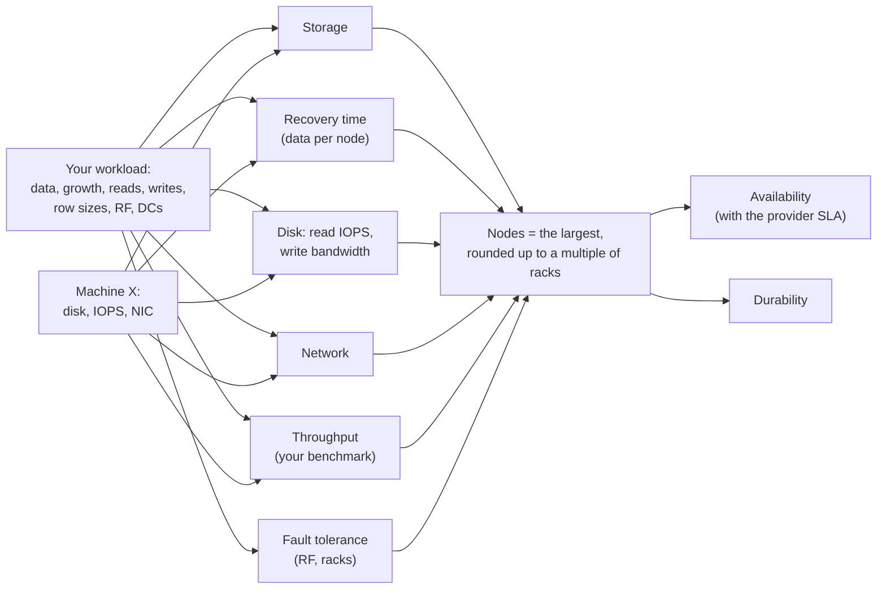

# Capacity Planning: How Many Nodes, of Which Machine

> [!CAUTION]
> Commands on this page can change or delete data and affect running clusters. Try them on a test or staging cluster first, and read the [disclaimer](../README.md#disclaimer). The guide is provided "as is", without warranty.

This page answers "if we use machine X, how many nodes do we need, what availability and durability do we get, and roughly what does it cost?" The node count is the largest of six separate requirements: storage, recovery time, disk, network, throughput and fault tolerance. Each one has a short formula. Then the cloud provider's uptime SLA goes into the availability math, and the provider's list price gives a rough monthly cost.

[`tools/capacity_plan.py`](../tools/capacity_plan.py) does the arithmetic (Python 3, standard library only).

Where the numbers come from:

* **Cassandra's own limits and defaults:** the 5.0 source (streaming and compaction throttles, commit log space, request size limits).
* **Machine specs, SLAs and list prices:** each provider's own published pages and price lists, checked on 2026-11-22. They are listed in [section 11](#11-machine-profiles-and-their-sources).
* **Throughput per node:** only your own benchmark. No document can tell you how many operations per second your data model gets on a given machine.

The examples in section 12 are run by [`test_env` scenario 14](../test_env/README.md), and their output is compared with this page.

> [!NOTE]
> Everything here is a planning estimate. The workload numbers in the examples are **illustrative**. Use the method and the calculator with your own measurements, then check the plan against the running cluster ([section 13](#13-after-launch-check-the-plan)).

---

## 1. The method



| Requirement | Nodes needed per datacenter | Section |
| :--- | :--- | :--- |
| Storage | on-disk data per DC ÷ usable disk per node | [3](#3-storage) |
| Recovery time | on-disk data per DC ÷ (rebuild hours × streaming rate) | [4](#4-recovery-time-limits-data-per-node) |
| Read IOPS | disk reads per second ÷ the IOPS you plan to use per node | [5](#5-disk-read-iops-and-write-bandwidth) |
| Network | bytes per second on the wire ÷ the bandwidth you plan to use per node | [6](#6-network) |
| Throughput | operations per second ÷ operations per node from your benchmark | [8](#8-memory-and-cpu) |
| Fault tolerance | at least RF, and at least one node per rack | [9](#9-availability-with-the-providers-sla) |

Round the largest up to a multiple of the rack count, so each rack (zone) holds the same number of nodes and the same share of data.

---

## 2. Gather the inputs

| Input | Where to get it |
| :--- | :--- |
| Data today (one copy, uncompressed) and growth per year | Your current system, or rows × average row size |
| Compression ratio | `nodetool tablestats`, "SSTable Compression Ratio" (on-disk ÷ raw), after loading a realistic sample. Text often compresses to 0.3–0.6; already-compressed blobs barely compress (illustrative). |
| Reads and writes per second at peak, per datacenter | Your application's metrics, or a load model |
| Average write size and read result size | Row size × rows per request |
| Consistency level for reads | Usually `LOCAL_QUORUM` ([consistency](../03_application_development/04_consistency_and_transactions.md)) |
| RF, datacenters, racks | Usually RF 3 in each DC, with 3 racks mapped to 3 zones ([deployment runbook](02_cluster_deployment_runbook.md#1-pre-flight-planning)) |
| Compaction strategy | [Compaction strategies](../06_operations_and_housekeeping/04_compaction_strategies.md) |
| Longest acceptable time to rebuild one node | Your recovery-time objective |
| Operations per second per node | Your benchmark on the candidate machine ([section 8](#8-memory-and-cpu)) |

---

## 3. Storage

```text
on-disk data per DC  = data × (1 + growth)^years × compression ratio × RF
usable per node      = disk × max fill (by strategy) − commit log space
nodes for storage    = on-disk data per DC ÷ usable per node
```

* **Max fill** leaves room for compaction, which writes new SSTables before it deletes the old ones. Keep about **50% free with STCS**, and 20–30% free with LCS, UCS and TWCS ([disk headroom](../06_operations_and_housekeeping/04_compaction_strategies.md#6-disk-headroom)). The calculator fills to 50% and 70%.
* **Commit log:** `commitlog_total_space` defaults to the smaller of 8192 MiB and ¼ of the commit log volume. The calculator reserves it on the data disk, since local-NVMe machines usually have one volume.
* **Snapshots** share the same headroom. Give them an expiry ([housekeeping](../06_operations_and_housekeeping/02_housekeeping_and_automations.md#3-snapshot-retention--offsite-backups)).
* **Each datacenter holds a full copy** at its own RF. Two DCs with RF 3 store six copies.
* **Indexes add to it.** SAI indexes are stored next to each SSTable. A few non-vector indexes add a few percent; a vector index can be larger than the vectors themselves. Pass the overhead as `--index-overhead` ([measured figures](#sai-and-vector-indexes)).

---

## 4. Recovery time limits data per node

When a node dies, its replacement streams the node's data from the other replicas. Cassandra 5.0 throttles streaming by default, so the **time to rebuild a node grows with the data it holds**:

| Setting (5.0 default) | Value | What it limits |
| :--- | :--- | :--- |
| `stream_throughput_outbound` | 24 MiB/s | What each node sends to a node that is streaming |
| `entire_sstable_stream_throughput_outbound` | 24 MiB/s | The same, for whole-SSTable (zero-copy) streaming, which `stream_entire_sstables: true` enables by default |
| `inter_dc_stream_throughput_outbound` | 24 MiB/s | Streaming between datacenters |

```text
rebuild hours          ≈ data per node ÷ streaming rate ÷ 3600
max data per node      = rebuild-hours target × 3600 × streaming rate
nodes for recovery     = on-disk data per DC ÷ max data per node
```

At 24 MiB/s, one TB takes about 11 hours. A replacement can pull from several nodes at once and go faster, but plan on the throttle unless you have measured otherwise. During a rebuild you can raise it on every node with `nodetool setstreamthroughput -m <MiB/s>` and `nodetool setstreamthroughput -e <MiB/s>` (entire-SSTable streaming), up to what the disks and network allow.

> [!WARNING]
> Without `-m`, `setstreamthroughput` takes **megabits** per second: `nodetool setstreamthroughput 100` sets about 12 MiB/s, half the default. Check with `nodetool getstreamthroughput -m`. Plan with the rate you will actually use.

> [!IMPORTANT]
> This is why **bigger disks don't reduce the node count** until you also raise the streaming rate: the cluster can only hold as much data per node as it can rebuild in time. Section 12 shows it. The same applies to repair, which must cover every node within `gc_grace_seconds` (10 days by default) ([why](../06_operations_and_housekeeping/02_housekeeping_and_automations.md#why-repair-has-a-deadline)).

---

## 5. Disk: read IOPS and write bandwidth

**Writes are sequential.** Each write is appended to the commit log, flushed once as an SSTable, then rewritten by compaction. They use disk *bandwidth*, not random IOPS:

```text
writes in per node    = writes/s × write size × RF ÷ nodes
compaction per node   = writes in per node × compression ratio × write amplification
```

Write amplification is how many times compaction rewrites each flushed byte. It depends on the strategy and the data. The calculator starts from 5 for STCS and UCS, 15 for LCS and 2 for TWCS (illustrative; measure yours with `nodetool compactionhistory`). Compare the result with **`compaction_throughput`, 64 MiB/s by default**: if compaction needs more than about half of it, raise the throttle or add nodes. Otherwise pending compactions build up and reads slow down.

**Reads are random.** Each read at `LOCAL_QUORUM` with RF 3 is served by 2 replicas, which each read every SSTable that might hold the partition:

```text
disk reads/s  = reads/s × replicas read (2 for LOCAL_QUORUM at RF 3, 1 for LOCAL_ONE)
                × SSTables per read × 2 (index + data) × (1 − page-cache hit rate)
nodes for IOPS = disk reads/s ÷ (published read IOPS × share you plan to use)
```

* **SSTables per read** comes from `nodetool tablehistograms <ks> <table>`, the "SSTables" column. With LCS or UCS it's usually 1–2; with STCS on an update-heavy table it can be much higher.
* **Plan on at most half the published IOPS** (the calculator's default). Providers publish maximums for 4 KiB reads at deep queue depths. Cassandra reads a whole compression chunk (16 KiB by default) per data read.
* **Network storage** (AWS EBS, Google Hyperdisk, Azure managed disks) has a per-volume limit you provision and a per-VM limit you can't exceed. Use the lower one. Per-VM limits are tens of thousands of IOPS, against hundreds of thousands for local NVMe, so read IOPS often decides the node count on network storage ([section 11](#11-machine-profiles-and-their-sources)).
* On network storage, the commit log, flushes, compaction and streaming share one throughput limit with reads. The calculator adds them up and warns above half of it.

---

### SAI and vector indexes

SAI indexes are SSTable components: each one is written at flush and **rebuilt by every compaction** that rewrites the SSTable. They add disk, compaction work and build time. Measured on the quickstart node (5.0.9, one node, 9 CPUs, 1 GiB heap) with 200,000 rows of a text column (50 values), an int column, a set of 3 text tags, and a 64-dimension float vector; **illustrative**:

| | On disk | Time to build the index | Time to rewrite the table (`upgradesstables -a`) |
| :--- | :--- | :--- | :--- |
| Table alone | 62.1 MB | | 2 s |
| SAI on the text, int and set columns | +2.2 MB, plus 2.5 MB shared by all indexes on the SSTable (about 7% in total) | 2–3 s each | 3 s |
| SAI vector index (COSINE) on the 64-dimension vector | +89.7 MB, **1.75 ×** the 51.2 MB of raw vector data | 243 s | **251 s** |

What it means for sizing:

* **Non-vector indexes** cost little: plan a few percent of disk per index (`--index-overhead 0.05` for a handful), and a little more compaction.
* **Vector indexes dominate everything else.** Rewriting the same SSTables took about 100 times longer with the vector index, because compaction rebuilds the vector graph. Measure how many vectors per second one compaction rebuilds on your machine, and check that the vectors you write per node, times the write amplification, stay well below that. Otherwise pending compactions grow, which is the usual way vector workloads fall behind. Disk grows by more than the vectors' own size.
* **Memory:** `sai_options.segment_write_buffer_size` (1024 MiB by default) is, in the words of `cassandra.yaml`, the "total permitted memory allowed for writing SAI index segments", split between all indexes being built at once.
* Vector search is **experimental** in 5.0 (Cassandra prints a warning when you create the index; see [indexing](../02_data_modeling_and_indexing/02_indexing_and_vector_search.md)).

Measure your own indexes after loading a realistic sample. `system_views.sai_sstable_indexes` reports each index's size per SSTable (`per_column_disk_size`), plus the components shared by all indexes on that SSTable (`per_table_disk_size`):

<!-- test: run:capacity-sai-size -->
```sql
SELECT index_name, sstable_name, per_column_disk_size, per_table_disk_size
FROM system_views.sai_sstable_indexes WHERE keyspace_name = 'examples';
```

Compare the sum with `nodetool tablestats` "Space used (live)" for the table, which includes the index files.

---

## 6. Network

```text
bytes/s per DC ≈ writes/s × write size × (RF + remote DCs)     coordinator to replicas, and to each other DC
               + reads/s  × read size  × 2                      replica to coordinator, coordinator to client
nodes for network = bytes/s × 8 ÷ (baseline Gbps per node × share you plan to use)
```

* Use the **baseline** bandwidth, not the "up to" figure. On AWS, for example, an `i4i.2xlarge` has a 4.687 Gbps baseline and bursts to 12 Gbps only while network credits last.
* Plan on about **half** the baseline (the calculator's default). Streaming during a rebuild, repair and hint replay need the rest.
* Traffic between datacenters is charged at inter-region rates: each write crosses to every remote DC once.

### Traffic between zones costs money

With racks mapped to zones, most of a cluster's traffic crosses zones, and providers charge for it. The calculator adds the estimate to its cost block:

```text
bytes crossing zones ≈ writes/s × write size × (RF − 1)               coordinator to the replicas in the other zones
                     + reads/s  × read size  × (replicas read − 1)    the second replica's data at LOCAL_QUORUM
                     + (writes/s × write size + reads/s × read size) × (racks − 1) ÷ racks
                                                                       clients reaching a coordinator in another zone
```

| Provider | Price for traffic between zones | Source |
| :--- | :--- | :--- |
| AWS | $0.01/GB in each direction, so $0.02 per GB that crosses | [EC2 on-demand pricing](https://aws.amazon.com/ec2/pricing/on-demand/), "Data transfer within the same AWS Region" |
| Google Cloud | $0.01/GiB, charged to the sender | [Network pricing](https://cloud.google.com/vpc/network-pricing) |
| Azure | The Retail Prices API lists "Inter-Availability Zone Data Transfer" meters at $0.01/GB in and $0.01/GB out | [Azure Retail Prices API](https://learn.microsoft.com/rest/api/cost-management/retail-prices/azure-retail-prices) |

In the worked example in section 12 this comes to **more than the VMs cost**. To reduce it:

* **`internode_compression`** is `dc` by default in both templates, so traffic between zones in the same datacenter is sent uncompressed. Setting it to `all` compresses it, at some CPU cost. Measure both.
* **Send each request to a coordinator in the client's own zone**, if your driver can prefer the local rack, and run clients in every zone.
* `LOCAL_ONE` reads avoid the second replica's response, at the [consistency cost](../03_application_development/04_consistency_and_transactions.md) that implies.
* Repair, streaming, hint replay and backups to object storage add traffic the estimate doesn't include.

---

## 7. Request and row size limits

Large requests hurt latency and garbage collection long before they hit a limit. These are the 5.0 limits and warnings:

| Limit (5.0 default) | Value | Effect |
| :--- | :--- | :--- |
| Largest mutation | ½ of `commitlog_segment_size` (32 MiB), so **16 MiB**, unless `max_mutation_size` is set | Larger writes are rejected: "Rejected an oversized mutation" ([troubleshooting](../06_operations_and_housekeeping/05_troubleshooting_playbook.md#12-commitlog-or-hints-filling-the-disk)) |
| `batch_size_warn_threshold` / `batch_size_fail_threshold` | 5 KiB / 50 KiB | A logged warning, then a rejected batch |
| `native_transport_max_frame_size` | 16 MiB | The largest request or response frame on the client protocol |
| `max_value_size` | 256 MiB | The largest single value Cassandra will read back |
| Partition size | Rule of thumb: under about 100 MB and 100,000 rows | Larger partitions make reads, repair and compaction slow ([anti-patterns](../01_architecture_and_mental_model/02_anti_patterns.md)) |
| Result page | Driver page size (5,000 rows in the Java driver) × row size | The memory each page costs the coordinator and the client |

For sizing, keep typical rows in the KiB range, and partitions well under the rule of thumb. The partition-size formulas in the official [data modeling guide](https://cassandra.apache.org/doc/5.0/cassandra/developing/data-modeling/data-modeling_refining.html) estimate a partition's cells and bytes from its columns.

---

## 8. Memory and CPU

* **Memory:** the heap is sized by `cassandra-env.sh` (at most 31 GiB with G1), and everything else on the machine is page cache, which serves most hot reads. See [heap sizing](01_configuration_and_tuning.md#heap-auto-sizing-cassandra-envsh). For read-heavy workloads, more RAM per node raises the page-cache hit rate and cuts disk reads (the `--cache-hit` input).
* **CPU and throughput** can only be measured. Run [`cassandra-stress`](../09_reference/03_tools_reference.md#6-cassandra-stress-load-generation) with your own table definition (a stress profile) on a small **staging** cluster of the candidate machine, using your RF and consistency level. Increase the load until the p99 latency passes your target. The highest rate below the target, divided by the node count, is `--ops-per-node`.
* Benchmark with a realistic amount of data per node, not an empty table: compaction and cache misses only show up once data is larger than memory.

### A starter stress profile

[`tools/stress/starter_profile.yaml`](../tools/stress/starter_profile.yaml) is a commented `cassandra-stress` user profile: a time-ordered table with one partition per account, writes of one row, and the two reads most applications do (latest rows, and one row by key). Copy it, then replace the table with yours and set:

* `population` for the partition key: how many distinct partitions you have.
* `cluster` for the first clustering column: rows per partition.
* `size` for each column: your real value sizes, so the bytes per row match.
* the replication in `keyspace_definition`: your datacenter names and RF.

Check that the profile runs, on the quickstart node:

<!-- test: sh:capacity-stress-profile -->
```bash
docker cp tools/stress/starter_profile.yaml cass-quickstart:/tmp/starter_profile.yaml
docker exec cass-quickstart /opt/cassandra/tools/bin/cassandra-stress user profile=/tmp/starter_profile.yaml \
  'ops(insert=1,latest=2,one_row=1)' n=2000 cl=ONE -rate threads=4 2>stress-errors.log \
  | grep -E '^(Total errors|END)'
```
```text
Total errors              :          0 [insert: 0, latest: 0, one_row: 0]
END
```

`stress-errors.log` may hold two harmless messages, seen on 5.0.9:

* `Could not parse type name vector<float, 64>`, with a Java stack trace, if **any** keyspace on the cluster has a table with a `vector` column (here, the [querying examples](../03_application_development/05_querying_with_cql.md#1-set-up-the-sample-data)). `cassandra-stress` uses an older driver that can't read vector types in the schema. It doesn't affect a profile without vector columns. A profile **with** one fails: `cassandra-stress` creates the table, then stops with `Unable to find table <keyspace>.<table>`. Benchmark vector tables with your own client instead.
* A server warning that `USE <keyspace>` with prepared statements is an anti-pattern. `cassandra-stress` does that itself.

Then benchmark on staging, from a separate load-generator machine, at a fixed rate, and step the rate up between runs until p99 passes your target. Replace `<staging_hosts>` with a comma-separated list of staging node addresses and `<rate>` with operations per second:

```bash
cassandra-stress user profile=starter_profile.yaml 'ops(insert=1,latest=2,one_row=1)' \
  duration=30m cl=LOCAL_QUORUM -node <staging_hosts> -rate threads=200 fixed=<rate>/s \
  -log file=stress_<rate>.log
```

Load enough data first that each node holds a realistic amount (`n=<rows>` with the insert operation only), so cache misses and compaction show up. A fixed rate (`fixed=`) measures latency at the load you expect. Without it, stress runs as fast as it can, which measures peak throughput with queueing latency mixed in.

---

## 9. Availability with the provider's SLA

### What the providers commit to

| Provider | One VM | VMs across two or more zones | Source |
| :--- | :--- | :--- | :--- |
| AWS EC2 | 99.5% (Instance-Level SLA) | 99.99% (Region-Level SLA: instances in two or more Availability Zones) | [Amazon Compute SLA](https://aws.amazon.com/compute/sla/), last updated May 25, 2022 |
| Google Compute Engine | 99.9% for most machine families; 99.95% for memory-optimized (Premium Tier) | 99.99% for instances in multiple zones (99.95% in Stockholm) | [Compute Engine SLA](https://cloud.google.com/compute/sla), last modified October 14, 2026 |
| Azure Virtual Machines | 99.9% with Premium SSD, Premium SSD v2 or Ultra Disk; 99.5% with Standard SSD; 95% with Standard HDD | 99.99% across two or more Availability Zones; 99.95% in an Availability Set | [Microsoft Online Services SLA](https://www.microsoft.com/licensing/docs/view/Service-Level-Agreements-SLA-for-Online-Services), November 17, 2026 |

An SLA is a promise of service credits, not a measurement: real VMs are usually up far more than this. Using the SLA as each node's availability gives a **pessimistic floor**, which is what a plan needs.

### How Cassandra turns node uptime into cluster uptime

A query at `LOCAL_QUORUM` with RF 3 needs 2 of the 3 replicas of its partition. With racks mapped to zones, the 3 replicas are in 3 different racks. With vnodes (16 tokens per node), almost any two nodes in different racks share some token range. So:

```text
q          = 1 − one-VM SLA  (+ planned maintenance minutes per month ÷ 43,200)
p (a rack has at least one node down) = 1 − (1 − q)^(nodes per rack)
P (some token range below LOCAL_QUORUM) = 3·p²·(1 − p) + p³          (2 or 3 racks impaired at once)
planning availability = (1 − P) × the provider's multi-zone SLA
```

For `LOCAL_ONE`, a range is unavailable only when all 3 racks are impaired at once (p³).

What it means:

* **A whole zone can fail and `LOCAL_QUORUM` keeps working**, because each range still has 2 replicas in the other zones. That's why racks should map to zones, and why the provider's multi-zone SLA (99.99%) is the right ceiling.
* **More nodes don't make a cluster more available.** With more nodes, the chance that two nodes in different racks are down at the same moment goes up, although each such event affects a smaller share of the data. Section 12 shows the figure going down as the node count goes up.
* **Planned maintenance counts.** A rolling restart takes each node down for a few minutes. Pass it as `--maintenance-min`, and restart one node at a time.
* **Failures aren't independent in real life** (a bad deploy, a zone-wide network problem). Treat the result as a floor for independent failures, not a promise.

---

## 10. Durability

Data is lost only if every replica of a range loses its data before a replacement has re-streamed it. With RF 3 in 3 racks:

```text
T (years)       = rebuild hours ÷ 8,760
P (loss / year) ≈ nodes × f  ×  (2/3 · nodes × f × T)  ×  (1/3 · nodes × f × T)
                  first loss    a second, in another rack  a third, in the last rack
```

`f` is the chance per year that one node loses its data:

* **Local NVMe (instance store):** the data is gone when the VM stops, is terminated or its host fails. Providers don't publish a rate. Use your own fleet's replacement rate; the examples use an illustrative 2% per year.
* **AWS EBS:** gp3 is published at 99.8–99.9% durability (0.1–0.2% annual failure rate), and io2 Block Express at 99.999% (0.001%) ([EBS volume types](https://docs.aws.amazon.com/ebs/latest/userguide/ebs-volume-types.html)). An instance failure doesn't lose an EBS volume.
* **Each extra datacenter** multiplies the probability by itself: both DCs would have to lose the same range.

The result is usually tiny: with RF 3 across 3 zones and fast rebuilds, independent hardware failures almost never lose data. **The real risks are correlated failures and human mistakes**: a bad `TRUNCATE`, a faulty deploy, a deleted cluster. Replication copies those everywhere within milliseconds, and only [backups](../07_disaster_recovery/01_backup_and_disaster_recovery.md) protect against them. A shorter rebuild window lowers the risk directly, which is one more reason to keep data per node moderate.

---

## 11. Machine profiles and their sources

`--list-machines` shows the built-in profiles: for each provider, its current local-NVMe machines and its newest general-purpose machine with network storage. Each value is the provider's published maximum or list price, checked on 2026-11-22. Providers change specs and prices, so check the source before you buy:

<!-- test: sh:capacity-machines -->
```bash
python3 tools/capacity_plan.py --list-machines
```
```text
machine                    storage  vCPU       disk read IOPS NIC Gbps  VM SLA  $/hour
aws-i4i.2xlarge            local       8    1.88 TB   200,000    4.687   99.5%   0.686
aws-i4i.4xlarge            local      16    3.75 TB   400,000    9.375   99.5%   1.373
aws-i4i.8xlarge            local      32    7.50 TB   800,000    18.75   99.5%   2.746
aws-i7i.2xlarge            local       8    1.88 TB   300,000    4.687   99.5%   0.755
aws-i8g.2xlarge            local       8    1.88 TB   300,000    4.688   99.5%   0.686
aws-m8g.2xlarge-gp3        network     8     volume    12,000     3.75   99.5%   0.359
gcp-n2-standard-32-4ssd    local      32    1.61 TB   680,000       32   99.9%   1.718
gcp-z3-highmem-8-highlssd  local       8    3.22 TB   750,000       23   99.9%   1.152
gcp-n4-standard-8-hdb      network     8     volume    30,000       16   99.9%   0.363
azure-L8s_v3               local       8    1.92 TB   400,000     12.5   99.9%   0.696
azure-L16s_v3              local      16    3.84 TB   800,000     12.5   99.9%   1.392
azure-L8s_v4               local       8    1.92 TB   550,000     12.5   99.9%   0.696
azure-D8s_v6-pv2           network     8     volume    16,667     12.5   99.9%   0.403
```

For any other machine, give its figures directly: `--disk 3.84TB --read-iops 800000 --nic-gbps 12.5 --instance-sla 99.9 --zone-sla 99.99 --price-hour 1.39`.

### Local NVMe or network storage

The biggest choice is where the data lives, more than which CPU generation you pick:

| | Local NVMe (i4i/i7i/i8g, Z3, N2 + Local SSD, Lsv3/Lsv4) | Network storage (m8g + gp3, N4 + Hyperdisk Balanced, Dsv6 + Premium SSD v2) |
| :--- | :--- | :--- |
| Read IOPS per node | 200,000 to 750,000 (published maximums) | 12,000 to 30,000 for an 8-vCPU VM: the **per-VM** limit caps it, whatever you provision on the volume |
| Latency | Lowest | Higher: every read crosses the network. Expect a higher p99 for reads that miss the page cache, and benchmark it. |
| A VM fails or is stopped | The data is gone. The replacement streams it from other replicas ([section 4](#4-recovery-time-limits-data-per-node)) | Attach the volume to a new VM and start Cassandra. It catches up from hints and repair, with no full rebuild. |
| Data per node | Fixed by the machine | You choose the volume size and pay per GiB, so headroom costs money |
| Durability inputs ([section 10](#10-durability)) | Your own replacement rate | The volume's published annual failure rate, where the provider publishes one (EBS gp3: 0.1–0.2%) |

**When network storage wins:** most reads come from the page cache (a small hot set, or a write-heavy workload), or you want fast VM replacement without streaming. **When local NVMe wins:** reads miss the cache and hit the disk, which is common in Cassandra once data is much larger than RAM. Section 12 shows both cases.

> [!WARNING]
> On network storage, use the provider's **single-zone** volume (gp3, Hyperdisk Balanced, Premium SSD v2 LRS). Cassandra already keeps a copy in each zone. Zone-replicated volumes, such as Google's Hyperdisk Balanced High Availability (twice the price per GiB of Hyperdisk Balanced) and Azure's ZRS disks, add cost and write latency without protecting anything that RF 3 across zones doesn't already protect.

### Provider notes and caveats

**AWS**
* **i7i** (Intel) and **i8g** (Graviton4) are the newer generation of i4i. On the same 1,875 GB disk they publish 300,000 random-read IOPS against i4i's 200,000, at about the same price (i8g) or 10% more (i7i).
* **Graviton (i8g, m8g) is arm64.** The official `cassandra` images are multi-arch and Cassandra 5.0 runs on Java 17 on arm64; this repository's `test_env` runs on arm64 hosts. Check any agents, sidecars and JNI libraries you add for arm64 builds.
* **m8g + gp3** is the network-storage option. gp3 includes 3,000 IOPS and 125 MB/s, and you pay for more up to 80,000 IOPS and 2,000 MiB/s per volume. An `m8g.2xlarge` can use only 12,000 IOPS and 312.5 MB/s of it as a baseline (it bursts to 40,000 and 1,250 MB/s for 30 minutes at least once every 24 hours), so the profile provisions the baseline.
* Use the **baseline** network figure; burst bandwidth runs out ([section 6](#6-network)).
* AWS's single-instance SLA is 99.5%, lower than Google's and Azure's 99.9%. That lowers the availability floor in this model; it is a credit commitment, not measured reliability.

**Google Cloud**
* **N4 has no Local SSD.** N4, N4A and N4D can use only Hyperdisk (Balanced, Balanced High Availability, Throughput). `gcp-n4-standard-8-hdb` is N4 with Hyperdisk Balanced: 3,000 IOPS and 140 MiB/s included, up to 160,000 IOPS per volume, but an `n4-standard-8` VM is capped at 30,000 IOPS and 480 MiB/s (80,000 and 1,200 MiB/s at 16 vCPUs). N4 is Google's newest general-purpose family and costs less than a third as much per hour as the smallest Z3, so it fits when reads come mostly from cache.
* **Z3** is the storage-optimized family with Titanium SSD. `z3-highmem-8-highlssd` has one 3,000 GiB disk, 750,000 read IOPS and 64 GB of RAM. Its list price includes the SSD. Z4D is the next generation, with 3,500 GiB disks.
* **One Titanium SSD holds more than 24 MiB/s can rebuild in 12 hours.** With the default throttle, recovery time sets the node count, and you pay for disk you can't fill. Raise the streaming rate during rebuilds, or accept a longer recovery target.
* **C4, C4A, C4D and C4N `-lssd` machines aren't profiled.** Google warns that their Local SSDs "might not recover all writes that completed before a power loss event." Cassandra treats a synced commit log as durable, so after a host power loss on these machines, treat the node as suspect: run a full repair of its ranges, or replace it. Z3 and Z4D aren't covered by that warning.
* **N2 + Local SSD** still works but is older. N2 needs at least 24 vCPUs to reach the full Local SSD IOPS, which is why the profile is a 32-vCPU machine. Local SSD on N2 is billed separately; the profile price includes it.
* Google publishes an "up to" egress figure, not a baseline. Plan on half of it, as for the others.

**Azure**
* **Lsv4** is the newer generation of Lsv3: the same price, and for 8 vCPUs four 480 GB NVMe disks with 550,000 read IOPS (Lsv3: 400,000). The NVMe disks are **temporary storage**: Microsoft's Lsv3 page says the data "is lost on stop or deallocation". Treat them like AWS instance store.
* **Dsv6 + Premium SSD v2** is the network-storage option. Premium SSD v2 includes 3,000 IOPS and 125 MB/s, and you pay for more up to 80,000 IOPS per disk, but a `D8s_v6` is capped at 16,667 IOPS and 496 MB/s uncached (bursting higher for short periods).
* The 99.9% single-VM SLA needs Premium SSD, Premium SSD v2 or Ultra Disk for **every** OS and data disk. A Standard SSD OS disk drops it to 99.5%.

### Rough cost

The calculator multiplies the profile's on-demand **list** price by 730 hours a month. For network storage it adds the volume, sized to hold the end-of-plan data at the strategy's max fill plus the commit log, with the IOPS and throughput the VM can use.

| Provider (region) | Machines | Network volume price | Source |
| :--- | :--- | :--- | :--- |
| AWS (us-east-1), Linux on-demand | i4i.2xlarge $0.686/h, i7i.2xlarge $0.755/h, i8g.2xlarge $0.6864/h, m8g.2xlarge $0.35904/h | gp3: $0.08/GB-month; $0.005 per IOPS-month above 3,000; $0.04 per MB/s-month above 125 | [EC2 on-demand pricing](https://aws.amazon.com/ec2/pricing/on-demand/), [EBS pricing](https://aws.amazon.com/ebs/pricing/) |
| Google Cloud (us-central1), on-demand | n2-standard-32 $1.553888/h + Local SSD $0.08/GiB-month; z3-highmem-8-highlssd $1.151931/h with SSD; n4-standard-8 $0.3628/h | Hyperdisk Balanced: $0.08/GiB-month; $0.005 per IOPS-month above 3,000; $0.04 per MB/s-month above 140 | [Compute Engine pricing](https://cloud.google.com/products/compute/pricing), [disk pricing](https://cloud.google.com/compute/disks-image-pricing) |
| Azure (East US), Linux pay-as-you-go | L8s_v3 and L8s_v4 $0.696/h, L16s_v3 $1.392/h, D8s_v6 $0.403/h | Premium SSD v2: about $0.080/GiB-month; $0.0051 per IOPS-month above 3,000; $0.040 per MB/s-month above 125 | [Azure Retail Prices API](https://learn.microsoft.com/rest/api/cost-management/retail-prices/azure-retail-prices) |

Treat the result as **rough**, for comparing options rather than budgeting:

* **Discounts change it.** One- and three-year commitments, savings plans and committed-use discounts typically take a large share off compute, by different amounts per family. Compare options at the price you will actually pay.
* **Traffic between zones is estimated on its own line** ([section 6](#traffic-between-zones-costs-money)) and can exceed the VM cost. Traffic to other regions, repair and streaming aren't included.
* **Not included either:** backups and snapshot storage, OS disks, monitoring, support plans, and operator time.
* Prices vary by region, sometimes by 20% or more.

### Spec sources

| Profiles | Published figures used | Source |
| :--- | :--- | :--- |
| `aws-i4i.*`, `aws-i7i.2xlarge`, `aws-i8g.2xlarge` | Instance store size; 100% random read and write IOPS (4,096 B); **baseline** network bandwidth (i4i.2xlarge 4.687 Gbps, bursts to 12; 4xlarge 9.375; 8xlarge 18.75; i7i/i8g.2xlarge about 4.69) | [EC2 storage optimized specifications](https://docs.aws.amazon.com/ec2/latest/instancetypes/so.html) |
| `aws-m8g.2xlarge-gp3` | Baseline EBS IOPS (16 KiB I/O) and throughput: 12,000 and 312.5 MB/s; baseline network 3.75 Gbps | [EC2 general purpose specifications](https://docs.aws.amazon.com/ec2/latest/instancetypes/gp.html), [EBS volume types](https://docs.aws.amazon.com/ebs/latest/userguide/ebs-volume-types.html) |
| `gcp-n2-standard-32-4ssd` | 4 × 375 GiB Local SSD (NVMe): 680,000 read and 360,000 write IOPS, which need at least 24 vCPUs on N2; egress 2 Gbps per vCPU, up to 32 Gbps for N2 | [Local SSD](https://cloud.google.com/compute/docs/disks/local-ssd), [network bandwidth](https://cloud.google.com/compute/docs/network-bandwidth) |
| `gcp-z3-highmem-8-highlssd` | 1 × 3,000 GiB Titanium SSD: 750,000 read and 500,000 write IOPS; egress up to 23 Gbps | [Storage-optimized machines](https://cloud.google.com/compute/docs/storage-optimized-machines), [Local SSD](https://cloud.google.com/compute/docs/disks/local-ssd) |
| `gcp-n4-standard-8-hdb` | No Local SSD; Hyperdisk Balanced per-VM limit for `n4-*-8`: 30,000 IOPS, 480 MiB/s; egress up to 16 Gbps | [General-purpose machines](https://cloud.google.com/compute/docs/general-purpose-machines), [Hyperdisk Balanced](https://cloud.google.com/compute/docs/disks/hd-types/hyperdisk-balanced) |
| `azure-L*s_v3`, `azure-L8s_v4` | NVMe disks (Lsv3 1 × 1.92 TB per 8 vCPUs, Lsv4 4 × 480 GB); NVMe random-read IOPS (Lsv3 "best case, 4k block size, QD=256"); network bandwidth (an upper limit, "not guaranteed") | [Lsv3-series](https://learn.microsoft.com/azure/virtual-machines/sizes/storage-optimized/lsv3-series), [Lsv4-series](https://learn.microsoft.com/azure/virtual-machines/sizes/storage-optimized/lsv4-series) |
| `azure-D8s_v6-pv2` | Uncached Premium SSD v2 limit: 16,667 IOPS, 496 MB/s; network 12,500 Mbps | [Dsv6-series](https://learn.microsoft.com/azure/virtual-machines/sizes/general-purpose/dsv6-series), [Azure managed disk types](https://learn.microsoft.com/azure/virtual-machines/disks-types) |

---

## 12. Worked example

An **illustrative** workload: 3 TB of data today (one copy, uncompressed), growing 50% a year, planned for 2 years. Peak load is 15,000 writes/s of 1 KiB and 30,000 reads/s returning 2 KiB at `LOCAL_QUORUM`. The table uses UCS with a measured compression ratio of 0.5. Nodes must rebuild within 12 hours, and nodes lose their local data at an assumed 2% a year. On AWS `i4i.2xlarge`:

<!-- test: sh:capacity-example -->
```bash
python3 tools/capacity_plan.py --machine aws-i4i.2xlarge \
  --data 3TB --growth 50 --years 2 \
  --writes 15000 --write-size 1KiB --reads 30000 --read-size 2KiB \
  --compression 0.5 --strategy ucs --replace-hours 12 --afr 2
```
```text
Workload, per datacenter
  data after 2 years at 50%/year: 6.75 TB (one copy, uncompressed)
  on disk with RF 3 and compression 0.5: 10.12 TB

Nodes needed per datacenter on aws-i4i.2xlarge
  storage: fill disks to 70% (UCS), 1.30 TB usable each                  8
  recovery: rebuild a node in 12 h at 24 MiB/s, <= 1.09 TB each         10
  read IOPS: 240,000/s, planning on 50% of 200,000 per node              3
  network: 1.35 Gbps, planning on 50% of 4.687 Gbps per node             1
  throughput: not computed; benchmark one node and pass --ops-per-node
  fault tolerance: at least RF, and one node per rack                    3
  => 12 nodes per datacenter, 12 in total (largest need: recovery; rounded up to a multiple of 3 racks)

Each node at 12 nodes
  data: 375.00 GB today, 843.75 GB at the end; disk 45% full
  rebuild time at 24 MiB/s: 9.3 h
  writes in: 3.66 MiB/s; compaction must rewrite 9.16 MiB/s (write amplification 5; compaction_throughput default 64 MiB/s)
  read IOPS: 20,000/s, 10.0% of published maximum
  network: 0.11 Gbps, 2% of baseline

Availability, if every VM were down for its whole SLA allowance (a pessimistic floor)
  one VM: 99.5% (+0 min/month planned) -> 99.5000% up
  some token range below LOCAL_QUORUM: 0.1166% of the time, ~50 min/month
  provider commitment for VMs across zones: 99.99%
  planning figure for LOCAL_QUORUM in one datacenter: 99.8734%, ~55 min/month

Rough cost: on-demand list price, AWS us-east-1, checked 2026-11-22
  per node per month: ~$501 (VM with its local disks)
  cluster per month: ~$6,009 for 12 nodes; excludes backups, support and discounts
  traffic between zones: ~371.59 TB/month, ~$7,432/month at $0.02/GB (replication, quorum reads, clients in other zones; repair, streaming and other DCs extra)

Durability (independent failures only; backups cover correlated failures and mistakes)
  node data loss 2%/year, rebuild window 9.3 h, RF 3 in 3 racks, 1 DC(s)
  chance per year of losing every replica of some range: about 1 in 290 million years
```

How to read the result:

* **Recovery time decides it**, not storage or load. Each node may hold only what it can rebuild in 12 hours at 24 MiB/s (about 1.09 TB), so recovery needs 10 nodes, and keeping 3 racks even makes it 12. Storage alone would need 8.
* The disks and network are lightly used, and compaction needs well under its throttle. If the benchmark had been slow, throughput could have decided it instead (`--ops-per-node`).
* **Availability:** even with every VM at its 99.5% SLA allowance, `LOCAL_QUORUM` is available about 99.87% of the time. That's a floor, before counting real uptime above the SLA.
* **Cost:** the 12 VMs list at about $6,000 a month, and the traffic between zones at about $7,400 more. For a cluster like this, transfer is the line to work on first ([section 6](#traffic-between-zones-costs-money)).

**Same workload, different machines.** This runs every built-in profile at the default streaming throttle and at 100 MiB/s (set with `nodetool setstreamthroughput -m 100` and `-e 100` on every node during a rebuild), and prints the node count, the requirement that decided it, the `LOCAL_QUORUM` planning figure and the rough monthly cost:

<!-- test: sh:capacity-compare -->
```bash
for rate in 24 100; do
  echo "streaming at $rate MiB/s:"
  for m in $(python3 tools/capacity_plan.py --list-machines | awk 'NR > 1 {print $1}'); do
    python3 tools/capacity_plan.py --machine "$m" --stream-mibps "$rate" \
      --data 3TB --growth 50 --years 2 --writes 15000 --write-size 1KiB --reads 30000 --read-size 2KiB \
      --compression 0.5 --strategy ucs --replace-hours 12 \
      | awk -v m="$m" '/=>/ {n = $2; why = $0; sub(/.*largest need: /, "", why); sub(/;.*/, "", why)}
                       /planning figure/ {a = $(NF-2); sub(/,$/, "", a)}
                       /cluster per month/ {c = $4}
                       END {printf "  %-26s %3s nodes  %-9s  LOCAL_QUORUM %s  %s/month\n", m, n, why, a, c}'
  done
done
```
```text
streaming at 24 MiB/s:
  aws-i4i.2xlarge             12 nodes  recovery   LOCAL_QUORUM 99.8734%  ~$6,009/month
  aws-i4i.4xlarge             12 nodes  recovery   LOCAL_QUORUM 99.8734%  ~$12,027/month
  aws-i4i.8xlarge             12 nodes  recovery   LOCAL_QUORUM 99.8734%  ~$24,055/month
  aws-i7i.2xlarge             12 nodes  recovery   LOCAL_QUORUM 99.8734%  ~$6,614/month
  aws-i8g.2xlarge             12 nodes  recovery   LOCAL_QUORUM 99.8734%  ~$6,013/month
  aws-m8g.2xlarge-gp3         42 nodes  read IOPS  LOCAL_QUORUM 98.6746%  ~$14,557/month
  gcp-n2-standard-32-4ssd     12 nodes  storage    LOCAL_QUORUM 99.9852%  ~$15,052/month
  gcp-z3-highmem-8-highlssd   12 nodes  recovery   LOCAL_QUORUM 99.9852%  ~$10,091/month
  gcp-n4-standard-8-hdb       18 nodes  read IOPS  LOCAL_QUORUM 99.9793%  ~$8,611/month
  azure-L8s_v3                12 nodes  recovery   LOCAL_QUORUM 99.9852%  ~$6,097/month
  azure-L16s_v3               12 nodes  recovery   LOCAL_QUORUM 99.9852%  ~$12,194/month
  azure-L8s_v4                12 nodes  recovery   LOCAL_QUORUM 99.9852%  ~$6,097/month
  azure-D8s_v6-pv2            30 nodes  read IOPS  LOCAL_QUORUM 99.9605%  ~$12,572/month
streaming at 100 MiB/s:
  aws-i4i.2xlarge              9 nodes  storage    LOCAL_QUORUM 99.9238%  ~$4,507/month
  aws-i4i.4xlarge              6 nodes  storage    LOCAL_QUORUM 99.9604%  ~$6,014/month
  aws-i4i.8xlarge              3 nodes  recovery   LOCAL_QUORUM 99.9825%  ~$6,014/month
  aws-i7i.2xlarge              9 nodes  storage    LOCAL_QUORUM 99.9238%  ~$4,960/month
  aws-i8g.2xlarge              9 nodes  storage    LOCAL_QUORUM 99.9238%  ~$4,510/month
  aws-m8g.2xlarge-gp3         42 nodes  read IOPS  LOCAL_QUORUM 98.6746%  ~$14,557/month
  gcp-n2-standard-32-4ssd     12 nodes  storage    LOCAL_QUORUM 99.9852%  ~$15,052/month
  gcp-z3-highmem-8-highlssd    6 nodes  storage    LOCAL_QUORUM 99.9888%  ~$5,045/month
  gcp-n4-standard-8-hdb       18 nodes  read IOPS  LOCAL_QUORUM 99.9793%  ~$8,611/month
  azure-L8s_v3                 9 nodes  storage    LOCAL_QUORUM 99.9873%  ~$4,573/month
  azure-L16s_v3                6 nodes  storage    LOCAL_QUORUM 99.9888%  ~$6,097/month
  azure-L8s_v4                 9 nodes  storage    LOCAL_QUORUM 99.9873%  ~$4,573/month
  azure-D8s_v6-pv2            30 nodes  read IOPS  LOCAL_QUORUM 99.9605%  ~$12,572/month
```

How to read it:

* **With the default throttle, recovery time sets the count for every local-NVMe machine**, so the cheapest machine per node wins: i4i, i8g, L8s_v3 and L8s_v4 all come out around $6,000 a month. Z3 has twice the disk but can't use it at 24 MiB/s, so it costs more.
* **Raise the streaming rate and larger disks pay off.** At 100 MiB/s, Z3 needs 6 nodes and the 8xlarge i4i needs 3. A plan built on fewer, larger nodes is only valid if you can rebuild a node at that rate, so test it: replace a node in a staging cluster with the throttle you plan to use and time it. Fewer nodes also mean each failure takes out a larger share of capacity, so check that the remaining nodes can carry the load with one rack down.
* **The network-storage options are decided by read IOPS.** This workload sends up to 240,000 reads a second to disk if nothing is cached, and an 8-vCPU VM can do only 12,000 to 30,000 IOPS on network storage. So they need 18 to 42 nodes. On AWS and Azure that costs 2 to 2.4 times the cheapest local-NVMe option. On Google, N4 still costs less than Z3 at the default throttle, but not once Z3 can use its disk at 100 MiB/s. More nodes also lower the availability floor: 42 VMs at AWS's 99.5% instance SLA make overlapping failures in two zones likely.
* **The AWS rows show lower availability only because AWS's single-instance SLA is 99.5%**, while Google's and Azure's are 99.9%. That's a difference in what each provider promises to pay credits for, not in measured reliability.

**When reads come from the page cache.** The comparison above assumes every read goes to disk. If your hot data fits in RAM and you measure, say, an 80% page-cache hit rate (`--cache-hit 0.8`), the picture changes:

<!-- test: sh:capacity-cache -->
```bash
for m in aws-i8g.2xlarge aws-m8g.2xlarge-gp3 gcp-z3-highmem-8-highlssd gcp-n4-standard-8-hdb azure-L8s_v4 azure-D8s_v6-pv2; do
  python3 tools/capacity_plan.py --machine "$m" --cache-hit 0.8 \
    --data 3TB --growth 50 --years 2 --writes 15000 --write-size 1KiB --reads 30000 --read-size 2KiB \
    --compression 0.5 --strategy ucs --replace-hours 12 \
    | awk -v m="$m" '/=>/ {n = $2; why = $0; sub(/.*largest need: /, "", why); sub(/;.*/, "", why)}
                     /cluster per month/ {c = $4}
                     END {printf "  %-26s %3s nodes  %-9s  %s/month\n", m, n, why, c}'
done
```
```text
  aws-i8g.2xlarge             12 nodes  recovery   ~$6,013/month
  aws-m8g.2xlarge-gp3         12 nodes  recovery   ~$4,927/month
  gcp-z3-highmem-8-highlssd   12 nodes  recovery   ~$10,091/month
  gcp-n4-standard-8-hdb       12 nodes  recovery   ~$6,125/month
  azure-L8s_v4                12 nodes  recovery   ~$6,097/month
  azure-D8s_v6-pv2            12 nodes  recovery   ~$5,703/month
```

Now every option is limited by recovery time, and network storage is competitive: m8g + gp3 is the cheapest AWS option, D8s_v6 + Premium SSD v2 the cheapest Azure option, and N4 + Hyperdisk Balanced costs about 40% less than Z3, because you pay only for the volume size you use. They also replace a failed VM without a rebuild, so a longer `--replace-hours` may be acceptable for them, which lowers the count further. Measure the cache hit rate on a realistic data set before you rely on it: it drops as data grows past RAM.

**Adding a benchmark result.** Suppose a `cassandra-stress` run on `i4i.2xlarge` held p99 under target up to 20,000 operations/s per node (an assumed figure):

<!-- test: sh:capacity-throughput -->
```bash
python3 tools/capacity_plan.py --machine aws-i4i.2xlarge \
  --data 3TB --growth 50 --years 2 \
  --writes 15000 --write-size 1KiB --reads 30000 --read-size 2KiB \
  --compression 0.5 --strategy ucs --replace-hours 12 --ops-per-node 20000 \
  | grep -E '^  (throughput|=>)'
```
```text
  throughput: 45,000 ops/s at 20,000 per node (your benchmark)           3
  => 12 nodes per datacenter, 12 in total (largest need: recovery; rounded up to a multiple of 3 racks)
```

---

## 13. After launch: check the plan

Measure the real cluster against each requirement, and revisit the plan when one of them drifts:

| Requirement | Measure | Act when |
| :--- | :--- | :--- |
| Storage | Disk use per node (`df`, `nodetool status` Load) | Above the max fill for your strategy |
| Recovery | Time of your last node replacement or rebuild | Longer than the target |
| Compaction | `nodetool compactionstats` pending tasks; `compactionhistory` | Pending tasks keep growing |
| Read IOPS | `iostat`; `nodetool tablehistograms` SSTables per read | Disk busy most of the time, or SSTables per read growing |
| Network | NIC throughput against the baseline | Regularly above half the baseline |
| Throughput | p99 latency at peak ([monitoring](../06_operations_and_housekeeping/03_monitoring_and_observability.md)) | Above the target |

Add nodes **one at a time per rack**, keeping racks balanced, and let each one finish joining before you start the next ([deployment runbook](02_cluster_deployment_runbook.md#5-bootstrap-sequence)). Then run `nodetool cleanup` on the old nodes to drop the data they no longer own.

---

## Sources

Cassandra (branch `cassandra-5.0`):
* [conf/cassandra.yaml](https://github.com/apache/cassandra/blob/cassandra-5.0/conf/cassandra.yaml) and [Config.java](https://github.com/apache/cassandra/blob/cassandra-5.0/src/java/org/apache/cassandra/config/Config.java): `stream_throughput_outbound`, `entire_sstable_stream_throughput_outbound`, `inter_dc_stream_throughput_outbound` (24 MiB/s each), `stream_entire_sstables`, `compaction_throughput` (64 MiB/s), `commitlog_total_space`, `commitlog_segment_size`, batch thresholds, `native_transport_max_frame_size`, `max_value_size`
* Official docs: [hardware choices](https://cassandra.apache.org/doc/5.0/cassandra/managing/operating/hardware.html). Its garbage-collector advice predates 5.0: 5.0 ships G1 settings, and CMS isn't available on Java 17. Also the [data modeling guide](https://cassandra.apache.org/doc/5.0/cassandra/developing/data-modeling/data-modeling_refining.html) (partition size formulas)

Providers (checked 2026-11-22): the SLA pages in section 9, and the specification pages and price lists in section 11.
