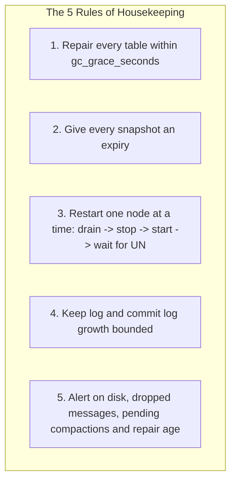
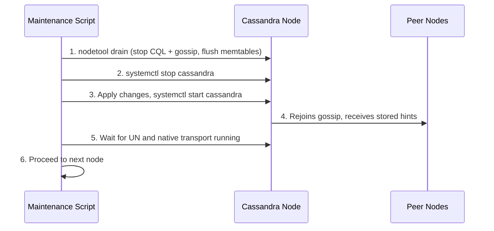

# Housekeeping, Maintenance Automations & Operational Best Practices

A Cassandra cluster needs regular background housekeeping. Without it, clusters suffer **resurrected deleted data** (missed repairs), **disk exhaustion from forgotten snapshots**, and **compaction backlogs**.

This guide covers repair scheduling, snapshot and backup automation, log retention, rolling restarts and alerting. The scripts are starting points: adapt the paths, error handling and alerting to your environment, and test them on a non-production cluster.

---

## 1. The Five Rules of Cassandra Housekeeping



---

## 2. Scheduled Repairs (Preventing Resurrected Data)

### Why Repair Has a Deadline
A `DELETE` (or an expired TTL) writes a **tombstone**. Compaction may purge a tombstone once it is older than the table's `gc_grace_seconds` (default 864,000 s = 10 days).
* If a replica missed the delete (it was down, or dropped the mutation) and the other replicas purge their tombstone before a repair reaches it, that replica still holds the old data and no longer sees anything that deletes it.
* Reads and repairs then copy the old data back to the other replicas: **the deleted data comes back.**

**Rule:** every table must be fully repaired more often than its `gc_grace_seconds`. With the 10-day default, aim to complete a repair cycle at least every 7 days, leaving margin for failures.

Related settings:
* **Hints** cover short outages: a coordinator stores hints for a down replica for up to `max_hint_window` (default `3h`). A node down for longer than that needs a repair after it returns.
* **Lowering `gc_grace_seconds`** reduces tombstone build-up but shortens the repair deadline. Do it only when repairs reliably complete well within the new window. Never set it to 0 on a table with multiple replicas that receives deletes, except for tables with only TTL'd, never-updated data that you have analysed carefully.

### Option A: Built-in Automated Repair (Cassandra 5.0.8 and later)
Cassandra 5.0.8 backported the automated repair scheduler from 6.0 (CEP-37). It runs inside every node, splits token ranges into bounded assignments, avoids repairing replicas at the same time by default, and records its history in `system_distributed.auto_repair_history`.

There are two steps to turn it on:
1. On every node, before startup, set `-Dcassandra.autorepair.enable=true`. **This cannot be undone.**
2. Enable scheduling in the `auto_repair:` block of `cassandra.yaml`.

Configuration, rollout, safely enabling incremental repair, table-level options, nodetool commands, metrics and alerts are all covered in **[Built-in Auto Repair](06_auto_repair.md)**.

### Option B: Cassandra Reaper
[Cassandra Reaper](https://cassandra-reaper.io/) is a widely used external repair scheduler with a web UI. It splits the ring into segments, repairs them with configurable intensity and concurrency, and can pause and resume schedules. It needs its own deployment and a backing store.

### Option C: A Scripted Repair (small clusters only)
If you can use neither of the above, run `nodetool repair --full -pr` on **every node in every DC**, **one node at a time**. Running it on all nodes at once overloads the cluster and makes overlapping repair sessions compete for the same replicas.

The simplest safe pattern gives each node its own time slot, spaced further apart than the longest observed repair:

| Node | Slot (`OnCalendar=`) |
| :--- | :--- |
| 10.0.1.10 | `Sun *-*-* 01:00:00` |
| 10.0.1.11 | `Sun *-*-* 07:00:00` |
| 10.0.1.12 | `Sun *-*-* 13:00:00` |
| 10.0.2.10 | `Mon *-*-* 01:00:00` |
| ... | ... |

```bash
#!/usr/bin/env bash
# /usr/local/bin/cassandra-scheduled-repair.sh
set -euo pipefail

LOG_FILE="/var/log/cassandra/scheduled_repair.log"
LOCK_FILE="/var/lock/cassandra-repair.lock"
exec >> "${LOG_FILE}" 2>&1

# Do not start a second repair on this node if the previous one is still running.
exec 9> "${LOCK_FILE}"
flock -n 9 || { echo "[$(date -Iseconds)] Previous repair still running. Skipping."; exit 0; }

echo "[$(date -Iseconds)] Starting primary-range full repair..."

# Only repair from a healthy node, and only if every node is up:
# a repair with a replica down fails for the affected ranges.
if [[ "$(nodetool statusbinary)" != "running" ]]; then
    echo "[$(date -Iseconds)] ERROR: Native transport not running. Aborting."
    exit 1
fi
if nodetool status | grep -qE '^D[NLJM] '; then
    echo "[$(date -Iseconds)] ERROR: At least one node is down. Aborting."
    exit 1
fi

# With no keyspace argument, nodetool repairs every non-local keyspace
# (system and system_schema are skipped; system_distributed is skipped unless named).
nodetool repair --full -pr

echo "[$(date -Iseconds)] Repair completed."
```

`/etc/systemd/system/cassandra-repair.timer` (set `OnCalendar` to this node's slot):
```ini
[Unit]
Description=Weekly Cassandra primary-range repair (this node's slot)

[Timer]
OnCalendar=Sun *-*-* 01:00:00
Persistent=false

[Install]
WantedBy=timers.target
```
`Persistent=false` stops a missed run from firing immediately at boot, which could overlap another node's slot. Alert if a node's last successful repair is older than about 7 days.

---

## 3. Snapshot Retention & Offsite Backups

> [!CAUTION]
> **Forgotten snapshots are a common cause of full disks.** A snapshot is a set of hard links. It costs almost nothing when taken, but as compaction replaces the original SSTables the snapshot keeps the old files alive, so its real size grows until it equals the data it captured.

### Give Every Snapshot an Expiry
Cassandra can expire snapshots itself; prefer that over deleting directories with `find`/`rm`, which bypasses Cassandra's snapshot tracking:
* **Manual snapshots**: `nodetool snapshot -t <tag> --ttl 3d [keyspace]`. Cassandra clears the snapshot when the TTL passes.
* **Automatic snapshots** taken before `TRUNCATE` / `DROP TABLE` (`auto_snapshot: true`, the default; keep it on): set `auto_snapshot_ttl: 30d` in `cassandra.yaml`. By default these snapshots never expire.
* **A daily safety net** for everything else:
  ```bash
  # /etc/cron.daily/cassandra-expire-snapshots
  nodetool clearsnapshot --all --older-than 7d
  ```
  `--older-than` accepts units such as `d`, `h`, `m`. Pick a value longer than your longest-lived intentional snapshot.

### Backup Script: Snapshot, Upload One Tag, Clear It

```bash
#!/usr/bin/env bash
# /usr/local/bin/cassandra-backup-manager.sh
set -euo pipefail

BACKUP_TAG="backup_$(date -u +%Y%m%d_%H%M%S)"
DATA_DIR="/mnt/cassandra/data"
NODE_ID="$(hostname)"                       # or the node's listen address
DEST="s3://my-company-cassandra-backups/${NODE_ID}/${BACKUP_TAG}"
WORK_DIR="/mnt/cassandra/backup_meta/${BACKUP_TAG}"
LOG_FILE="/var/log/cassandra/backup_manager.log"

exec >> "${LOG_FILE}" 2>&1
echo "[$(date -Iseconds)] Starting backup ${BACKUP_TAG}"

# 1. Snapshot all keyspaces. nodetool snapshot flushes memtables first (unless -sf),
#    so a separate 'nodetool flush' is not needed. The TTL is a safety net in case
#    step 4 never runs.
nodetool snapshot -t "${BACKUP_TAG}" --ttl 2d

# 2. Save the metadata needed to restore this node: schema, tokens, topology.
mkdir -p "${WORK_DIR}"
cqlsh -e "DESCRIBE SCHEMA" > "${WORK_DIR}/schema.cql"   # add credentials/TLS options as needed
nodetool info -T  > "${WORK_DIR}/node_info.txt"         # includes tokens, DC and rack
nodetool status   > "${WORK_DIR}/cluster_status.txt"

# 3. Upload ONLY this snapshot tag (plus the metadata). Each table's snapshot
#    directory also contains schema.cql and manifest.json.
aws s3 sync "${DATA_DIR}/" "${DEST}/data/" \
    --exclude "*" \
    --include "*/snapshots/${BACKUP_TAG}/*" \
    --only-show-errors
aws s3 sync "${WORK_DIR}/" "${DEST}/meta/" --only-show-errors

# 4. Release the hard links on local disk.
nodetool clearsnapshot -t "${BACKUP_TAG}"
rm -rf "${WORK_DIR}"

echo "[$(date -Iseconds)] Backup ${BACKUP_TAG} uploaded and local snapshot cleared."
```
Notes:
* Run it on every node at roughly the same time so the per-node backups are close to each other in time. They are still **not** a single consistent point in time; repair reconciles the differences after a restore.
* `aws s3 sync --include` matches with simple globs; check the first backup's object list to confirm only the expected tag was uploaded.
* For continuous protection between snapshots, consider `incremental_backups: true` (hard links of every flushed SSTable into `backups/`), which also needs its own upload-and-delete job, or commit log archiving for point-in-time recovery (see the disaster recovery runbook).

---

## 4. Disk & Log Housekeeping

### 1. Log Rotation (`conf/logback.xml`)
The shipped `conf/logback.xml` already rotates `system.log` and `debug.log`. The `SYSTEMLOG` appender as shipped:
```xml
<appender name="SYSTEMLOG" class="ch.qos.logback.core.rolling.RollingFileAppender">
  <filter class="ch.qos.logback.classic.filter.ThresholdFilter">
    <level>INFO</level>
  </filter>
  <file>${cassandra.logdir}/system.log</file>
  <rollingPolicy class="ch.qos.logback.core.rolling.SizeAndTimeBasedRollingPolicy">
    <!-- rollover daily -->
    <fileNamePattern>${cassandra.logdir}/system.log.%d{yyyy-MM-dd}.%i.zip</fileNamePattern>
    <!-- each file should be at most 50MB, keep 7 days worth of history, but at most 5GB -->
    <maxFileSize>50MB</maxFileSize>
    <maxHistory>7</maxHistory>
    <totalSizeCap>5GB</totalSizeCap>
  </rollingPolicy>
  ...
</appender>
```
`DEBUGLOG` uses the same limits, so the defaults can use up to about 10 GB in total. `${cassandra.logdir}` is set by `bin/cassandra` from `CASSANDRA_LOG_DIR` (default `$CASSANDRA_HOME/logs`; packages usually use `/var/log/cassandra`). GC logs are rotated by the JVM (`filecount=10,filesize=10485760` in `cassandra-env.sh`). Change `maxHistory`/`totalSizeCap` only if your log volume has room for it.

---

### 2. Disk Space Watchdog
Alert early and leave room for compaction. Compaction, cleanup, scrub and `garbagecollect` all **write new SSTables before deleting old ones**, so they need free space and cannot rescue a nearly-full disk.

```bash
#!/usr/bin/env bash
# /usr/local/bin/cassandra-disk-watchdog.sh
DATA_DIR=/mnt/cassandra/data
DISK_USAGE=$(df --output=pcent "${DATA_DIR}" | tail -1 | tr -dc '0-9')

if [ "${DISK_USAGE}" -gt 85 ]; then
    logger -s -t CASSANDRA_WATCHDOG "CRITICAL: ${DATA_DIR} at ${DISK_USAGE}%. Clearing snapshots older than 1 day."
    # Removes only aged snapshots. Do NOT clear every snapshot automatically:
    # one of them may be the only copy you need for a restore.
    nodetool clearsnapshot --all --older-than 1d
elif [ "${DISK_USAGE}" -gt 75 ]; then
    logger -s -t CASSANDRA_WATCHDOG "WARNING: ${DATA_DIR} at ${DISK_USAGE}%."
fi
```
If the disk is still filling after snapshots are gone, the fixes are human decisions: add nodes or disks, drop or TTL data, or (after a topology change) run `nodetool cleanup` while there is still headroom. `nodetool clearsnapshot --all` with no age filter deletes **every** snapshot on the node, including the ones you may need to restore from. Run it by hand only.

---

## 5. Rolling Restarts

For OS patching, Java upgrades or `cassandra.yaml` changes, restart **one node at a time** and wait until it is healthy before moving on.



`nodetool drain` stops client and internode traffic and flushes memtables, so you don't need `disablebinary`, `disablegossip` or `flush` beforehand.

```bash
#!/usr/bin/env bash
# /usr/local/bin/rolling-restart-node.sh
set -euo pipefail

# The address this node advertises in 'nodetool status' (its listen/broadcast address).
# 'hostname -I' is not reliable: hosts often have several addresses, and the first one
# may not be the address Cassandra uses.
NODE_ADDR="${1:?usage: $0 <node listen/broadcast address>}"

echo "[$(date -Iseconds)] Draining ${NODE_ADDR}..."
nodetool drain

echo "Stopping Cassandra..."
sudo systemctl stop cassandra

# Apply OS / Java / configuration changes here.

echo "Starting Cassandra..."
sudo systemctl start cassandra

echo "Waiting for nodetool to respond..."
until nodetool info >/dev/null 2>&1; do sleep 5; done

echo "Waiting for ${NODE_ADDR} to report UN..."
until nodetool status | awk -v a="${NODE_ADDR}" '$1 == "UN" && $2 == a {found=1} END {exit !found}'; do
    sleep 5
done

until [[ "$(nodetool statusbinary)" == "running" ]]; do
    sleep 2
done

echo "[$(date -Iseconds)] ${NODE_ADDR} is UN and accepting CQL."
```
Before moving to the next node, also check from another node that it sees this node as `UN`, and that `nodetool tpstats` shows no growing backlog while the node receives hints.

---

## 6. Health Checks & Alerting Thresholds

Starting points; tune them to your workload and hardware.

| Metric | Normal | Warning | Critical | Action |
| :--- | :--- | :--- | :--- | :--- |
| **Data disk usage** | < 50–60% | > 75% | > 85% | Expire old snapshots, check `nodetool listsnapshots` and `tablestats`, plan capacity. Leave headroom for compaction. |
| **Dropped mutations** (`tpstats`) | 0 | Any sustained increase | Rapid increase | Look for disk saturation, GC pauses, or overload. Ensure hints and repairs are running. |
| **Pending compactions** (`compactionstats`) | Low and stable | Rising for hours | Still rising after a day | Check disk throughput and `setcompactionthroughput`; review the compaction strategy. |
| **Tombstones per read** (`tablestats`, `tablehistograms`) | Well below 1,000 | Near `tombstone_warn_threshold` (1,000) | Near `tombstone_failure_threshold` (100,000) | Fix the delete pattern or data model. |
| **GC pause time** (`gc.log`) | Below `MaxGCPauseMillis` (300 ms shipped) | Regularly above target | Pauses of seconds | Look at heap pressure, large partitions, and heap sizing. |
| **Schema versions** (`describecluster`) | 1 | > 1 for minutes | > 1 persistently | Find the lagging node; `nodetool resetlocalschema` on it is a last resort. |
| **SSTables per read** (`tablehistograms`) | Low single digits | Steadily rising | Double digits | Compaction is falling behind or the strategy does not fit the workload. |
| **Time since last successful repair** | < 7 days | > 7 days | Approaching `gc_grace_seconds` | Fix or reschedule repairs before the deadline. |
| **Percent repaired** (`tablestats`, incremental repair only) | High and stable | Falling | Falling steadily | Incremental repairs are not running or not completing. |
