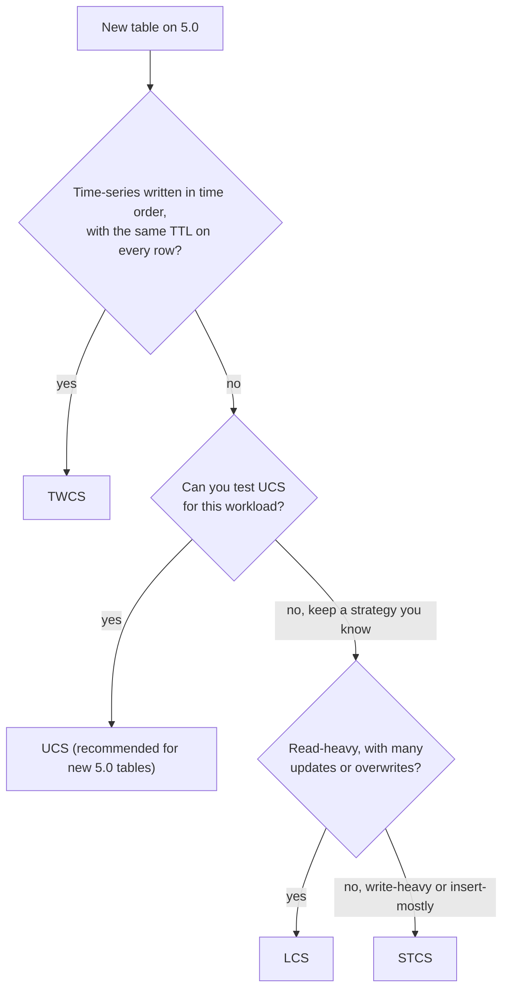

# Compaction Strategies: STCS, LCS, TWCS & UCS

> [!CAUTION]
> Commands on this page can change or delete data and affect running clusters. Try them on a test or staging cluster first, and read the [disclaimer](../README.md#disclaimer). The guide is provided "as is", without warranty.

Compaction merges SSTables in the background. This is how Cassandra keeps the number of files read per query low, reclaims space from overwrites, and eventually removes tombstones. The strategy is set **per table**, and it is the biggest lever you have over read latency, write amplification and disk headroom.

| Template | Default strategy for new tables |
| :--- | :--- |
| `conf/cassandra.yaml` | `SizeTieredCompactionStrategy` (no `default_compaction` set; `min_threshold: 4`, `max_threshold: 32`) |
| `conf/cassandra_latest.yaml` | `UnifiedCompactionStrategy` with `scaling_parameters: T4`, `target_sstable_size: 1GiB`, `min_sstable_size: 100MiB`, `max_sstables_to_compact: 64` |

`default_compaction` applies only to tables that don't specify a compaction strategy, and it also applies to system tables.

---

## 1. The Strategies at a Glance

| Strategy | Shape | Read amplification | Write amplification | Temporary disk headroom | Best for |
| :--- | :--- | :--- | :--- | :--- | :--- |
| **STCS** `SizeTieredCompactionStrategy` | Merges SSTables of similar size | Higher: one partition may sit in many SSTables | Low | **Up to 50%**: a large compaction can temporarily double the data it rewrites | Write-heavy workloads, insert-mostly data |
| **LCS** `LeveledCompactionStrategy` | Levels of fixed-size SSTables that don't overlap (`sstable_size_in_mb` 160, `fanout_size` 10) | Low: about one SSTable per level | High: data is rewritten at each level | Small, because compactions are short | Read-heavy workloads, many updates or overwrites |
| **TWCS** `TimeWindowCompactionStrategy` | One group of SSTables per time window (`compaction_window_unit` DAYS, `compaction_window_size` 1); STCS within the current window | Low for time-ordered reads | Low | Small | Time-series with a **uniform TTL** that is written in time order |
| **UCS** `UnifiedCompactionStrategy` (new in 5.0) | Density-based levels and shards; can be tiered or leveled, configured per level | Configurable | Configurable | Low, because output is sharded and compactions run in parallel | General purpose; recommended for new 5.0 tables |

A first choice for a new table (then read the sections below for the details):



> [!NOTE]
> `DateTieredCompactionStrategy` was **removed** in 5.0. Switch any DTCS table to TWCS before you upgrade.

---

## 2. Unified Compaction Strategy (UCS)

UCS combines tiered and leveled compaction behind one parameter. The full design is in [`UnifiedCompactionStrategy.md`](https://github.com/apache/cassandra/blob/cassandra-5.0/src/java/org/apache/cassandra/db/compaction/UnifiedCompactionStrategy.md).

### `scaling_parameters` (w)
| Value | Behavior | Comparable to |
| :--- | :--- | :--- |
| `T4` (the default) | Tiered, fanout 4 | STCS with `min_threshold: 4` |
| `L10` | Leveled, fanout 10 | LCS with its defaults |
| `N` | Middle ground (fanout 2) | — |
| A list such as `T4, L10` | Each level has its own setting; the last entry applies to all higher levels | STCS for fresh data, LCS for older data |

Use **T** (tiered) for write-heavy workloads, or where bloom filters or time order make reads cheap. Use **L** (leveled) for read-heavy workloads, especially with wide partitions where bloom filters help less.

### Other UCS options
| Option | Default | Meaning |
| :--- | :--- | :--- |
| `target_sstable_size` | 1GiB | Output SSTables are aimed at between t/√2 and t·√2 in size. |
| `base_shard_count` | 4 | Minimum number of shards, which sets the parallelism of the lowest levels. |
| `sstable_growth` | 0.333 | How much of the data growth increases SSTable size, as opposed to the shard count. Keeps the SSTable count manageable on very large tables. |
| `min_sstable_size` | 100MiB | Below this size, UCS uses fewer shards than `base_shard_count`. |
| `expired_sstable_check_frequency_seconds` | 600 | How often to look for SSTables whose data has fully expired. |
| `max_sstables_per_shard_factor` | 10 (**5.0.10+**) | If a shard holds more than this factor × fanout SSTables, the whole shard is compacted. Set 0 to disable. **Don't set it until every node runs 5.0.10 or later**: older nodes reject tables that have the option (NEWS.txt). |

```sql
ALTER TABLE ks.events WITH compaction = {
    'class': 'UnifiedCompactionStrategy',
    'scaling_parameters': 'T4'
};
```

UCS can be re-tuned at any time. Changing `scaling_parameters` does not force a full rewrite; existing SSTables move into the new layout gradually.

---

## 3. TWCS Rules of Thumb

* Pick the window so that you end up with roughly **20–50 windows** over the data's lifetime. For example, a 30-day TTL works well with 1-day windows.
* Write data in time order, and set the TTL through `default_time_to_live` so that every cell expires on schedule.
* **Do not** issue explicit `DELETE`s or out-of-order writes (including read-repair of old data). They mix timestamps across windows and block whole-SSTable expiry.
* TWCS drops an SSTable outright once **all** of its data has expired and no other SSTable overlaps it. Use `tools/bin/sstableexpiredblockers` to find the SSTables that are blocking expiry.
* `unsafe_aggressive_sstable_expiration: true` drops expired SSTables without checking for overlaps. Use it only if you never overwrite or delete. It also requires starting every node with `-Dcassandra.allow_unsafe_aggressive_sstable_expiration=true`.

---

## 4. Tombstones and `gc_grace_seconds`

A tombstone can only be removed by compaction when **all** of the following are true:
1. It is older than the table's `gc_grace_seconds` (default 864000 = 10 days).
2. The compaction includes every SSTable that might still hold data the tombstone shadows. Overlapping SSTables outside the compaction block the purge.
3. If `only_purge_repaired_tombstones: true` is set, the data has also been repaired.

Repair must finish on every range **within** `gc_grace_seconds`, or deleted data can come back (see [Housekeeping](02_housekeeping_and_automations.md)). Lowering `gc_grace_seconds` makes tombstones go away sooner, but it shortens that repair deadline and the window for hint delivery.

### Single-SSTable tombstone compactions (STCS, LCS, TWCS)
| Option | Default | Effect |
| :--- | :--- | :--- |
| `tombstone_threshold` | 0.2 | Compact a single SSTable on its own when more than 20% of it is droppable tombstones. |
| `tombstone_compaction_interval` | 86400 (seconds) | Minimum age of an SSTable before it can be considered. |
| `unchecked_tombstone_compaction` | false | `true` skips the pre-check for overlaps. It costs more I/O, but helps when tombstones are stuck. |
| `only_purge_repaired_tombstones` | false | Purge only tombstones in repaired data. Use with incremental repair. |

To clear shadowed data from a table without a full major compaction, use `nodetool garbagecollect` (granularity `ROW` by default, or `-g CELL`). It still rewrites SSTables, so it needs free disk space.

---

## 5. Switching Strategies

```sql
ALTER TABLE ks.t WITH compaction = {'class': 'LeveledCompactionStrategy'};
```

* The change is a schema change: it applies cluster-wide straight away and starts compactions on every node at the same moment. On large tables, **throttle first** with `nodetool setcompactionthroughput <MiB/s>`. Watch `nodetool compactionstats` (or the virtual table `system_views.sstable_tasks`).
* Going from STCS to LCS rewrites the whole table into levels, which is expensive. STCS to UCS-T4 has almost no immediate cost, and the table can then be re-tuned towards `L`.
* To test a change on one node first, set the strategy per node over JMX (`ColumnFamilyStoreMBean.setCompactionParametersJson`). The setting does not survive a restart.

---

## 6. Disk Headroom

* **STCS**: keep about **50%** free. Compacting the largest tier can temporarily need space equal to its input. Avoid a major compaction (`nodetool compact` with no flags) on STCS tables. If you must run one, `-s` / `--split-output` splits the output into size-tiered files instead of one huge SSTable.
* **LCS, UCS and TWCS**: compactions are smaller or sharded, so 20–30% free is usually enough. Snapshots, streaming and repair (anticompaction) also need room.
* `repair_disk_headroom_reject_ratio` (default 0.0, meaning disabled, in 5.0) can make repair refuse to start when the disk is too full.
* Set `concurrent_compactors` (in `cassandra.yaml`) and `compaction_throughput` (default `64MiB/s`) to match your disks. You can change both at runtime with `nodetool setconcurrentcompactors` and `nodetool setcompactionthroughput`.

---

## 7. UCS Migration Runbook

Use this to move tables from STCS or LCS to UCS one at a time, with a way back at every step. Equivalents from [`UnifiedCompactionStrategy.md`](https://github.com/apache/cassandra/blob/cassandra-5.0/src/java/org/apache/cassandra/db/compaction/UnifiedCompactionStrategy.md):
* "The default value is T4, matching the default STCS behaviour with threshold 4."
* "To select an equivalent of LCS with its default fan factor 10, use L10."

The equivalence is approximate: the same document lists behavioural differences, such as UCS grouping SSTables by timestamp instead of size, and having no upper compaction threshold.

| Current strategy | Start with | Notes |
| :--- | :--- | :--- |
| STCS (default `min_threshold: 4`) | `'scaling_parameters': 'T4'` | If you tuned `min_threshold`, use `T<min_threshold>`. |
| LCS (`fanout_size: 10`) | `'scaling_parameters': 'L10'` | If you tuned `fanout_size`, use `L<fanout_size>`. |
| TWCS | Keep TWCS | UCS has no time windows. Test before you move time-series tables. |

### Step 0: record the current settings (your rollback)
```sql
SELECT keyspace_name, table_name, compaction
FROM system_schema.tables
WHERE keyspace_name = 'ks' AND table_name = 'events';
```
Save the output. Rolling back means running `ALTER TABLE ... WITH compaction = <saved map>`.

### Step 1: baseline (24h+ before the change)
Record for the table on a few nodes:
* `nodetool tablestats ks.events`: SSTable count and space used.
* `nodetool tablehistograms ks.events`: SSTables per read, and read latency percentiles.
* `nodetool compactionstats`: pending tasks.
* `df` on the data volume.
* JMX table metrics: `LiveSSTableCount`, `PendingCompactions`, `SSTablesPerReadHistogram`, `BytesFlushed`, `CompactionBytesWritten`, `LiveDiskSpaceUsed`.

A rough measure of **write amplification** is `ΔCompactionBytesWritten / ΔBytesFlushed` over a day. Compare it before and after the change.

### Step 2 (optional): canary one node
```text
JMX: org.apache.cassandra.db:type=Tables,keyspace=ks,table=events
     setCompactionParametersJson('{"class":"UnifiedCompactionStrategy","scaling_parameters":"T4"}')
```
This changes only that node, and only until it restarts or the next schema change. Watch it for a day.

### Step 3: roll out per table
```bash
nodetool setcompactionthroughput 32    # on every node: throttle during the switch
```
```sql
ALTER TABLE ks.events WITH compaction = {
  'class': 'UnifiedCompactionStrategy',
  'scaling_parameters': 'T4'           -- or 'L10' for former LCS tables
};
```
The schema change takes effect on every node at once. Migrate **one table at a time**, starting with the smallest or least critical.

### Step 4: watch until stable
| Signal | Expect | Act if |
| :--- | :--- | :--- |
| `nodetool compactionstats` / `system_views.sstable_tasks` | A temporary rise in pending tasks, then a steady decline | Pending keeps growing for hours: lower the throughput limit further, or roll back |
| `LiveSSTableCount` | Settles. UCS splits output into shards, so more but smaller SSTables are normal | Grows without bound |
| `SSTablesPerReadHistogram` p99 | Same as before or better | Clearly worse: consider `L` scaling, or roll back |
| Disk free | Never below your headroom target (section 6) | Free space falling fast: stop and roll back |
| Write amplification | Lower for `T`, higher for `L` | Out of line with expectations |

Restore the throughput limit afterwards: `nodetool setcompactionthroughput 64`.

### Step 5: tune or roll back
* **Tune** without rewriting the table: change `scaling_parameters` (for example `T4` → `T4, L10` to keep fresh data tiered and older data leveled), `target_sstable_size`, or `base_shard_count`.
* **Roll back:** `ALTER TABLE` back to the map you saved in step 0. SSTables written by UCS are ordinary SSTables. STCS simply adopts them. LCS puts them in L0 and re-levels them, which costs I/O like an STCS→LCS switch, so throttle as in step 3.

---

## Sources

* [`src/java/org/apache/cassandra/db/compaction/UnifiedCompactionStrategy.md`](https://github.com/apache/cassandra/blob/cassandra-5.0/src/java/org/apache/cassandra/db/compaction/UnifiedCompactionStrategy.md): design, parameters, T4/L10 equivalents, and differences from STCS and LCS
* [`src/java/org/apache/cassandra/metrics/TableMetrics.java`](https://github.com/apache/cassandra/blob/cassandra-5.0/src/java/org/apache/cassandra/metrics/TableMetrics.java): `LiveSSTableCount`, `PendingCompactions`, `BytesFlushed`, `CompactionBytesWritten`, `SSTablesPerReadHistogram`
* [`src/java/org/apache/cassandra/metrics/CompactionMetrics.java`](https://github.com/apache/cassandra/blob/cassandra-5.0/src/java/org/apache/cassandra/metrics/CompactionMetrics.java)
* [`src/java/org/apache/cassandra/db/ColumnFamilyStoreMBean.java`](https://github.com/apache/cassandra/blob/cassandra-5.0/src/java/org/apache/cassandra/db/ColumnFamilyStoreMBean.java): `setCompactionParametersJson`
* [`conf/cassandra.yaml`](https://github.com/apache/cassandra/blob/cassandra-5.0/conf/cassandra.yaml), [`conf/cassandra_latest.yaml`](https://github.com/apache/cassandra/blob/cassandra-5.0/conf/cassandra_latest.yaml), [`NEWS.txt`](https://github.com/apache/cassandra/blob/cassandra-5.0/NEWS.txt)
* Official docs:
  * https://cassandra.apache.org/doc/5.0/cassandra/managing/operating/compaction/ucs.html
  * https://cassandra.apache.org/doc/5.0/cassandra/managing/operating/compaction/index.html
