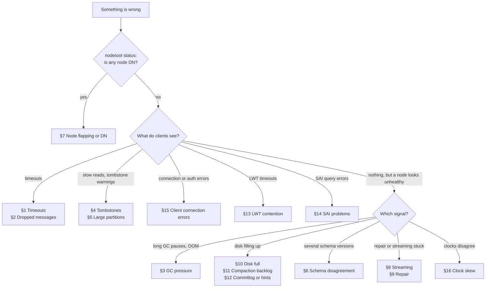

# Troubleshooting Playbook: Symptom → Diagnosis → Fix

The official troubleshooting section teaches techniques: finding the bad node, reading logs, using nodetool and OS tools. This page is organized by **symptom** instead. Each entry gives the **exact text** Cassandra 5.0 logs or returns (taken from the `cassandra-5.0` branch source), the commands that confirm the cause, and the fix.

> [!TIP]
> **First five minutes, on any incident:**
> ```bash
> nodetool status                     # anyone DN / UJ / UL?
> nodetool describecluster            # one schema version? unreachable nodes?
> nodetool tpstats                    # pending/blocked stages, dropped messages
> nodetool compactionstats            # compaction backlog
> grep -E "WARN|ERROR" /var/log/cassandra/system.log | tail -50
> ```
> Virtual tables give the same data over CQL, per node: `system_views.thread_pools`, `sstable_tasks`, `pending_hints`, `streaming`, `repairs`, `max_partition_size`, `tombstones_per_read`, `clients`. See [Monitoring](03_monitoring_and_observability.md).

Then go to the section for what you see:



Log locations: `$CASSANDRA_LOG_DIR` (`$CASSANDRA_HOME/logs` for tarball installs, `/var/log/cassandra` for packages), in `system.log`, `debug.log` and `gc.log`.

---

## 1. Read/Write Timeouts

**Client sees:** `ReadTimeoutException` / `WriteTimeoutException` with `Operation timed out - received only N responses.`
**Unavailable instead:** `Cannot achieve consistency level <CL>`. Not enough replicas were *alive* to even attempt the request. Go to [§7](#7-node-flapping-or-shown-dn).

**Confirm**
```bash
nodetool proxyhistograms          # coordinator latency: is it every request, or the tail?
nodetool tablehistograms ks.tbl   # local read latency, SSTables per read, partition size
nodetool tpstats                  # pending ReadStage / MutationStage, dropped messages
```
**Usual causes and fixes**
| Cause | Evidence | Fix |
| :--- | :--- | :--- |
| Large partition or tombstones | See §4–§5 | Fix the data model |
| Too many SSTables per read | `tablehistograms` SSTables column at p99 > 5–10 | Compaction is behind (§11) or the strategy is wrong ([Compaction](04_compaction_strategies.md)) |
| GC pauses | §3 | Heap sizing and model fixes |
| Disk saturated | `iostat -x` shows await/util high | Throttle compaction (`nodetool setcompactionthroughput`), use faster disks |
| Coordinator fan-out | `IN (...)`, `ALLOW FILTERING`, unbounded SAI queries | [Performant reads](../03_application_development/02_performant_reads.md) |
| Consistency level too strict | Timeouts only at `QUORUM`/`EACH_QUORUM` across DCs | Use `LOCAL_QUORUM` ([Consistency](../03_application_development/04_consistency_and_transactions.md)) |

Raising `read_request_timeout` / `write_request_timeout` hides the problem rather than fixing it. Only do it for known slow analytical queries.

---

## 2. Dropped Messages

**Log (`system.log`, INFO):** `<VERB> messages were dropped in last 5000 ms: X internal and Y cross node.` (verb names such as `MUTATION_REQ`, `READ_REQ`)

**Meaning:** a request waited in a queue longer than its timeout, so the node discarded it. Dropped mutations are repaired by hints, read repair and anti-entropy repair, but they are a sign of overload.

**Confirm:** `nodetool tpstats` (the dropped section, plus pending and blocked per stage), and `system_views.thread_pools`.

**Fix:** same causes as §1. If drops happen on only one node, check that node's disk, GC and network first (`system_views.internode_inbound` / `internode_outbound`). Then run repair once it is healthy.

---

## 3. GC Pressure, Long Pauses & OutOfMemoryError

**Logs:**
* `G1 Young Generation GC in 450ms. ...`. Pauses longer than `gc_log_threshold` (200ms) are logged at INFO, and longer than `gc_warn_threshold` (1000ms) at WARN.
* `Not marking nodes down due to local pause of <n>ns > <m>ns`. The *local* JVM paused long enough that the failure detector refused to judge peers.
* On OOM, `cassandra-env.sh` passes `-XX:OnOutOfMemoryError="kill -9 %p"`, and `jvm-server.options` sets `-XX:+HeapDumpOnOutOfMemoryError`. The process dies and leaves a `.hprof` file in `CASSANDRA_HEAPDUMP_DIR`.

**Confirm**
```bash
nodetool gcstats                         # pause totals since last call
nodetool info | grep -i heap
grep -E "GC in [0-9]{4,}ms" system.log   # pauses of 1s or more
nodetool tablestats | grep -E "Compacted partition maximum bytes"   # giant partitions
```
**Fixes, in order:**
1. Find what allocates: large partitions (§5), tombstone scans (§4), huge batches (`batch_size_*` warnings), `ALLOW FILTERING`, or very large `IN` lists.
2. Check the heap size against the defaults. See [JVM](../04_infrastructure_and_cloud/01_java_and_jvm_flavors.md) and [Config](../05_cluster_deployment_and_config/01_configuration_and_tuning.md). Never set it above 31 GB.
3. Too many SSTables also costs heap (§11).
4. Off-heap OOM (`Direct buffer memory`): check `MaxDirectMemorySize` and the chunk cache (`file_cache_size`).

---

## 4. Tombstone Warnings & `TombstoneOverwhelmingException`

**Logs:**
* Warning: `Read N live rows and M tombstone cells for query <query>; token <t> (see tombstone_warn_threshold)`
* Failure: `Scanned over 100001 tombstones during query '<query>' (last scanned row token was <t> and partion key was (<k>)); query aborted` (the "partion" typo is in the source)

**Confirm**
```bash
nodetool tablestats ks.tbl | grep -i tombstone   # "Average/Maximum tombstones per slice (last five minutes)"
```
```sql
SELECT * FROM system_views.tombstones_per_read;
```
```bash
# Offline: partitions with many tombstones, on a copy or a snapshot
tools/bin/sstablepartitions -o 10000 /var/lib/cassandra/data/ks/tbl-*/   # -o / --min-tombstones
```
**Fix:** this is a data-model problem.
* Queue-like delete patterns: [Anti-patterns](../01_architecture_and_mental_model/02_anti_patterns.md).
* Binding `null`s: [Writes](../03_application_development/01_performant_writes.md).
* TTL with STCS: use TWCS. See [Compaction](04_compaction_strategies.md).

Tombstones are only purged after `gc_grace_seconds` **and** a compaction that includes every SSTable holding the shadowed data. Do not lower `gc_grace_seconds` unless repair reliably runs more often than that.

---

## 5. Large Partitions

**Log:** `Partition <ks.tbl:key> has size <s>, this exceeds the warning threshold of <t>.`
> [!NOTE]
> In 5.0 this comes from the `partition_size_warn_threshold` guardrail, which **defaults to null (disabled)**. It replaces `compaction_large_partition_warning_threshold`. It is checked only when SSTables are written (flush and compaction), and per SSTable. Set it, for example to `100MiB`, if you want warnings.

**Confirm**
```bash
nodetool tablestats ks.tbl | grep "Compacted partition maximum bytes"
nodetool tablehistograms ks.tbl           # partition size percentiles
tools/bin/sstablepartitions -t 100MiB <sstable dir>    # -t / --min-size: list the offending keys
```
```sql
SELECT * FROM system_views.max_partition_size;
```
**Fix:** add a bucket to the partition key ([Schema design](../02_data_modeling_and_indexing/01_schema_design_patterns.md)). You cannot split an existing partition in place: write new data to the bucketed table, and backfill or expire the old one.

---

## 6. Schema Disagreement

**Symptom:** DDL times out, or clients warn about schema agreement. `nodetool describecluster` lists **more than one** `Schema versions:` entry.

**Common 5.0-specific causes:**
* A rolling upgrade is in progress (expected until it finishes).
* `-Dcassandra.autorepair.enable=true` is set on only some nodes, so `system_distributed` generation 7 and 6 coexist. See [Auto repair](06_auto_repair.md).

**Fix:**
1. Stop issuing DDL.
2. Wait a few minutes, since normal propagation is quick.
3. If one node is the outlier, run `nodetool reloadlocalschema` there. As a last resort, run `nodetool resetlocalschema` on **that node only**: it drops the node's local schema and pulls it from peers.
4. Never run concurrent DDL from several clients. Run schema changes from one place, one statement at a time, and wait for agreement between them.

---

## 7. Node Flapping or Shown DN

**Logs:** `InetAddress /10.0.1.18:7000 is now DOWN` / `... is now UP`, repeating. Also check the *DN node's* log for `Not marking nodes down due to local pause` (that node was the one pausing).

**Confirm**
```bash
nodetool status
nodetool gossipinfo                        # STATUS, generation/heartbeat per endpoint
nodetool failuredetector                   # phi values
```
```sql
SELECT * FROM system_views.internode_outbound;   -- pending, dropped, errors per peer
```
**Causes:** GC pauses (§3), network loss or MTU mismatch (see the cloud guides), a saturated node, or clock problems (§15).

**Fix:** fix the root cause. Raising `phi_convict_threshold` (default 8) to 10–12 only helps on genuinely noisy networks, such as some cloud environments.

**Truly dead node:** see [DR: replace a node](../07_disaster_recovery/01_backup_and_disaster_recovery.md). Use `nodetool removenode <host-id>` only for nodes that will never return. `nodetool assassinate` is a last resort for nodes stuck in gossip.

---

## 8. Bootstrap / Rebuild / Streaming Stuck or Failed

**Logs:** `Error during bootstrap: ...`, `Stream failed: ...`, `[Stream #<id>] ...` session errors. On a node that cannot reach seeds: `Unable to contact any seeds: ...` or `Unable to gossip with any peers`.

**Confirm**
```bash
nodetool netstats                 # active streams and progress
nodetool status                   # node stuck in UJ?
```
```sql
SELECT * FROM system_views.streaming;
```
**Fixes**
* Network or firewall: port 7000 (and 7001 if legacy SSL) must be open between **all** nodes, not only to seeds.
* Streaming throughput: `stream_throughput_outbound` / `inter_dc_stream_throughput_outbound` (default 24MiB/s), and `entire_sstable_stream_throughput_outbound` for zero-copy streaming. Set at runtime with `nodetool setstreamthroughput` / `setinterdcstreamthroughput`.
* A failed bootstrap can be resumed with `nodetool bootstrap resume`. To start over instead, restart with `-Dcassandra.reset_bootstrap_progress=true`, or wipe the data directories and bootstrap again. (`nodetool bootstrap resume --force` overrides that property; read CASSANDRA-17679 first.)
* Don't bootstrap several nodes at once (`cassandra.consistent.rangemovement=true` enforces this). See the [Deployment runbook](../05_cluster_deployment_and_config/02_cluster_deployment_runbook.md).
* SAI: `Cannot build SAI index while entire SSTable streaming is in progress.` This is transient. The index build retries after streaming finishes.

---

## 9. Repair Failing or Hanging

**Logs (`nodetool repair` output and `system.log`):**
* `Repair session <id> for range <r> failed with error <e>`
* `Repair command #<n> failed with error <e>`
* `Got negative replies from endpoints [...]` / `Did not get replies from all endpoints.` A participant refused or is down.
* `Rejecting incoming repair, pending compactions (N) above threshold (M)` / `Rejecting incoming repair, disk usage (x%) above threshold (y%)`. These are the protective thresholds; see [Auto repair §6](06_auto_repair.md#6-guard-rails-that-protect-the-node).

**Confirm**
```sql
SELECT * FROM system_views.repairs;            -- also repair_sessions, repair_jobs, repair_validations
```
```bash
nodetool repair_admin list                   # incremental repair sessions
nodetool compactionstats                     # validation / anticompaction running?
nodetool netstats                            # repair streaming
```
**Fixes**
* All replicas must be up. Plain `nodetool repair` fails if any replica is down; `--force` skips down endpoints, but then those ranges are not repaired.
* Hung incremental sessions: `nodetool repair_admin cancel --session <id>`, then `nodetool repair_admin cleanup`.
* Huge or long repairs: split them with subranges (`-st`/`-et`), or let [Auto repair](06_auto_repair.md) or Reaper do the splitting.
* Validation (Merkle tree building) is slow on big tables. Compaction health (§11) affects repair duration directly.

---

## 10. Disk Full

**Logs:**
* `Not enough space for compaction (<id>) of ks.tbl, estimated sstables = N, expected write size = M`, or the warning `Not enough space for compaction {}, {}MiB estimated. Reducing scope.`
* `Insufficient disk space to write N bytes into the <ks> keyspace` / `Insufficient disk space to store <x>`
* With `disk_failure_policy: stop` (the default): `Stopping transports as disk_failure_policy is stop`. The node stops gossip and CQL but the JVM stays up.

**Confirm:**
```bash
df -h <data dirs>
nodetool listsnapshots
nodetool tablestats | grep -E "Space used \(total\)|Space used by snapshots \(total\)"
```
**Fixes, safest first:**
1. **Snapshots:** `nodetool clearsnapshot -t <tag>` or `nodetool clearsnapshot --all --older-than 7d` (`--older-than` is refused without `--all`). Check for automatic `dropped-*` / `truncated-*` snapshots.
2. Leftover data after topology changes: `nodetool cleanup` (needs some free space; one node at a time).
3. Temporarily add another `data_file_directories` entry on a new volume (restart required).
4. Add nodes, or larger disks.

**Never** delete live `*-Data.db` files by hand, and never start a major compaction to save space (it needs extra space first). See [Compaction headroom](04_compaction_strategies.md#6-disk-headroom).

---

## 11. Compaction Backlog

**Symptom:** `nodetool compactionstats` pending tasks growing, `SSTables per read` rising, disk usage climbing.

**Confirm**
```bash
nodetool compactionstats -H
nodetool getcompactionthroughput
nodetool tablestats ks.tbl | grep "SSTable count"
```
```sql
SELECT * FROM system_views.sstable_tasks;
```
**Fixes**
* Raise `nodetool setcompactionthroughput` (0 = unthrottled) if the disks have headroom. Raise `nodetool setconcurrentcompactors` if CPU and disk allow.
* Check whether the strategy suits the workload: STCS on read-heavy tables, LCS on write-heavy tables, or TTL data without TWCS. See [Compaction strategies](04_compaction_strategies.md).
* A table stuck behind a single huge compaction: wait, or use `nodetool stop COMPACTION` and switch the strategy (UCS shards big compactions).

---

## 12. CommitLog or Hints Filling the Disk

**CommitLog:** `commitlog_total_space` defaults to the smaller of 8192MiB and ¼ of the commitlog volume. When it fills, Cassandra force-flushes the tables that are holding the oldest segments. You will see `Flushing largest <table> to free up room...` when memtable space runs short. Constant forced flushes mean the flushes can't keep up: check disk speed and `memtable_flush_writers` (default 2 per data directory).

**Hints:** stored under `hints_directory` for peers that are down, up to `max_hint_window` (3h). Logs:
* `Not hinting <peer> which has been down <n> ms` (outside the window)
* `Not hinting <peer> which has reached to the max hints size <b> bytes on disk...` (cap set by `max_hints_size_per_host`; the default `0MiB` means unlimited)

**Confirm:**
```bash
nodetool listpendinghints
du -sh <hints_directory>
```
```sql
SELECT * FROM system_views.pending_hints;
```
`listpendinghints` and `pending_hints` count only hint files that have been closed. The file being written for a peer that just went down doesn't show yet, so check the size of `hints_directory` too (seen in the [operations tutorial](../00_getting_started/03_tutorial_operations.md#5-keep-writing-while-the-node-is-down)).

**Fix:** bring the target node back, or remove it. If a node will be gone for a long time, `nodetool truncatehints <endpoint>` frees the space; you **must** run repair later. Set `max_hints_size_per_host` so one dead peer can't fill the disk.

**Oversized mutations** (logged at the coordinator): `Rejected an oversized mutation (<size>/<max>) for keyspace: <ks>. Top keys are: ...`. The maximum mutation size is half of `commitlog_segment_size` (32MiB by default), unless `max_mutation_size` is set. Fix the writer (huge batches or blobs) rather than raising the limit.

---

## 13. Slow LWTs & Contention

**Client sees:** `CAS operation timed out: received N of M required responses after K contention retries`. Or the ambiguous `CAS operation result is unknown - proposal accepted by N but not a quorum.` The write *may* have been applied, so read at `SERIAL` before retrying.

**Confirm:** JMX `org.apache.cassandra.metrics:type=ClientRequest,scope=CASWrite,name=ContentionHistogram` (also `scope=CASRead`, with `Timeouts`, `Unavailables` and `UnfinishedCommit`). `nodetool proxyhistograms` shows CAS read and write latency.

**Fixes**
* Contention means many clients doing compare-and-set on the **same partition**. Redesign: shard the hot key, or serialize writers in the application.
* Enable Paxos v2 (2 round-trips instead of 4 for writes). See [Consistency](../03_application_development/04_consistency_and_transactions.md) and [Upgrading](../05_cluster_deployment_and_config/04_upgrading_to_5_0.md).
* `cas_contention_timeout` (1000ms) bounds the retry loop. Raising it only lengthens the queue.

---

## 14. SAI Problems

| Symptom | Text | Fix |
| :--- | :--- | :--- |
| Query rejected | `... If you want to execute this query despite the performance unpredictability, use ALLOW FILTERING` | The column has no index, or the operator isn't supported for that index or column type. See [Indexing](../02_data_modeling_and_indexing/02_indexing_and_vector_search.md). |
| Query rejected by operator policy | `Executing this query despite the performance unpredictability with ALLOW FILTERING has been disabled ...` | The `allow_filtering_enabled: false` guardrail is set. Add an index or a query table. |
| Read fails during index build | Client: `ReadFailure ... INDEX_NOT_AVAILABLE` (the coordinator found too few replicas with a queryable index). Replica side: `The secondary index '<name>' is not yet available` | Wait for the build. Check `SELECT * FROM system_views.sai_column_indexes` on each node (`is_queryable`, `is_building`). A new index is never usable the instant `CREATE INDEX` returns. |
| Build failed | `Failed to build index for SSTable ...` / `Failed to complete an index build` (`system.log`) | Fix the cause (disk, corrupt SSTable: try `nodetool verify` or `scrub`), then run `nodetool rebuild_index <ks> <table> <index>`. |
| Index marked non-queryable | `... All indexes from this table are going to be marked as non-queryable and will need to be rebuilt.` | Run `nodetool rebuild_index` on that node. |
| Slow queries touching many SSTables | Guardrail `sai_sstable_indexes_per_query_warn_threshold` (32) | Compaction backlog (§11). Restrict the partition key. |
| Large terms rejected | `sai_string_term_size_*` (1KiB warn / 8KiB fail), `sai_frozen_term_size_*`, `sai_vector_term_size_*` | Don't index large blobs or text. |

---

## 15. Client Connection & Authentication Errors

| Client sees | Server-side cause | Check |
| :--- | :--- | :--- |
| Java driver 4.x `AllNodesFailedException` / `NoNodeAvailableException` (Python and 3.x drivers: `NoHostAvailable`) | Wrong contact points or port, nodes down, TLS mismatch, or **wrong local DC name** in the driver | `nodetool statusbinary` (should print `running`), `nodetool status`; check the DC name in the driver against `nodetool status` |
| `Provided username <u> and/or password are incorrect` | Bad credentials | `PasswordAuthenticator` enabled? Role exists? See [Security](../05_cluster_deployment_and_config/03_security_hardening.md). |
| `Unable to perform authentication: ...` | `system_auth` unavailable: replicas down, or RF too low | `system_auth` replication with `NetworkTopologyStrategy` and RF 3 per DC, then repair it |
| `You have to be logged in and not anonymous to perform this request` | Authentication is on, but the client connected without credentials | Configure credentials in the driver |
| `User <u> has no <PERM> permission on <resource> or any of its parents` | Missing `GRANT` | `LIST ALL PERMISSIONS OF <role>;` |
| Connection refused right after restart | Native transport not started yet, or disabled | `nodetool statusbinary`, `nodetool enablebinary` |

`SELECT * FROM system_views.clients;` lists connected clients with driver name and version, protocol version, user and SSL status. Use it to find out-of-date drivers.

---

## 16. Clock Skew

**Logs and warnings:**
* `Encountered ballot that is more than 1 second in the future, is there a clock sync issue?` (Paxos)
* Guardrail `maximum_timestamp`: `Timestamps too far in the future can lead to data that can't be easily overwritten` (when `maximum_timestamp_warn_threshold` is set)

**Why it matters:** last-write-wins uses client or coordinator timestamps. A clock running ahead makes its writes "win" over later, legitimate writes, and its deletes can shadow future inserts.

**Confirm:** `chronyc tracking` / `timedatectl` on every node **and every client host** (the Java driver 4.x generates timestamps on the client).

**Fix:** run NTP/chrony everywhere and alert on offsets above about 10ms. Set `maximum_timestamp_warn_threshold` / `maximum_timestamp_fail_threshold` to catch bad writers. Data already written with future timestamps can only be overwritten with an explicit `USING TIMESTAMP` higher than theirs, or by deleting it at a later timestamp.

---

## Sources

* Code, cassandra-5.0 branch (exception and log text):
  * [`RequestTimeoutException.java`](https://github.com/apache/cassandra/blob/cassandra-5.0/src/java/org/apache/cassandra/exceptions/RequestTimeoutException.java)
  * [`MessagingMetrics` / dropped messages](https://github.com/apache/cassandra/blob/cassandra-5.0/src/java/org/apache/cassandra/metrics/MessagingMetrics.java)
  * [`GCInspector.java`](https://github.com/apache/cassandra/blob/cassandra-5.0/src/java/org/apache/cassandra/service/GCInspector.java)
  * [`ReadCommand.java`](https://github.com/apache/cassandra/blob/cassandra-5.0/src/java/org/apache/cassandra/db/ReadCommand.java), [`DefaultFSErrorHandler.java`](https://github.com/apache/cassandra/blob/cassandra-5.0/src/java/org/apache/cassandra/service/DefaultFSErrorHandler.java) and [`TombstoneOverwhelmingException.java`](https://github.com/apache/cassandra/blob/cassandra-5.0/src/java/org/apache/cassandra/db/filter/TombstoneOverwhelmingException.java)
  * [`Guardrails.java`](https://github.com/apache/cassandra/blob/cassandra-5.0/src/java/org/apache/cassandra/db/guardrails/Guardrails.java)
  * [`Gossiper.java`](https://github.com/apache/cassandra/blob/cassandra-5.0/src/java/org/apache/cassandra/gms/Gossiper.java) and [`FailureDetector.java`](https://github.com/apache/cassandra/blob/cassandra-5.0/src/java/org/apache/cassandra/gms/FailureDetector.java)
  * [`StorageService.java`](https://github.com/apache/cassandra/blob/cassandra-5.0/src/java/org/apache/cassandra/service/StorageService.java)
  * [`ActiveRepairService.java`](https://github.com/apache/cassandra/blob/cassandra-5.0/src/java/org/apache/cassandra/service/ActiveRepairService.java)
  * [`CompactionTask.java`](https://github.com/apache/cassandra/blob/cassandra-5.0/src/java/org/apache/cassandra/db/compaction/CompactionTask.java)
  * [`StorageProxy.java`](https://github.com/apache/cassandra/blob/cassandra-5.0/src/java/org/apache/cassandra/service/StorageProxy.java) (hints)
  * [`MutationExceededMaxSizeException.java`](https://github.com/apache/cassandra/blob/cassandra-5.0/src/java/org/apache/cassandra/db/MutationExceededMaxSizeException.java)
  * [`IndexNotAvailableException.java`](https://github.com/apache/cassandra/blob/cassandra-5.0/src/java/org/apache/cassandra/index/IndexNotAvailableException.java) and the [SAI package](https://github.com/apache/cassandra/tree/cassandra-5.0/src/java/org/apache/cassandra/index/sai)
  * [`PasswordAuthenticator.java`](https://github.com/apache/cassandra/blob/cassandra-5.0/src/java/org/apache/cassandra/auth/PasswordAuthenticator.java)
  * [`SSTablePartitions.java`](https://github.com/apache/cassandra/blob/cassandra-5.0/src/java/org/apache/cassandra/tools/SSTablePartitions.java)
  * [`db/virtual/`](https://github.com/apache/cassandra/tree/cassandra-5.0/src/java/org/apache/cassandra/db/virtual)
* Config:
  * [`conf/cassandra.yaml`](https://github.com/apache/cassandra/blob/cassandra-5.0/conf/cassandra.yaml)
  * [`conf/cassandra-env.sh`](https://github.com/apache/cassandra/blob/cassandra-5.0/conf/cassandra-env.sh)
  * [`conf/jvm-server.options`](https://github.com/apache/cassandra/blob/cassandra-5.0/conf/jvm-server.options)
* In-repo docs: [`doc/modules/cassandra/pages/troubleshooting/`](https://github.com/apache/cassandra/tree/cassandra-5.0/doc/modules/cassandra/pages/troubleshooting)
* Official docs:
  * https://cassandra.apache.org/doc/5.0/cassandra/troubleshooting/index.html
  * https://cassandra.apache.org/doc/5.0/cassandra/troubleshooting/finding_nodes.html
  * https://cassandra.apache.org/doc/5.0/cassandra/troubleshooting/reading_logs.html
  * https://cassandra.apache.org/doc/5.0/cassandra/troubleshooting/use_nodetool.html
  * https://cassandra.apache.org/doc/5.0/cassandra/troubleshooting/use_tools.html
