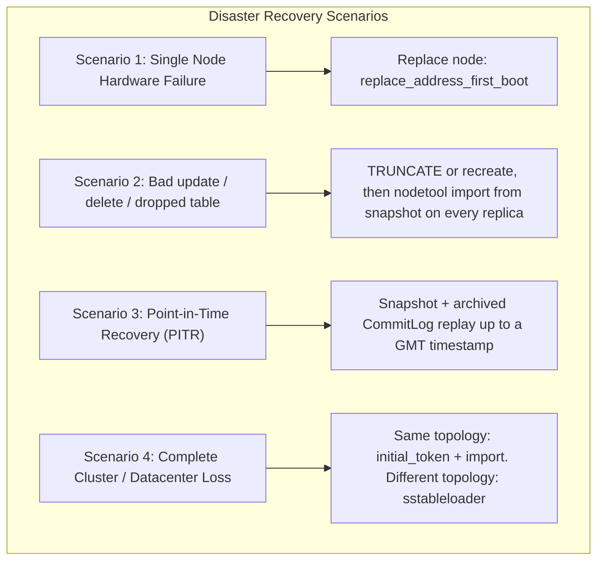

# Backup, Restoration & Disaster Recovery Runbook

> [!CAUTION]
> Commands on this page can change or delete data and affect running clusters. Try them on a test or staging cluster first, and read the [disclaimer](../README.md#disclaimer). The guide is provided "as is", without warranty.

This runbook covers recovery from hardware failure, accidental data changes, and full cluster loss in Apache Cassandra 5.0. Every command and flag below exists in the 5.0 code base. Rehearse each procedure on a non-production cluster before you need it.

---

## 0. Two Rules That Apply to Every Restore

> [!IMPORTANT]
> **1. Restoring old data does not undo newer writes.** Cassandra reconciles every cell by write timestamp (last-write-wins). If you copy a snapshot back into a table that still holds the bad update or the delete, the newer bad cells and tombstones win on reads, and repair copies them back onto the restored replicas. To roll a table back, first **remove the newer data**: `TRUNCATE` the table (or restore into a new, empty table), and then restore on **every replica**.
>
> **2. A backup must hold more than SSTables.** For each node, keep:
> * the snapshot SSTables (one snapshot tag, not every snapshot on disk),
> * the schema (each table snapshot directory contains `schema.cql`; also keep a cluster-wide `cqlsh -e "DESCRIBE SCHEMA"`),
> * the node's tokens (`nodetool info -T`, or `SELECT tokens FROM system.local`), its datacenter and rack, and its Host ID,
> * the `system_auth` keyspace snapshot if you use authentication (roles, passwords and permissions live there).
>
> Each snapshot directory also contains `manifest.json`, which lists the SSTables that belong to that snapshot.



---

## 1. Scenario 1: Dead Node Replacement

Use this when a node has an unrecoverable hardware failure or its instance is gone. If the node is merely down and its disks are intact, just fix it and start it again; do not replace it.

### Step 1: Identify the Dead Node
From a healthy node:
```bash
$ nodetool status
--  Address        Load       Tokens  Owns  Host ID                               Rack
UN  10.0.1.12      142.34 GiB 16      33.4% a1b2c3d4-e5f6-7a8b-9c0d-1e2f3a4b5c6d  rack1
DN  10.0.1.15      138.81 GiB 16      33.2% b2c3d4e5-f6a7-8b9c-0d1e-2f3a4b5c6d7e  rack2  <-- DEAD
```
Note the dead node's IP, rack and datacenter. The replacement must be placed in the **same DC and rack**.

### Step 2: Provision the Replacement Host
1. Same Cassandra version, same Java major version, same `cassandra.yaml` settings as its peers (`cluster_name`, `num_tokens`, snitch, `cassandra-rackdc.properties` with the same DC and rack).
2. **The data, commitlog, saved_caches and hints directories must be empty.** A node that has already bootstrapped ignores `replace_address_first_boot` (it logs "this node is already bootstrapped") and simply rejoins as itself.
3. **The replacement must not be listed in its own `seeds:` list.** Seeds do not bootstrap, and a replace without bootstrap is refused at startup ("Replacing a node without bootstrapping risks invalidating consistency guarantees..."). If the dead node was a seed, remove its IP from the seed list on the replacement, and later update the seed list cluster-wide.
4. Set `listen_address` to the replacement's own IP:
   * **Same IP as the dead node** (`10.0.1.15`): `listen_address: 10.0.1.15`. While the replacement streams, it does not receive hints for that address, so plan to repair afterwards.
   * **New IP** (`10.0.1.25`): `listen_address: 10.0.1.25`. Clients and other nodes learn the new address through gossip.

### Step 3: Set the Replace Flag
`-Dcassandra.replace_address_first_boot=<dead node IP>` is read from the JVM options. Put it somewhere that is loaded regardless of Java version: `conf/jvm-server.options`, or `JVM_OPTS` in `conf/cassandra-env.sh`. (`jvm11-server.options` / `jvm17-server.options` are only loaded for that Java version.)

```bash
# conf/jvm-server.options
-Dcassandra.replace_address_first_boot=10.0.1.15
```

### Step 4: Start the Replacement Node
```bash
sudo systemctl start cassandra     # or however your installation starts Cassandra
nodetool netstats                  # watch streaming progress
nodetool status                    # replacement shows UJ, then UN
```
* **What happens**: The node takes over the dead node's tokens and streams the data for those ranges from the surviving replicas.
* The `_first_boot` variant is ignored once the node has completed its bootstrap, so leaving it in place does not cause another replacement. Remove it anyway so the configuration reflects reality. (The older `-Dcassandra.replace_address` is not ignored on later boots and fails with "Cannot replace address with a node that is already bootstrapped".)

### Step 5: Repair if the Outage Was Long
Peers keep hints for a down node only for `max_hint_window` (default `3h`). If the dead node was down longer than that, or the replacement reused the same IP, run a repair of the replaced node's ranges once it is `UN`:
```bash
nodetool repair --full        # on the replacement node
```

---

## 2. Scenario 2: Restoring a Table from a Snapshot

Use this to roll back a bad application update, an accidental `DELETE`/`TRUNCATE`, or a `DROP TABLE`.

> [!NOTE]
> `nodetool refresh` is deprecated in 5.0 (it prints "nodetool refresh is deprecated, use nodetool import instead"). Use `nodetool import`, which verifies the SSTables, places them in the right data directory, and loads them into the live table.

### Step 1: Find the Snapshot
Snapshots live under `<data_dir>/<keyspace>/<table>-<table_id>/snapshots/<tag>/`. With the default `auto_snapshot: true`, Cassandra also takes automatic snapshots named `truncated-<epoch_ms>-<table>` before a `TRUNCATE` and `dropped-<epoch_ms>-<table>` before a `DROP TABLE`.

```bash
nodetool listsnapshots | grep -E 'users'
```

> [!WARNING]
> **A dropped table's snapshot stays under the OLD table directory.** If you re-create the table by hand with `CREATE TABLE`, it gets a **new table ID** and a new directory, `users-<new_id>`, next to the old one. (The snapshot's `schema.cql` contains `ID = <old id>`, so re-creating from that file reuses the old ID and directory.) Either way, never use a glob such as `users-*` in restore commands: resolve the exact snapshot path, and let `nodetool import` place files in whatever directory the live table uses.

```bash
DATA=/mnt/cassandra/data
KS=production_keyspace
TABLE=users
TAG=backup_20261121          # or dropped-1763712000000-users

# Directory that holds the snapshot (old ID for a dropped table):
SNAP_DIR=$(ls -d "${DATA}/${KS}/${TABLE}"-*/snapshots/"${TAG}")
echo "${SNAP_DIR}"           # must print exactly one path
```

### Step 2: Get the Table into a Clean State (on the whole cluster)
Pick one:
* **Table still exists, data is bad**: `TRUNCATE production_keyspace.users;` (requires all nodes to be up). This removes the newer bad cells and tombstones that would otherwise win over the restored data.
* **Table was dropped**: re-create it from the snapshot's own schema file. It holds `CREATE TYPE`/`CREATE TABLE IF NOT EXISTS`/`CREATE INDEX` statements with the original table ID and dropped-column history, so the old SSTables remain readable:
  ```bash
  cqlsh -f "${SNAP_DIR}/schema.cql"
  ```
* **Lowest risk**: create a new table (for example `users_restored`) with the same schema, restore into it, verify, and switch the application over.

### Step 3: Import the Snapshot on EVERY Replica
Run on **every node** that holds replicas of the table (in a single-DC RF=3 cluster that is every node, because each node holds a slice of the data):

```bash
# Copy the snapshot files to a staging directory owned by the cassandra user.
STAGE=/mnt/cassandra/restore/${KS}/${TABLE}
sudo -u cassandra mkdir -p "${STAGE}"
sudo -u cassandra find "${SNAP_DIR}" -maxdepth 1 -type f \
    ! -name schema.cql ! -name manifest.json -exec cp {} "${STAGE}/" \;

# Load them into the live table. import moves the files into the table's current
# data directory, so it works even though the table has a new ID.
nodetool import "${KS}" "${TABLE}" "${STAGE}"
```
Useful `import` flags: `--copy-data` (`-cd`) copies instead of moving, `--extended-verify` (`-e`) verifies every value, and `--no-tokens` (`-t`) skips the check that every token in the SSTables is owned by this node (leave that check on when restoring a node's own snapshot).

### Step 4: Verify, then Repair
```bash
cqlsh -e "SELECT count(*) FROM production_keyspace.users;"   # spot-check only on small tables
nodetool repair --full production_keyspace users              # run on each node, one at a time
```

---

## 3. Scenario 3: Point-in-Time Recovery (PITR) with Archived CommitLogs

PITR replays archived commit log segments on top of a snapshot, applying only mutations whose **write timestamp** is at or before `restore_point_in_time`. It works per node, so it must be done on **every replica**.

### Prerequisite: Archiving Must Already Be Enabled
Archiving must have been running since before the snapshot you will restore from. Configure `conf/commitlog_archiving.properties` on every node:
```ini
# Each command is a single executable with arguments (no pipes or &&).
archive_command=/bin/ln %path /mnt/commitlog_archive/%name
```
`archive_command` runs when a segment is finished. The archive directory must be on the same filesystem for `ln`, or use a script that copies to durable storage.

### Restore Settings
```ini
restore_command=/bin/cp -f %from %to
restore_directories=/mnt/commitlog_archive
# GMT. Supported formats (from the shipped template):
#   yyyy:MM:dd HH:mm:ss          (seconds)
#   yyyy:MM:dd HH:mm:ss.SSS      (milliseconds)
#   yyyy:MM:dd HH:mm:ss.SSSSSS   (microseconds)
restore_point_in_time=2026:11:21 07:30:00
# Must match the precision of your client write timestamps (default MICROSECONDS).
precision=MICROSECONDS
```
The cut-off compares against the mutation's write timestamp (the client- or coordinator-assigned `WRITETIME`), not the time the segment was written.

### Execution (on every replica)
The last-write-wins rule applies here too: newer data on any replica will win. The procedure below removes it.

1. `TRUNCATE` the affected table(s) while the cluster is up. On replay, Cassandra clears a truncation record that is newer than `restore_point_in_time`, so the truncate does not block the replay.
2. Stop the node: `nodetool drain && sudo systemctl stop cassandra`.
3. Copy the SSTables of the last snapshot taken **before** the restore point into the table's live data directory (resolve the directory explicitly, as in Scenario 2).
4. Move the node's current commit log segments out of `commitlog_directory`, so only the archived segments are replayed.
5. Put the restore settings above in `conf/commitlog_archiving.properties`.
6. Start the node. At startup it copies the archived segments in with `restore_command` and replays mutations up to the restore point.
7. When all replicas are done, clear the `restore_*` settings so a later restart does not replay again, and run `nodetool repair --full <keyspace> <table>`.

---

## 4. Scenario 4: Full Cluster Restoration from Cold Storage

Use this when an entire datacenter or cluster must be rebuilt from offsite backups.

### Option A: Same Topology (fastest): Restore Each Node's Tokens
If the new cluster has the **same number of nodes per DC/rack** as the old one, give each new node the tokens of one old node, then import that node's snapshot locally. No data crosses the network.

1. For each old node, retrieve its saved token list, DC and rack (the backup script in the housekeeping guide stores `nodetool info -T` output under `<node>/<tag>/meta/`).
2. On the matching new node, before its first start:
   ```yaml
   # cassandra.yaml
   num_tokens: 16                         # must equal the number of tokens listed
   initial_token: -9181...,-8034...,...   # comma-separated tokens of the old node
   ```
   Also set the same DC and rack in `cassandra-rackdc.properties`.
3. Start the new nodes (seeds first, then the others one at a time), and wait for all to be `UN`.
4. Re-create the schema: `cqlsh -f schema.cql`. Tables get new IDs, so use `nodetool import` rather than copying files into data directories.
5. On each node, download that old node's snapshot and import it table by table:
   ```bash
   nodetool import production_keyspace users /mnt/restore_staging/production_keyspace/users
   ```
6. Run `nodetool repair --full` on each node, one at a time.

### Option B: Different Topology: Stream with `sstableloader`
If the node count or token layout differs, files cannot be imported locally because each node would receive data for ranges it does not own. `sstableloader` reads SSTables and streams each partition to the nodes that own it in the new cluster.

1. **Provision the new cluster** and wait for all nodes to be `UN`.
2. **Re-create keyspaces and tables**: `cqlsh <new_cluster_ip> -f /path/to/schema.cql`.
3. **Download one snapshot tag** per old node (not the whole data directory):
   ```bash
   # Layout written by the backup script in the housekeeping guide: <node>/<tag>/data and <node>/<tag>/meta
   aws s3 sync s3://my-company-cassandra-backups/10.0.1.12/backup_20261121/data/ /mnt/restore_staging/10.0.1.12/
   ```
4. **Rearrange to `<keyspace>/<table>` layout.** `sstableloader` takes the keyspace name from the parent directory and the table from the SSTable files (or `--target-keyspace` / `--target-table`). Snapshot paths look like `<ks>/<table>-<id>/snapshots/<tag>/`, so copy each into a clean directory:
   ```bash
   SRC=/mnt/restore_staging/10.0.1.12
   for snap in "${SRC}"/*/*/snapshots/backup_20261121; do
       ks=$(basename "$(dirname "$(dirname "$(dirname "${snap}")")")")
       tbl_dir=$(basename "$(dirname "$(dirname "${snap}")")")
       tbl=${tbl_dir%-*}                         # strip the -<table_id> suffix
       mkdir -p "/mnt/load/10.0.1.12/${ks}/${tbl}"
       find "${snap}" -maxdepth 1 -type f ! -name schema.cql ! -name manifest.json \
           -exec cp {} "/mnt/load/10.0.1.12/${ks}/${tbl}/" \;
   done
   ```
5. **Stream each table directory**:
   ```bash
   sstableloader --nodes 10.0.1.10,10.0.1.11 \
       --throttle-mib 100 \
       /mnt/load/10.0.1.12/production_keyspace/users
   ```
   * `--nodes` (`-d`): initial contact points in the new cluster.
   * `--username` / `--password`, `--conf-path`, and the SSL flags (`--truststore`, `--keystore`, ...) are available when the cluster uses authentication or TLS.
   * With RF=3 you load every old node's snapshot, so each partition is streamed about three times. The new cluster reconciles the copies, but plan for the extra network and compaction load.
6. **Post-restore**: run `nodetool repair --full` on each node, one at a time.

### Restoring Users and Roles (`system_auth`)
If the cluster uses `PasswordAuthenticator`, roles and permissions are stored in the `system_auth` keyspace. Either restore its snapshot with the same procedure (Option A), or re-create roles and grants from a script kept with your backups. Make sure `system_auth` uses `NetworkTopologyStrategy` with an appropriate replication factor in every DC.
