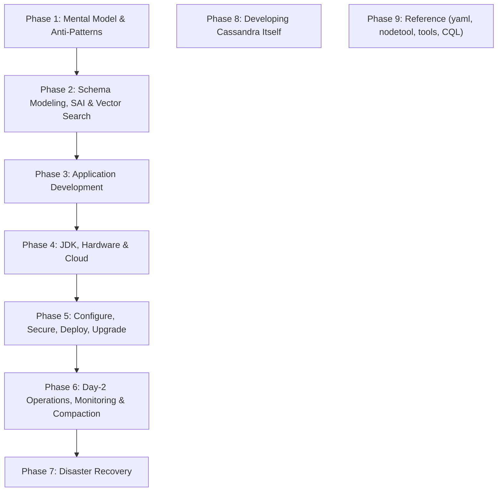

# Field Guide for Apache Cassandra® 5.0

> **Independent documentation.** This is a community guide to [Apache Cassandra®](https://cassandra.apache.org/). It is not affiliated with, endorsed by, or sponsored by [The Apache Software Foundation](https://www.apache.org/). For the official documentation, see [cassandra.apache.org/doc](https://cassandra.apache.org/doc/5.0/).

This documentation set follows the order in which an engineering team actually meets Cassandra: evaluation and data modeling, application development, infrastructure sizing, cluster deployment and security, day-to-day operations, upgrades, and disaster recovery. Final sections cover building and testing Apache Cassandra from source, and generated reference pages.

THIS IS COMPLETELY AI GENERATED as a MEANS to help engineering teams actually use the product, and be a reasonable guide that addresses anything official docs may miss.

If you want the backstory, I managed a bunch of clusters and thought to myself I bet we could get a good docs if I pointed AI at the code. I will try that this weekend...

> **Version scope**: These guides target Apache Cassandra **5.0.x**. Names and defaults were verified against the upstream `cassandra-5.0` branch at 5.0.10 (commit `47227d98bf`); behavior was validated on a live **5.0.9** cluster (the newest Docker Hub image at the time) with [`test_env/`](test_env/README.md). Supported runtimes are **Java 11 and Java 17** (Java 17 fully supported since 5.0.5, CASSANDRA-20681). Java 21 is not supported.
>
> Cassandra 5.0 ships two configuration templates:
> * `conf/cassandra.yaml`: the default. It is conservative and upgrade-compatible: SkipList memtables, BIG SSTables, STCS compaction, legacy secondary indexes, Paxos v1, `storage_compatibility_mode: CASSANDRA_4`.
> * `conf/cassandra_latest.yaml`: enables the newer features: Trie memtables, BTI SSTables, Unified Compaction Strategy, SAI as the default index, Paxos v2, `storage_compatibility_mode: NONE`.
>
> Where a behavior depends on which template you start from, the guides say so. Performance figures, where given, are illustrative only, so benchmark on your own hardware and workload. All security settings ship **disabled** (`AllowAllAuthenticator`, no TLS). Read the [Security Hardening](05_cluster_deployment_and_config/03_security_hardening.md) page before go-live.

These pages complement, and do not replace, the official AsciiDoc reference in [`doc/modules/cassandra/pages`](https://github.com/apache/cassandra/tree/cassandra-5.0/doc/modules/cassandra/pages) (published at cassandra.apache.org). They are opinionated runbooks and guidance. The official docs remain the parameter-by-parameter reference. See [How this guide relates to the official docs](08_developing_cassandra/01_building_and_testing_from_source.md#6-how-this-guide-relates-to-the-official-docs).

---

## The Engineering Lifecycle

---

## Table of Contents

### Phase 1: Architecture & Mental Model
> **Audience**: Software engineers, architects. **Goal**: Unlearn RDBMS habits, and understand why writes are cheap appends while reads may merge several SSTables.

* **[01_mental_model.md](01_architecture_and_mental_model/01_mental_model.md)**: LSM write and read paths (SkipList vs Trie memtables, BIG vs BTI SSTables), the token ring (`num_tokens: 16`, Murmur3), RDBMS vs Cassandra concepts, and how `cassandra.yaml` differs from `cassandra_latest.yaml`.
* **[02_anti_patterns.md](01_architecture_and_mental_model/02_anti_patterns.md)**: queues and tombstones, `ALLOW FILTERING`, huge partitions (rule of thumb: about 100 MB or 100k rows), multi-partition batches, unbounded collections, re-preparing statements, per-request sessions, `ALL`, and the guardrails that catch these.

### Phase 2: Schema Modeling & Indexing
> **Audience**: Data modelers, backend and AI/ML engineers.

* **[01_schema_design_patterns.md](02_data_modeling_and_indexing/01_schema_design_patterns.md)**: query-first modeling, primary-key anatomy, lookup tables (logged batch, idempotent dual writes, or SAI), time bucketing, wide rows, static columns, counters, materialized views (experimental, off by default), CDC, and choosing `gc_grace_seconds` and TTL values.
* **[02_indexing_and_vector_search.md](02_data_modeling_and_indexing/02_indexing_and_vector_search.md)**: SAI vs legacy 2i, operators and analyzer options, vector types, ANN via JVector, similarity functions, and ANN query limits (LIMIT ≤ 1000, no paging, CL downgrade).

### Phase 3: Application Development
> **Audience**: Backend and API developers.

* **[01_performant_writes.md](03_application_development/01_performant_writes.md)**: async pipelining with backpressure, single-partition vs multi-partition batches, `null` vs unset, upsert and row-marker semantics, and TTLs with TWCS.
* **[02_performant_reads.md](03_application_development/02_performant_reads.md)**: single-partition reads, clustering slices, replacing `IN` with parallel async reads, paging vs token-range scans, and SAI instead of `ALLOW FILTERING`.
* **[03_client_drivers.md](03_application_development/03_client_drivers.md)**: the singleton `CqlSession`, multiplexing (32,768 stream IDs; driver default 1,024 requests per connection), `DefaultLoadBalancingPolicy` token-aware DC-local routing, speculative execution, idempotence, and timeouts, auth and TLS settings.
* **[04_consistency_and_transactions.md](03_application_development/04_consistency_and_transactions.md)**: consistency levels including `EACH_QUORUM` and `SERIAL`/`LOCAL_SERIAL`, clock skew, LWT hazards, Paxos v1 vs v2 (added in 4.1, opt-in via `paxos_variant: v2`, upgrade steps, `paxos_state_purging`), and Dynamic Data Masking (off by default).

### Phase 4: Infrastructure & Cloud
> **Audience**: Cloud architects, SREs, DevOps.

* **[01_java_and_jvm_flavors.md](04_infrastructure_and_cloud/01_java_and_jvm_flavors.md)**: Java 11 and 17 (not 21), JDK distributions, the bundled Amazon Corretto Crypto Provider, shipped G1 settings, heap and direct-memory auto-sizing, trying ZGC, and ARM64.
* **[02_aws_deployment_guide.md](04_infrastructure_and_cloud/02_aws_deployment_guide.md)**: instance store vs EBS; `Ec2Snitch` vs `Ec2MultiRegionSnitch` vs `GossipingPropertyFileSnitch`; `ec2_naming_scheme` (standard: rack `us-east-1a`); AZ racks; MTU caveats; security groups and ports; S3 backups.
* **[03_gcp_deployment_guide.md](04_infrastructure_and_cloud/03_gcp_deployment_guide.md)**: Local SSD vs Hyperdisk, safe RAID0 via `/dev/disk/by-id`, `GoogleCloudSnitch` (rack = zone letter), global VPC, GCS backups.
* **[04_azure_deployment_guide.md](04_infrastructure_and_cloud/04_azure_deployment_guide.md)**: Lsv3 NVMe vs managed disks, Accelerated Networking, `AzureSnitch` (`rack-<zone>` or `rack-<faultDomain>`), zones and placement, Blob backups.

### Phase 5: Configure, Secure, Deploy & Upgrade
> **Audience**: DBAs, SREs.

* **[01_configuration_and_tuning.md](05_cluster_deployment_and_config/01_configuration_and_tuning.md)**: production `cassandra.yaml` settings with 5.0 key names and shipped defaults, guardrails, hints, `auto_snapshot`, where JVM options belong, and Linux tuning.
* **[02_cluster_deployment_runbook.md](05_cluster_deployment_and_config/02_cluster_deployment_runbook.md)**: install methods (tarball, deb, rpm, source), seeds, snitch choice, `allocate_tokens_for_local_replication_factor`, one-at-a-time bootstrap, adding a DC (`auto_bootstrap: false`, system keyspace RF, `nodetool rebuild`), and verification.
* **[03_security_hardening.md](05_cluster_deployment_and_config/03_security_hardening.md)**: `system_auth` RF, password, network and CIDR authorizers, replacing the default superuser, client and internode TLS, mTLS authenticators, JMX, and audit logging.
* **[04_upgrading_to_5_0.md](05_cluster_deployment_and_config/04_upgrading_to_5_0.md)**: supported paths (4.0/4.1 → 5.0), behavior changes, the rolling procedure, `storage_compatibility_mode` (CASSANDRA_4 → UPGRADING → NONE), adopting BTI, UCS, SAI and auto-repair, enabling Paxos v2, and rollback limits.

### Phase 6: Day-2 Operations
> **Audience**: Operations engineers, on-call DBAs.

* **[01_nodetool_operations_guide.md](06_operations_and_housekeeping/01_nodetool_operations_guide.md)**: `status`, `ring`, `describecluster`, `tpstats`, `tablestats`, `tablehistograms`, `profileload`, `compact` (major!), `cleanup`, `garbagecollect`, repair (incremental by default; `-full`; `-pr` rules), snapshots, `import`, `drain`, `decommission`, `removenode`, and runtime tuning.
* **[02_housekeeping_and_automations.md](06_operations_and_housekeeping/02_housekeeping_and_automations.md)**: repairing within `gc_grace_seconds` (built-in auto-repair from 5.0.8, Reaper, or a staggered script), snapshot retention (`snapshot --ttl`, `clearsnapshot --all --older-than`, `auto_snapshot_ttl`), backup script, logs, rolling restarts, and alert thresholds.
* **[03_monitoring_and_observability.md](06_operations_and_housekeeping/03_monitoring_and_observability.md)**: `system_views` virtual tables, key JMX metrics, external exporters, the slow query log, full query logging, and audit logs.
* **[04_compaction_strategies.md](06_operations_and_housekeeping/04_compaction_strategies.md)**: STCS, LCS, TWCS and UCS, choosing and switching between them, tombstone settings, disk headroom, and a UCS migration runbook with rollback.
* **[05_troubleshooting_playbook.md](06_operations_and_housekeeping/05_troubleshooting_playbook.md)**: a first-response checklist, then 16 symptoms (timeouts, dropped messages, GC/OOM, tombstones, schema disagreement, streaming, repair, disk full, LWT contention, SAI, client/auth errors, clock skew). Each gives the exact log text, how to confirm it, and the fix.
* **[06_auto_repair.md](06_operations_and_housekeeping/06_auto_repair.md)**: the built-in auto-repair scheduler (5.0.8+): enabling it (irreversible JVM flag), every option with code defaults, repair types and splitters, table options, nodetool commands, a rollout runbook, and metrics and alerts.

### Phase 7: Disaster Recovery
> **Audience**: On-call engineers, SREs.

* **[01_backup_and_disaster_recovery.md](07_disaster_recovery/01_backup_and_disaster_recovery.md)**: the two rules of every restore (newest timestamp wins, so truncate first and restore on every replica; back up schema, tokens and `system_auth`), dead-node replacement (`replace_address_first_boot`), table restore with `nodetool import` (including dropped tables), point-in-time recovery from archived commitlogs (GMT), and full-cluster restore (same topology via `initial_token`, or `sstableloader`).

### Phase 8: Developing Apache Cassandra from Source
> **Audience**: Contributors, engineers patching or building their own distribution.

* **[01_building_and_testing_from_source.md](08_developing_cassandra/01_building_and_testing_from_source.md)**: prerequisites (JDK 11/17, Ant, Python for cqlsh), build targets, running a node from the source tree, unit and in-JVM dtests, the repository layout, and how these docs relate to `doc/`.

### Phase 9: Reference
> **Audience**: Everyone. Look things up here; read the phases above to learn.

* **[01_cassandra_yaml_reference.md](09_reference/01_cassandra_yaml_reference.md)**: *generated* from `conf/cassandra.yaml`, `cassandra_latest.yaml` and `Config.java`. Covers every key with its default, its `cassandra_latest` value, deprecated aliases, and hidden keys.
* **[02_nodetool_reference.md](09_reference/02_nodetool_reference.md)**: *generated* from the nodetool sources. Covers every command, argument and option.
* **[03_tools_reference.md](09_reference/03_tools_reference.md)**: cqlsh (including `COPY`), sstableloader, the SSTable tools (including `sstablepartitions`), fqltool, auditlogviewer, and cassandra-stress.
* **[04_cql_quick_reference.md](09_reference/04_cql_quick_reference.md)**: the CQL statements, table option defaults, types, functions (including the 5.0 math, collection, vector and masking functions), and permissions, all checked against the 5.0 grammar.

**Behavioral validation:** [`test_env/`](test_env/README.md) runs the guide's claims and runbooks (restore, node replacement, adding a DC, rolling restart, auto-repair, S3 backup pattern, and about 100 CQL, nodetool and default-value claims) against a 3–5 node Docker cluster. See [`test_env/results/LATEST.md`](test_env/README.md#reading-results) for the latest run.

The generated pages and the drift checker live in [`tools/`](tools/README.md). Re-run them against a Cassandra checkout whenever you move to a new 5.0.x release.

---

## Role-Based Quick Navigation

| If your role is... | Start here | Then read |
| :--- | :--- | :--- |
| **Backend / API developer** | [01_mental_model.md](01_architecture_and_mental_model/01_mental_model.md) | [01_schema_design_patterns.md](02_data_modeling_and_indexing/01_schema_design_patterns.md) → [01_performant_writes.md](03_application_development/01_performant_writes.md) → [03_client_drivers.md](03_application_development/03_client_drivers.md) → [04_consistency_and_transactions.md](03_application_development/04_consistency_and_transactions.md) |
| **AI / ML engineer** | [02_indexing_and_vector_search.md](02_data_modeling_and_indexing/02_indexing_and_vector_search.md) | [01_schema_design_patterns.md](02_data_modeling_and_indexing/01_schema_design_patterns.md) → [02_performant_reads.md](03_application_development/02_performant_reads.md) |
| **Cloud / DevOps engineer** | [01_java_and_jvm_flavors.md](04_infrastructure_and_cloud/01_java_and_jvm_flavors.md) | Cloud guide ([AWS](04_infrastructure_and_cloud/02_aws_deployment_guide.md) / [GCP](04_infrastructure_and_cloud/03_gcp_deployment_guide.md) / [Azure](04_infrastructure_and_cloud/04_azure_deployment_guide.md)) → [01_configuration_and_tuning.md](05_cluster_deployment_and_config/01_configuration_and_tuning.md) → [02_cluster_deployment_runbook.md](05_cluster_deployment_and_config/02_cluster_deployment_runbook.md) → [03_security_hardening.md](05_cluster_deployment_and_config/03_security_hardening.md) |
| **On-call SRE / DBA** | [05_troubleshooting_playbook.md](06_operations_and_housekeeping/05_troubleshooting_playbook.md) | [01_nodetool_operations_guide.md](06_operations_and_housekeeping/01_nodetool_operations_guide.md) → [02_housekeeping_and_automations.md](06_operations_and_housekeeping/02_housekeeping_and_automations.md) → [03_monitoring_and_observability.md](06_operations_and_housekeeping/03_monitoring_and_observability.md) → [01_backup_and_disaster_recovery.md](07_disaster_recovery/01_backup_and_disaster_recovery.md) |
| **Upgrading from 4.x** | [04_upgrading_to_5_0.md](05_cluster_deployment_and_config/04_upgrading_to_5_0.md) | [01_mental_model.md](01_architecture_and_mental_model/01_mental_model.md) (template differences) → [04_compaction_strategies.md](06_operations_and_housekeeping/04_compaction_strategies.md) → [04_consistency_and_transactions.md](03_application_development/04_consistency_and_transactions.md) (Paxos v2) |
| **Cassandra contributor** | [01_building_and_testing_from_source.md](08_developing_cassandra/01_building_and_testing_from_source.md) | [`CONTRIBUTING.md`](https://github.com/apache/cassandra/blob/cassandra-5.0/CONTRIBUTING.md), [`TESTING.md`](https://github.com/apache/cassandra/blob/cassandra-5.0/TESTING.md) |

---

## Using This Guide with AI Assistants

You can point an AI assistant at this guide and get cited, version-correct answers. [AI_USAGE.md](AI_USAGE.md) explains how:

* **Coding agents in a clone:** Claude Code, Gemini CLI, OpenAI Codex, Cursor and Copilot load [CLAUDE.md](CLAUDE.md), [GEMINI.md](GEMINI.md) or [AGENTS.md](AGENTS.md) automatically. Claude Code and Gemini CLI also get a `/validate-docs` command that checks the guide against a live cluster.
* **Chat apps** (Claude Projects, ChatGPT Projects, Gemini Gems, NotebookLM): upload the single-file edition built by `python3 tools/build_ai_bundle.py` (also attached to each release), and paste the [assistant rules](AI_USAGE.md#2-rules-for-assistants-answering-from-this-guide) into the custom instructions.
* **Retrieval (RAG) and other tools:** start from [`llms.txt`](llms.txt).

The rules tell an assistant to stay within 5.0.x, to say which config template a default comes from, to take exact names from the generated references, to cite pages, and to warn before irreversible operations.

---

## Contributing

Corrections and new runbooks are welcome. Read [CONTRIBUTING.md](CONTRIBUTING.md) first. Every claim must be backed by the Cassandra source or by a check in [`test_env/`](test_env/README.md).

---

## License & Trademarks

This guide is licensed under the [Apache License, Version 2.0](LICENSE). Configuration excerpts, code snippets and the generated reference pages are derived from [Apache Cassandra](https://github.com/apache/cassandra), also Apache-2.0. See [NOTICE](NOTICE) for attribution.

Apache®, Apache Cassandra®, Cassandra®, and the Cassandra logo are either registered trademarks or trademarks of The Apache Software Foundation in the United States and/or other countries. Their use here is for identification only and does not imply endorsement.
